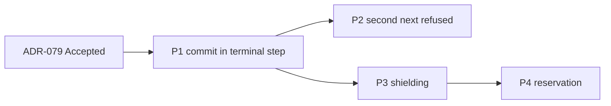

# Frame: Commit Inside the Command Pipeline

- **Date:** 2026-10-22
- **Issue:** DCE-142 (Feature DCE-130, fix plan cluster W2-1)
- **Alignment:** [02-commit-in-pipeline.alignment.md](02-commit-in-pipeline.alignment.md) (decided, B-103 to B-134)
- **Research:** [02-commit-in-pipeline.research.md](02-commit-in-pipeline.research.md)
- **ADR:** [ADR-079](../docs/adr/ADR-079-commit-inside-the-command-pipeline.md) (Accepted, 2026-10-22)

Each phase is one implementation Feature Task under DCE-130 and one PR. Every phase follows the fix plan's §4
and §5: test-first (strict-xfail red tests run locally with `--runxfail` and pushed with the green commit,
P-32), docs in the same change, an upgrade-note entry for each behaviour change (B-114). ADR-079 is Accepted,
and its notes in ADR-017 to 020, ADR-068 and ADR-076 were added with it.

Test names below are the acceptance tests; the fixer may group them in classes but keeps the names. Every
test uses synthetic data and asserts through the public API (fix plan §4.3: no private asserts).

**Review scenarios to start from.** Review ⑨ of PR #124 ran a patched copy of the tree in two rounds; its
scripts may not survive, so each is described here by what it asserts. Round 2 checked the final design on
Python 3.12.3, 3.13.16 and 3.14.8 with anyio 4.15.1.

| Scenario | Phase | Asserts |
|---|---|---|
| Order, K1, K3, B-116, logging | P1 | A spy on store, locks and UoW hooks gives `get, acquire, handler, _flush, _write_outbox, _commit, release, set`; for each fail point a retry runs the handler again; two locked increments with an awaiting `_commit` end at 2; a cached duplicate commits nothing; `LoggingBehavior` logs "Failed" for a commit failure |
| K3 on `FakeRepository` | P1 | The same increment test is green before the fix when the repository shares objects by reference (it gives 2): the K3 test needs copy-on-read, write-on-commit storage |
| Nested order | P1 | Outer locks A and dispatches Inner on A (reentry error) and on B. Today: `... inner-handler:B, release:B, commit:inner, release:A, commit:outer`; designed: `... commit:inner, release:B, commit:outer, release:A` |
| A post-commit `set` that fails | P1, P4 | The dispatch returns the result and one type-only WARNING is logged; with a reserving store an immediate duplicate gets `CommandInProgressError`, and after the TTL a retry runs the handler again (B-129) |
| Eager task factory and the shared context | P3 | Under `asyncio.eager_task_factory`, `create_task(..., context=...)` raises "cannot enter context ... already entered" on 3.12 to 3.14 and can hang the dispatch; the `asyncio.Task(coro, loop=loop, context=ctx)` constructor works on all three, with context variables visible both ways |
| Shield, round 2 | P3 | With the waiter future: `_commit`/`_rollback` finish under one and repeated native cancellations; the cancellation is re-raised with `cancelling()` consistent; `asyncio.timeout` gives `TimeoutError` with the commit kept; inside a `TaskGroup`; `shield_hooks = False`; a cancel during the post-commit `set` or the lock release after the commit is recorded. On 3.14 with `asyncio.shield` instead of the waiter, the loop's exception handler logs "exception in shielded future" with the hook's message; with the waiter it logs nothing |
| anyio scope over a commit | P3 | Under `anyio.move_on_after` over a slow commit the hybrid uses 0.01 to 0.02 s of CPU over 0.5 s (the task-plus-`asyncio.shield` loop alone spun 95127 times, 0.51 s CPU); the helper does not re-raise, anyio redelivers at the next checkpoint, and with none left the dispatch returns normally, committed and recorded (`cancelled_caught=False`) |
| Pending cancel | P3 | A cancellation requested during `_write_outbox` and delivered at the next await: `_commit` still runs, `CancelledError` still reaches the caller, and the result is recorded (B-132) |
| Hand-driven coroutine | P3 | Driven with `coro.send(None)` and no event loop, the hooks run inline (sniffio finds no async library) and the commit completes (B-131) |
| Task-bound storage | P3 | Storage keyed by `current_task()` sees another task in a shielded hook: rows committed `[]`, no error; with `shield_hooks = False` the rows commit (B-119) |
| Reservation, round 2 | P4 | With tokens: duplicates with and without locks; a cancel during `reserve` releases the new token; a cancel during `set`; a TTL expiry followed by a stale-token release frees nothing; a failed release keeps the id blocked until the TTL |

---

## Phase 1: Tracer Bullet: the commit runs in the terminal step

**Feature Task title:** W2-1 P1: Commit in the pipeline's terminal step; locks held and result recorded after it

**Rows:** CQRS-K1 (the cached failed commit), CQRS-K3, CQRS-11, FAKE-04 (commit-failure injection).
Decisions B-103, B-104, B-105, B-112, B-113, B-116, B-118, B-127, B-129.

**Components:**

- `src/pydomain/cqrs/command_bus.py`: the bus's own terminal step runs the handler, `uow.commit()`, then sets
  `ctx.new_events` (the private committed mark moved to Phase 3, B-136); the bus
  stops committing after the pipeline; `ctx.handler` stays the handler. `MessagePipeline`'s generic terminal
  is unchanged (14 `tests/cqrs/test_pipeline.py` tests run `kind=COMMAND` with no unit of work). The
  `dispatch` docstring (l.103) describes the new order.
- `src/pydomain/cqrs/behaviors.py`: docstrings of `IdempotencyBehavior` (records after the commit; the CQRS-04
  caveat stays until Phase 4) and `AggregateLockingBehavior` (held through the commit; l.349 "the command
  commits" becomes "the commit has already happened").
- `src/pydomain/cqrs/locking.py`: `LockProvider` docstring, a lease covers the commit.
- `src/pydomain/testing/fake_unit_of_work.py`: `fail_at: Literal["flush", "write_outbox", "commit"] | None`
  and `failure: BaseException | None = None`; the hook named by `fail_at` raises `failure` once, in the next
  scope that reaches it, then clears itself, like `FakeOutboxStore`'s `fail_next_append`; with `failure=None`
  it raises a new `RuntimeError` each time (B-127).
- Probes: delete `tests/support/probes/review/pr117/one_key_lock_k3.py` (it deadlocks by design under the fix:
  B waits for the lock A holds through its gated commit; the K3 tests replace it) and its row in
  `tests/support/probes/review/README.md` (l.15); in `tests/support/probes/README.md` mark CQRS-K1 and CQRS-K3
  (`cqrs/p_known.py`), CQRS-11 (`cqrs/p_10_14.py`) and the FAKE-04 commit-failure part
  (`fakes/probe_repo_uow.py`) fixed.

**Testing strategy** (fix plan §9.2: ordering spy; failure injection at every await of `commit()`):

- `test_command_pipeline_order_is_acquire_handler_commit_release_record`: the spy order above.
- `test_failed_commit_is_not_cached` (parametrized over `fail_at` = flush, write_outbox, commit): the retry
  with the same `command_id` runs the handler again; assert the handler's run count (2), not that the work
  persisted, because `FakeRepository` keeps saves after a rollback (W2-6).
- `test_locked_increments_do_not_lose_updates_across_a_slow_commit`: two gathered locked increments on one
  key, storage that copies on read and writes on commit, and an awaiting `_commit`, end at 2. The test must
  fail before the fix (it passes on `FakeRepository`, which shares by reference).
- `test_behavior_sees_committed_events_after_next`, and `test_dispatch_returns_the_events_behaviors_saw`:
  `dispatch()` returns the same stamped events as `ctx.new_events`.
- `test_pipeline_that_never_reaches_the_handler_commits_nothing`: a cached duplicate and a short-circuiting
  behavior leave the scope rolled back, with nothing committed (B-116). Update the existing
  `TestPipelineBehaviors.test_behavior_short_circuits` in `tests/cqrs/test_bus.py` (l.266; its
  `assert uow.hooks == ["commit"]` at l.295 pins the old commit).
- `test_nested_command_commits_and_releases_before_the_outer_commit`: the nested order above.
- `test_logging_behavior_reports_a_failed_commit_as_failed`: "Failed ...: <Type>", never "Completed".
- `test_failed_post_commit_record_is_a_warning_and_returns_the_result`: a `set` that raises after the commit
  logs one type-only WARNING, and `dispatch()` returns the result (B-129).
- `test_log_names_the_registered_handler`: the terminal step does not rename the handler in logs.
- `test_fake_unit_of_work_fail_at_raises_from_each_hook`, `test_fake_unit_of_work_fail_at_fails_once_then_clears`,
  `test_fake_unit_of_work_failure_defaults_to_runtime_error` and `test_fake_unit_of_work_without_fail_at_commits`.

**Docs:**

- arc42: §4.5 S4 (diagram and table); §5.3.5; §6.1 with the new sequence diagram (commit inside the
  pipeline, release after it); §8.5 (nested diagram, slot table with the ordering promise of ADR-079 point 8);
  §10.6; §9.21 (l.723) and §9.27 (l.932), which repeat "released before the commit ... W2-1"; §11 l.254 and
  l.264 (F-6 "pairs with W2-1", B-113); §12 l.202 (Command Bus "On success: commits") and l.354
  (`new_events`); §10.4 l.208 and §5 l.895 (the `FakeUnitOfWork` rows: `fail_at`).
- Decision log: the F-6 backlog row (l.207), "pairs with W2-1" (B-113).
- Diataxis: `concepts/cqrs/pipeline-behaviors.md` (the ordering promise, with the short-circuit and
  committed-then-raised rows), `concepts/cqrs/command-bus.md`, `concepts/cqrs/idempotency-and-locking.md`
  (l.56-59 flow, l.72 locks, l.130 "still succeeds and commits"), `how-to/cqrs/add-idempotency.md` (l.103: the
  cached-failure limit goes; the at-least-once gap is named, crash and ambiguous commit failure),
  `how-to/cqrs/add-pipeline-behavior.md` (what "after `next()`" means), `how-to/cqrs/add-distributed-locking.md`
  (the lease note; l.174 "The command commits"), `how-to/testing/use-fake-uow.md` (`fail_at`),
  `concepts/infrastructure/message-broker.md` (l.120) and `how-to/cqrs/handle-domain-events.md` (l.57), which
  say "the bus commits".
- Upgrade notes: items 1, 2, 4 and 6 of ADR-079's list.

**Verification gate:**

- The ordering spy shows the commit before the release and the record, and the K3 test is red before the fix
  and gives 2 after it, through the public API.
- `make check` green; `tests/test_architecture.py` and the export tests pass.

**Acceptance criteria:**

- [ ] All Phase 1 tests pass; their red versions failed locally for the stated reason.
- [ ] No caller of `CommandBus` commits after the pipeline; ADR-020's "handlers never commit" still holds.
- [ ] The listed docs, probe changes and upgrade-note entries are in the PR.

---

## Phase 2: A second `next()` is refused

**Feature Task title:** W2-1 P2: Refuse a second next() in command pipelines (PipelineReentryError)

**Rows:** CQRS-21. Decision B-111.

**Components:**

- `src/pydomain/cqrs/exceptions.py`: `PipelineReentryError(CQRSError)`, message without content (ADR-071).
- `src/pydomain/cqrs/command_bus.py`: the terminal step counts its calls per dispatch and raises on the second,
  before the handler. Review ⑨ checked that refusing it breaks no existing test.
- `src/pydomain/cqrs/__init__.py`, `tests/test_package_exports.py`: the new name.

**Testing strategy:**

- `test_second_next_raises_pipeline_reentry_error`: a behavior calling `next()` twice; the handler runs once;
  the caller gets `CommandExecutionError` whose `__cause__` is `PipelineReentryError`.
- `test_second_next_after_a_commit_keeps_the_first_commit`: the first run's change is persisted and its
  scope is not rolled back.
- `test_retry_behavior_after_a_failed_handler_is_refused`: the retry gets `PipelineReentryError`, and the
  first run's events never commit.
- `test_query_and_event_pipelines_allow_a_second_next`: unchanged behaviour, pinned.

**Docs:**

- arc42: §5.3.5 (the rule); §5.3.10 (l.511, the exception list); the §5 overview diagram (l.286-287); §12
  (l.485, l.495), which lists the exceptions.
- Diataxis: `concepts/cqrs/pipeline-behaviors.md`, `how-to/cqrs/add-pipeline-behavior.md` ("call `next()` at
  most once in a command pipeline; retry by dispatching again"),
  `concepts/infrastructure/exception-hierarchy.md`, `api-reference/_index.md` (l.44).
- Upgrade notes: item 5.

**Verification gate:**

- The audit probe's `RetryOnce` scenario (`cqrs/p_15_25.py` `c21`) rewritten as a test commits one run's
  events or none, never two.

**Acceptance criteria:**

- [ ] All Phase 2 tests pass; the export test lists `PipelineReentryError`.
- [ ] `tests/support/probes/README.md` no longer lists CQRS-21 as open.

---

## Phase 3: The commit and the rollback are shielded

**Feature Task title:** W2-1 P3: Shield _commit and _rollback from cancellation; record a committed command

**Rows:** CQRS-07. Decisions B-108, B-109, B-110, B-115, B-118, B-119, B-121 to B-124, B-126, B-128,
B-130 to B-134.

**Components:**

- `pyproject.toml`: `anyio>=4` in `dependencies` (B-122); a CI floor job runs the shield tests with
  `anyio==4.0`, and if they fail the floor is raised to the lowest version that passes, stated in the upgrade
  note (B-133). The pages that list the runtime dependencies say so: the README (l.74, "Only the contract
  suites import them"), `docs/diataxis/introduction.md`, `docs/diataxis/getting-started/installation.md` (l.63),
  `docs/diataxis/how-to/testing/run-contract-suites.md` (l.40), the arc42 pages that name `uuid-utils` (§1, §2,
  §3, §5, §7, §8, §10, §11), the repository's `CLAUDE.md` (l.9, "Only two runtime dependencies") and
  `.github/copilot-instructions.md`.
- `tests/test_architecture.py`: `test_only_contract_suites_import_test_frameworks` (l.179-187) allows anyio in
  `pydomain.cqrs.unit_of_work` only; pytest stays banned at runtime (B-128). The arc42 text that describes the
  rule changes with it: §2 l.117-118, §5 l.912, §10 l.48 and l.63.
- `src/pydomain/cqrs/unit_of_work.py`: one private helper (ADR-079 point 6), the only runtime importer of
  anyio. It runs a call inside `anyio.CancelScope(shield=True)` and, under asyncio, in a task built with
  `asyncio.Task(coro, loop=loop, context=ctx)` (never eager), waited on through a private future set by the
  task's done callback (not `asyncio.shield`), absorbing the caller's native cancellations until the call
  ends, then re-raising; under an anyio scope it does not re-raise (anyio redelivers). With no async library
  detected (sniffio) it runs the call inline without the scope (B-131). A `CancelledError` that reaches the
  caller while the inner task is not cancelled is the caller's and is never swallowed, also one pending at
  entry (B-132); the hook's own `CancelledError` becomes a private `CQRSError` raised from it (B-130); a hook
  error during a cancellation becomes a type-only note (ADR-078). `_commit()` and `_rollback()` use it unless `shield_hooks` is `False`; a completed `_commit()` sets
  the scope committed before the cancellation is re-raised. Docstrings: `shield_hooks`, task-keyed storage
  (B-119), a Protocol-only UoW shields its own hooks.
- `src/pydomain/cqrs/command_bus.py`: the terminal step sets the private committed mark (with the result) after a
  successful commit, added here with the test that reads it rather than in Phase 1 (B-136), and sets
  `ctx.new_events` and the mark also when `commit()` raises after a completed `_commit()` (read from the private
  flag of `AbstractUnitOfWork`).
- `src/pydomain/cqrs/behaviors.py`: `IdempotencyBehavior` records the result through the helper after every
  commit, and on any `BaseException` once the mark is set, then re-raises (B-121, B-123).
- `src/pydomain/cqrs/idempotency.py`: the `ProcessedMessageStore` docstring, a store works from any task
  (B-123).

The fixer verifies the hybrid of B-122 on Python 3.12, 3.13 and 3.14 and reports, without choosing another
design, if it fails. Review ⑨ round 2 found it working on all three (scenarios above).

**Testing strategy** (fix plan §9.2: cancellation at every await of `commit()`):

- `test_cancel_during_flush_or_outbox_rolls_back` (parametrized: `_flush`, `_write_outbox`): nothing
  committed, one rollback, `CancelledError` propagates (B-110).
- `test_cancel_pending_before_commit_still_commits_and_propagates`: the pending-cancel scenario.
- `test_cancel_during_commit_completes_it_and_does_not_roll_back`: the storage write is kept, the scope is
  committed, no rollback runs, `CancelledError` propagates.
- `test_repeated_cancellation_during_commit_is_absorbed_until_it_ends`.
- `test_timeout_during_commit_keeps_the_commit`: `asyncio.timeout` gives `TimeoutError`, `cancelling()` is 0
  afterwards, the commit is kept.
- `test_anyio_scope_cancel_during_commit_does_not_spin` (anyio marker): an anyio cancel scope over a slow
  commit; the helper's loop iterations (or CPU time) stay bounded.
- `test_anyio_scope_cancel_during_commit_keeps_the_commit` (anyio marker): the commit and the record are kept;
  the test asserts no re-raise from the helper (anyio redelivers at its next checkpoint, so with none left the
  dispatch can return normally).
- `test_hook_task_is_built_without_eager_start`: under `asyncio.eager_task_factory` the dispatch completes,
  commits, and sees the context variables both ways.
- `test_shielded_hook_failure_is_not_logged_by_the_loop`: on Python 3.14 the loop's exception handler sees
  nothing when a shielded hook raises (no "exception in shielded future" log, ADR-071).
- `test_cancel_during_rollback_completes_the_rollback`: a second cancellation while `_rollback` runs; it
  finishes, the buffers are drained, the cancellation propagates.
- `test_commit_hook_failure_during_cancellation_is_a_note`: `CancelledError` with
  `clean-up also failed: <Type>`, no content.
- `test_hook_raising_its_own_cancelled_error_is_a_failure`: with the caller not cancelled, the caller gets
  `CommandExecutionError` whose `__cause__` is the private `CQRSError` and whose `__cause__.__cause__` is the
  hook's `CancelledError`; its task's `cancelling()` is 0, and the scope is not marked committed (B-126, B-130).
- Updated for B-130 in `tests/cqrs/test_unit_of_work.py`:
  `TestRollbackHook::test_cancelled_rollback_hook_still_drains_and_starts_a_new_scope` (l.636) and
  `TestDrainEveryRepository::test_cancelled_storage_rollback_wins_over_drain_error` (l.735): a direct user of
  the unit of work gets the private `CQRSError` when the hook raises `CancelledError` itself.
- `test_hooks_run_inline_without_an_async_library`: a coroutine driven by hand, with no event loop, commits;
  the hooks run inline (B-131). A trio test is added only if trio joins the dev dependencies (ADR-076 l.148).
- `test_shielded_hooks_run_in_their_own_task_by_default`: `asyncio.current_task()` inside `_commit` and
  `_rollback` is not the dispatching task.
- `test_hooks_share_the_callers_context`: a context variable set before the dispatch is visible in the hooks,
  and one set in `_commit` is visible to the caller afterwards (B-119).
- `test_shield_hooks_false_runs_the_hooks_in_the_calling_task`, and
  `test_shield_hooks_false_leaves_the_hooks_cancellable`: a cancellation during `_commit` interrupts it and the
  scope rolls back.
- `test_cancelled_committed_command_is_recorded`: the retry gets the cached result and the handler does not
  run again (B-109).
- `test_cancel_during_the_post_commit_record_still_records` (B-123).
- `test_cancel_during_the_lock_release_after_the_commit_is_recorded` (B-121).
- `test_failed_record_after_a_committed_then_raised_command_is_a_note`: the commit completed, `next()` raised
  (a cancellation), and the `set` raises; the re-raised error carries `clean-up also failed: <Type>`, no
  WARNING is logged, and no content appears (B-134).
- `test_committed_then_cancelled_command_does_not_reach_in_process_handlers`: pins B-124.
- `test_anyio_is_a_runtime_dependency`: `pyproject.toml` lists `anyio>=4`; the CI floor job runs the shield
  tests with `anyio==4.0` (B-133).
- `tests/test_architecture.py`: anyio imported only by `pydomain.cqrs.unit_of_work` (B-128).
- `UnitOfWorkContract`: a case for "a commit cancelled while its storage commit runs is committed", if the
  fixer finds it holds for any conforming adapter; otherwise the case stays in `tests/cqrs/`.

**Docs:**

- arc42: §4 l.98; §5.3.7 (unit of work); §6.1 failure modes (the cancellation row); §10.6; the dependency
  lists named above.
- Diataxis: `concepts/cqrs/command-bus.md` (l.71), `concepts/cqrs/unit-of-work.md`; the pages that override
  `_commit`/`_rollback` (`how-to/recipes/cqrs-with-ddd.md`, `how-to/recipes/all-modules.md`,
  `how-to/infrastructure/configure-outbound-event-gateway.md`, `concepts/infrastructure/outbound-event-gateway.md`
  l.43): the hooks run in their own task under asyncio, in the caller's context, and task-keyed storage
  (`async_scoped_session(scopefunc=current_task)`) sets `shield_hooks = False`, with a short example;
  `concepts/cqrs/idempotency-and-locking.md` and `how-to/cqrs/handle-domain-events.md`: a command that
  commits and is then cancelled reaches in-process handlers only through the outbox path (B-124).
- Upgrade notes: item 7, naming `shield_hooks` and the `anyio` dependency.

**Verification gate:**

- The scratch scenario "cancel at `_commit.after-db`" (research §2) gives `db_row=True`, no `_rollback`, and a
  cached result through the public API, and the anyio scenario stays within its iteration bound on 3.12 to 3.14.

**Acceptance criteria:**

- [ ] All Phase 3 tests pass; their red versions failed locally for the stated reason.
- [ ] `anyio>=4` is in `dependencies` and every page that lists the runtime dependencies says so.
- [ ] `shield_hooks` is documented on `AbstractUnitOfWork` and in the upgrade note.
- [ ] `tests/support/probes/README.md` no longer lists CQRS-07 as open.

---

## Phase 4: Commands are reserved before the handler

**Feature Task title:** W2-1 P4: MessageReservationStore and CommandInProgressError for concurrent duplicates

**Rows:** CQRS-04. Decisions B-106, B-107, B-117, B-118, B-120, B-121, B-123, B-125, B-129. Removes the P-25 caveat where a
reserving store is used.

**Components:**

- `src/pydomain/cqrs/idempotency.py`: `MessageReservationStore` Protocol (`reserve` returns a token or `None`;
  `release(message_id, token)`); docstring: a store works from any task (B-123).
- `src/pydomain/cqrs/exceptions.py`: `CommandInProgressError(CQRSError)`, naming the command type only.
- `src/pydomain/cqrs/behaviors.py`: `IdempotencyBehavior`'s reserving flow (ADR-079 point 4) when its store
  implements both Protocols; `release` with the token through Phase 3's helper when not committed; a failed
  `release` is a type-only note; `reserve` runs through the same helper, and a token it returned while the
  caller was cancelled is released at once before the cancellation is re-raised (B-125).
- `src/pydomain/testing/fake_processed_message_store.py`: implements `reserve`/`release` with tokens, in a key
  space separate from results and from `check_and_set`, with an optional TTL to test expiry.
- `src/pydomain/testing/contracts/message_reservation_store.py` *(new)*: `MessageReservationStoreContract`.
- Exports: `pydomain.cqrs`, `pydomain.testing`, `pydomain.testing.contracts`, `tests/test_package_exports.py`.

**Testing strategy** (fix plan §9.2: concurrent duplicate commands):

- `test_concurrent_duplicates_run_the_handler_once`: two gathered dispatches of one `command_id`, with and
  without lock keys; one runs, the other gets `CommandInProgressError` (wrapped), nothing of it commits.
- `test_duplicate_after_completion_gets_the_cached_result`.
- `test_failed_command_releases_its_reservation` (handler failure and commit failure through `fail_at`): the
  retry runs.
- `test_command_cancelled_before_the_commit_releases_its_reservation`.
- `test_cancelled_committed_command_completes_its_reservation`: not released; the retry gets the cached result
  (B-121).
- `test_release_after_a_ttl_expiry_does_not_free_a_newer_reservation` (B-120).
- `test_cancel_during_reserve_releases_the_new_token`: a cancellation while `reserve` runs; `reserve`
  completes, its token is released at once, the cancellation propagates, and a retry can reserve (B-125).
- `test_failed_release_is_a_note_on_the_error`, and the id stays blocked until the TTL (ADR-079 Negative).
- `test_store_without_reservation_keeps_get_and_set`: a `ProcessedMessageStore`-only store keeps the old flow.
- `test_failed_post_commit_record_keeps_the_reservation_until_the_ttl`: an immediate duplicate gets
  `CommandInProgressError`; after the TTL a retry runs the handler again (B-129).
- `MessageReservationStoreContract`: `test_reserve_returns_a_token_the_first_time`,
  `test_reserve_returns_none_while_reserved`, `test_release_with_the_token_allows_a_new_reservation`,
  `test_stale_token_does_not_release_a_newer_reservation`, `test_concurrent_reserve_admits_one_caller`,
  `test_reserved_id_is_not_a_result` (`get` returns `MISSING`), `test_set_completes_a_reservation`,
  `test_reservations_do_not_collide_with_check_and_set`; run against `FakeProcessedMessageStore`.

**Docs:**

- arc42: §5.3.5; §5.3.6 (the Protocol list); §5.3.10 (the exception list); §5 l.908 (the contract suites);
  §8.5 (mechanism column); §10.6 (duplicates: the known limit is gone with a reserving store); §12 glossary.
- Diataxis: `concepts/cqrs/idempotency-and-locking.md`, `how-to/cqrs/add-idempotency.md` (the Redis example
  gains `reserve` with `SET NX`, a TTL and a token value, and a compare-and-delete `release`; the CQRS-04 caveat
  stays only for stores without reservation; a store works from any task),
  `how-to/testing/use-fake-processed-message-store.md`, `how-to/testing/run-contract-suites.md` (l.29),
  `concepts/cqrs/pipeline-behaviors.md` (l.197 caveat), `concepts/infrastructure/exception-hierarchy.md`,
  `api-reference/_index.md` (l.42, l.44, l.96).
- Upgrade notes: item 3.

**Verification gate:**

- The audit probe scenario `documented(idem,lock)` (`cqrs/p_04_09.py`) rewritten as a test gives
  `handler runs=1` with `FakeProcessedMessageStore`.

**Acceptance criteria:**

- [ ] All Phase 4 tests and the new contract suite pass; the export tests list the new names.
- [ ] `ProcessedMessageStore`'s four methods are unchanged.
- [ ] `tests/support/probes/README.md` no longer lists CQRS-04 as open; scripts whose rows are all fixed are
  deleted (P-28).

---

## Phase Sequence

- P1 first: every later phase relies on the commit being inside `next()`.
- P2 and P3 can run in parallel after P1 (different code: the terminal step's call count versus the UoW
  hooks); both touch the terminal step lightly, so the second to merge rebases.
- P4 after P3: the protected `release` reuses P3's helper, and both change `IdempotencyBehavior`.

## Scope Boundaries

**Out:** F-6 (scope-keyed buffers); F-10 (a local outbox-fed dispatcher); W2-2 (event idempotency keys);
W2-10 (the tracing channel); W3-1 (error wrapping); W3-6 (exactly-once recording, 0.5.0); W2-6 (the
`FakeRepository` part of FAKE-04).

**Constraints on other clusters** (ADR-079 Neutral):

- W2-2 keeps the key spaces of ADR-079 point 4 separate, and reuses the reservation semantics without changing
  them.
- W2-10: a tracing behavior at slot 0 spans the commit, and W2-10's channel must be readable in the terminal
  step.
- W3-1 decides how `CommandInProgressError` and `PipelineReentryError` are wrapped.

## Phase status

| Phase | Feature Task | Status |
|---|---|---|
| P1 | DCE-143 | implemented (PR #125) |
| P2 | DCE-144 | implemented (PR #126) |
| P3 | DCE-145 | implemented (PR #127) |
| P4 | DCE-146 | implemented (PR #128) |
