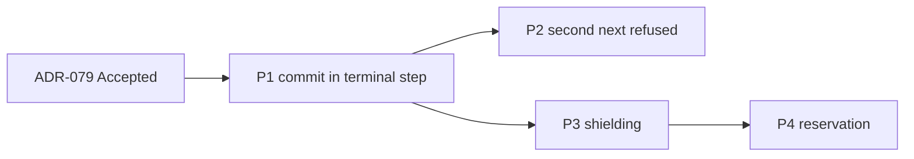

# Frame: Commit Inside the Command Pipeline

- **Date:** 2026-10-22
- **Issue:** DCE-142 (Feature DCE-130, fix plan cluster W2-1)
- **Alignment:** [02-commit-in-pipeline.alignment.md](02-commit-in-pipeline.alignment.md) (decided, B-103 to B-118)
- **Research:** [02-commit-in-pipeline.research.md](02-commit-in-pipeline.research.md)
- **ADR:** [ADR-079](../docs/adr/ADR-079-commit-inside-the-command-pipeline.md) (Proposed)

Each phase is one implementation Feature Task under DCE-130 and one PR. Every phase follows the fix plan's §4
and §5: test-first (strict-xfail red tests run locally with `--runxfail` and pushed with the green commit,
P-32), docs in the same change, an upgrade-note entry for each behaviour change (B-114). No phase starts before
ADR-079 is Accepted. The first phase adds the amendment notes to ADR-017 to 020 and the corrections to ADR-068
and ADR-076.

Test names below are the acceptance tests; the fixer may group them in classes but keeps the names. Every
test uses synthetic data and asserts through the public API (fix plan §4.3: no private asserts).

---

## Phase 1: Tracer Bullet: the commit runs in the terminal step

**Feature Task title:** W2-1 P1: Commit in the pipeline's terminal step; locks held and result recorded after it

**Rows:** CQRS-K1 (the cached failed commit), CQRS-K3, CQRS-11, FAKE-04 (commit-failure injection).
Decisions B-103, B-104, B-105, B-112, B-113, B-116, B-118.

**Components:**

- `src/pydomain/cqrs/command_bus.py`: the terminal step runs the handler, `uow.commit()`, then sets
  `ctx.new_events`; the bus stops committing after the pipeline; `ctx.handler` stays the handler.
- `src/pydomain/cqrs/behaviors.py`: whatever `MessagePipeline` needs to take the command terminal step
  (internal); docstrings of `IdempotencyBehavior` (records after the commit; the CQRS-04 caveat stays until
  Phase 4) and `AggregateLockingBehavior` (held through the commit).
- `src/pydomain/cqrs/locking.py`: `LockProvider` docstring, a lease covers the commit.
- `src/pydomain/testing/fake_unit_of_work.py`: `fail_at: Literal["flush", "write_outbox", "commit"] | None`
  and `failure: BaseException | None` keyword arguments; the hook named by `fail_at` raises `failure` (a
  `CQRSError` by default).
- `docs/adr/`: amendment notes in ADR-017, 018, 019, 020; correction notes in ADR-068 (l.171-173) and ADR-076
  (l.189) (B-113).
- `tests/support/probes/README.md`: CQRS-K1 and CQRS-K3 no longer open for `cqrs/p_known.py` and
  `review/pr117/one_key_lock_k3.py` (delete the latter: its only row is fixed).

**Testing strategy** (fix plan §9.2: ordering spy; failure injection at every await of `commit()`):

- `test_command_pipeline_order_is_acquire_handler_commit_release_record`: a spy on the store, the lock
  provider and the UoW hooks gives `get, acquire, handler, _flush, _write_outbox, _commit, release, set`.
- `test_failed_commit_is_not_cached` (parametrized over `fail_at` = flush, write_outbox, commit): the retry
  with the same `command_id` runs the handler and persists.
- `test_locked_increments_do_not_lose_updates_across_a_slow_commit`: two gathered locked increments on one
  key with an awaiting `_commit` end at 2.
- `test_behavior_sees_committed_events_after_next`: `ctx.new_events` holds the stamped events after `next()`
  returns.
- `test_pipeline_that_never_reaches_the_handler_commits_nothing`: a cached duplicate and a short-circuiting
  behavior leave the scope rolled back, with nothing committed.
- `test_logging_behavior_reports_a_failed_commit_as_failed`: "Failed ...: <Type>", never "Completed".
- `test_log_names_the_registered_handler`: the terminal step does not rename the handler in logs.
- `test_fake_unit_of_work_fail_at_raises_from_each_hook` and
  `test_fake_unit_of_work_without_fail_at_commits`.

**Docs:**

- arc42: §4.5 S4 (diagram and table); §5.3.5; §6.1 with the new sequence diagram (commit inside the
  pipeline, release after it); §8.5 (nested diagram, slot table with the ordering promise); §10.6; §11 l.254
  (B-113).
- Diataxis: `concepts/cqrs/pipeline-behaviors.md` (the ordering promise, B-112), `concepts/cqrs/command-bus.md`,
  `concepts/cqrs/idempotency-and-locking.md` (l.56-59 flow, l.72 locks), `how-to/cqrs/add-idempotency.md`
  (l.103: the cached-failure limit goes; the at-least-once gap is named), `how-to/cqrs/add-pipeline-behavior.md`
  (what "after `next()`" means), `how-to/cqrs/add-distributed-locking.md` (the lease note),
  `how-to/testing/use-fake-uow.md` (`fail_at`).
- Upgrade notes: items 1, 2, 4 and 6 of ADR-079's list.

**Verification gate:**

- The ordering spy shows the commit before the release and the record, and the scratch K3 scenario
  (research §8) gives `counter=2` through the public API.
- `make check` green; `tests/test_architecture.py` and the export tests pass.

**Acceptance criteria:**

- [ ] All Phase 1 tests pass; their red versions failed locally for the stated reason.
- [ ] No caller of `CommandBus` commits after the pipeline; ADR-020's "handlers never commit" still holds.
- [ ] The listed docs and upgrade-note entries are in the PR.

---

## Phase 2: A second `next()` is refused

**Feature Task title:** W2-1 P2: Refuse a second next() in command pipelines (PipelineReentryError)

**Rows:** CQRS-21. Decision B-111.

**Components:**

- `src/pydomain/cqrs/exceptions.py`: `PipelineReentryError(CQRSError)`, message without content (ADR-071).
- `src/pydomain/cqrs/command_bus.py`: the terminal step counts its calls per dispatch and raises on the second,
  before the handler.
- `src/pydomain/cqrs/__init__.py`, `tests/test_package_exports.py`: the new name.

**Testing strategy:**

- `test_second_next_raises_pipeline_reentry_error`: a behavior calling `next()` twice; the handler runs once;
  the caller gets `CommandExecutionError` whose `__cause__` is `PipelineReentryError`.
- `test_second_next_after_a_commit_keeps_the_first_commit`: the first run's change is persisted and its
  scope is not rolled back.
- `test_retry_behavior_after_a_failed_handler_is_refused`: the retry gets `PipelineReentryError`, and the
  first run's events never commit.
- `test_query_and_event_pipelines_allow_a_second_next`: unchanged behaviour, pinned.

**Docs:**

- arc42 §5.3.5 (the rule); §12 glossary if it lists the exceptions.
- Diataxis: `concepts/cqrs/pipeline-behaviors.md`, `how-to/cqrs/add-pipeline-behavior.md` ("call `next()` at
  most once in a command pipeline; retry by dispatching again"),
  `concepts/infrastructure/exception-hierarchy.md`.
- Upgrade notes: item 5.

**Verification gate:**

- The audit probe's `RetryOnce` scenario (`cqrs/p_15_25.py` `c21`) rewritten as a test commits one run's
  events or none, never two.

**Acceptance criteria:**

- [ ] All Phase 2 tests pass; the export test lists `PipelineReentryError`.
- [ ] `tests/support/probes/README.md` no longer lists CQRS-21 as open.

---

## Phase 3: The commit and the rollback are shielded

**Feature Task title:** W2-1 P3: Shield _commit and _rollback from cancellation; record a cancelled committed command

**Rows:** CQRS-07. Decisions B-108, B-109, B-110, B-115, B-118.

**Components:**

- `src/pydomain/cqrs/unit_of_work.py`: a private helper runs `_commit()` and `_rollback()` to completion under
  asyncio (a task awaited through `asyncio.shield`, absorbing further cancellations, then re-raising), inline
  with no asyncio task (as ADR-076, B-69); a completed `_commit()` sets the scope committed before the
  cancellation is re-raised; a hook error during a cancellation becomes a type-only note on it (ADR-078).
  The class attribute `shield_hooks: ClassVar[bool] = True`; a subclass that sets it to `False` runs its hooks
  inline in the calling task, without the shield (B-115). Protocol docstring: a Protocol-only UoW shields its
  own hooks.
- `src/pydomain/cqrs/command_bus.py`: the terminal step marks the context committed (private) when the commit
  completed, also when a cancellation follows.
- `src/pydomain/cqrs/behaviors.py`: `IdempotencyBehavior` records the result on that mark when `next()`
  raises a cancellation, with the same shielding, then re-raises.

**Testing strategy** (fix plan §9.2: cancellation at every await of `commit()`):

- `test_cancel_during_flush_or_outbox_rolls_back` (parametrized: `_flush`, `_write_outbox`): nothing
  committed, one rollback, `CancelledError` propagates (B-110).
- `test_cancel_during_commit_completes_it_and_does_not_roll_back`: the storage write is kept, the scope is
  committed, no rollback runs, `CancelledError` propagates.
- `test_repeated_cancellation_during_commit_is_absorbed_until_it_ends`.
- `test_cancel_during_rollback_completes_the_rollback`: a second cancellation while `_rollback` runs; it
  finishes, the buffers are drained, the cancellation propagates.
- `test_commit_hook_failure_during_cancellation_is_a_note`: `CancelledError` with
  `clean-up also failed: <Type>`, no content.
- `test_hooks_run_inline_without_an_asyncio_task`: the coroutine driven by hand, as the B-69 tests do.
- `test_shielded_hooks_run_in_their_own_task_by_default`: `asyncio.current_task()` inside `_commit` and
  `_rollback` is not the dispatching task.
- `test_shield_hooks_false_runs_the_hooks_in_the_calling_task`: with `shield_hooks = False`, both hooks see the
  dispatching task.
- `test_shield_hooks_false_leaves_the_hooks_cancellable`: a cancellation during `_commit` interrupts it and the
  scope rolls back, as before this ADR.
- `test_cancelled_committed_command_is_recorded`: the retry with the same `command_id` gets the cached result
  and the handler does not run again (B-109).
- `UnitOfWorkContract`: a case for "a commit cancelled while its storage commit runs is committed", if the
  fixer finds it holds for any conforming adapter; otherwise the case stays in `tests/cqrs/`.

**Docs:**

- arc42: §5.3.7 (unit of work); §6.1 failure modes (the cancellation row); §10.6.
- Diataxis: `concepts/cqrs/command-bus.md` (l.71), `concepts/cqrs/unit-of-work.md`; the recipes that override
  `_commit`/`_rollback` (`how-to/recipes/cqrs-with-ddd.md`, `how-to/recipes/all-modules.md`): under asyncio
  the hooks run in a separate task, and `shield_hooks = False` is the opt-out for a task-bound client.
- Upgrade notes: item 7, naming `shield_hooks`.

**Verification gate:**

- The scratch scenario "cancel at `_commit.after-db`" (research §2) gives `db_row=True`, no `_rollback`, and a
  cached result through the public API.

**Acceptance criteria:**

- [ ] All Phase 3 tests pass; their red versions failed locally for the stated reason.
- [ ] No anyio runtime dependency is added (`pyproject.toml` unchanged).
- [ ] `shield_hooks` is documented on `AbstractUnitOfWork` and in the upgrade note.
- [ ] `tests/support/probes/README.md` no longer lists CQRS-07 as open.

---

## Phase 4: Commands are reserved before the handler

**Feature Task title:** W2-1 P4: MessageReservationStore and CommandInProgressError for concurrent duplicates

**Rows:** CQRS-04. Decisions B-106, B-107, B-117, B-118. Removes the P-25 caveat where a reserving store is used.

**Components:**

- `src/pydomain/cqrs/idempotency.py`: `MessageReservationStore` Protocol (`reserve`, `release`).
- `src/pydomain/cqrs/exceptions.py`: `CommandInProgressError(CQRSError)`, naming the command type only.
- `src/pydomain/cqrs/behaviors.py`: `IdempotencyBehavior`'s reserving flow (ADR-079 point 4) when its store
  implements both Protocols; `release` after any `BaseException`, shielded after a cancellation with
  Phase 3's helper; a failed `release` is a type-only note.
- `src/pydomain/testing/fake_processed_message_store.py`: implements `reserve`/`release` in a key space
  separate from results and from `check_and_set`.
- `pydomain/testing/contracts/message_reservation_store.py` *(new)*: `MessageReservationStoreContract`.
- Exports: `pydomain.cqrs`, `pydomain.testing`, `pydomain.testing.contracts`, `tests/test_package_exports.py`.

**Testing strategy** (fix plan §9.2: concurrent duplicate commands):

- `test_concurrent_duplicates_run_the_handler_once`: two gathered dispatches of one `command_id` in the
  documented order; one runs, the other gets `CommandInProgressError` (wrapped), nothing of it commits.
- `test_duplicate_after_completion_gets_the_cached_result`.
- `test_failed_command_releases_its_reservation` (handler failure and commit failure through `fail_at`): the
  retry runs.
- `test_cancelled_command_releases_its_reservation`.
- `test_failed_release_is_a_note_on_the_error`.
- `test_store_without_reservation_keeps_get_and_set`: a `ProcessedMessageStore`-only store keeps the old flow.
- `MessageReservationStoreContract`: `test_reserve_is_true_the_first_time`,
  `test_reserve_is_false_while_reserved`, `test_release_allows_a_new_reservation`,
  `test_concurrent_reserve_admits_one_caller`, `test_reserved_id_is_not_a_result` (`get` returns `MISSING`),
  `test_set_completes_a_reservation`, `test_reservations_do_not_collide_with_check_and_set`; run against
  `FakeProcessedMessageStore`.

**Docs:**

- arc42: §5.3.5; §5.3.6 (the Protocol list); §8.5 (mechanism column); §10.6 (duplicates: the known limit is
  gone with a reserving store); §12 glossary.
- Diataxis: `concepts/cqrs/idempotency-and-locking.md`, `how-to/cqrs/add-idempotency.md` (the Redis example
  gains `reserve` with `SET NX` and a TTL, and `release`; the CQRS-04 caveat stays only for stores without
  reservation), `how-to/testing/use-fake-processed-message-store.md`, `concepts/cqrs/pipeline-behaviors.md`
  (l.197 caveat).
- Upgrade notes: item 3.

**Verification gate:**

- The audit probe scenario `documented(idem,lock)` (`cqrs/p_04_09.py`) rewritten as a test gives
  `handler runs=1` with `FakeProcessedMessageStore`.

**Acceptance criteria:**

- [ ] All Phase 4 tests and the new contract suite pass; the export tests list the new names.
- [ ] `ProcessedMessageStore`'s four methods are unchanged.
- [ ] `tests/support/probes/README.md` no longer lists CQRS-04 as open; scripts whose rows are all fixed are
  deleted (P-28).

---

## Phase Sequence

- P1 first: every later phase relies on the commit being inside `next()`.
- P2 and P3 can run in parallel after P1 (different code: the terminal step's call count versus the UoW
  hooks); both touch the terminal step lightly, so the second to merge rebases.
- P4 after P3: the release after a cancellation reuses P3's shielding helper, and both change
  `IdempotencyBehavior`.

## Scope Boundaries

**Out:** F-6 (scope-keyed buffers); W2-2 (event idempotency keys; it may reuse `MessageReservationStore`);
W2-10 (the tracing channel); W3-1 (error wrapping); W3-6 (exactly-once recording, 0.5.0); W2-6 (the
`FakeRepository` part of FAKE-04).

## Phase status

| Phase | Feature Task | Status |
|---|---|---|
| P1 | to be created | not started |
| P2 | to be created | not started |
| P3 | to be created | not started |
| P4 | to be created | not started |
