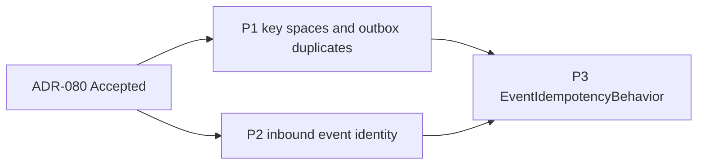

# Frame: Identify Delivered Events for Event Idempotency

- **Date:** 2026-10-23
- **Issue:** DCE-147 (Feature DCE-131, fix plan cluster W2-2)
- **Research:** [03-event-idempotency.research.md](03-event-idempotency.research.md)
- **ADR:** [ADR-080](../docs/adr/ADR-080-identify-delivered-events-for-event-idempotency.md) (Accepted, 2026-10-23; decision
  log B-145 to B-168)

Each phase below is one implementation Feature Task under DCE-131 and one PR. ADR-080 is Accepted, and its
notes on ADR-058, 060, 061, 062 and 063 were added with it. Every phase follows the fix plan's §4 and §5:
- test first: strict-xfail red tests, run locally with `--runxfail` and pushed together with the green commit
  (P-32);
- docs in the same change;
- an upgrade-note entry in `how-to/upgrade/upgrade-to-next-release.md` for each behaviour change. The numbers
  are ADR-080's Negative list (B-154, B-157 (e), B-161); Phase 3 also writes note 9 (B-168).

The notes on ADR-058, 060, 061, 062 and 063 are not part of a phase: the commit that accepted ADR-080 added them
(B-162).

The test names below are the acceptance tests. The fixer may group them in classes but keeps the names. Every
test uses synthetic data and asserts through the public API (fix plan §4.3). Each phase removes from
`tests/support/probes/` the lines it fixes, and deletes a script once every row it covers is fixed (P-28).

**Review scenarios to start from.** Review ⑨ of PR #129 prototyped parts of the design; its scripts may not
survive, so each one is described here by what it asserts.

| Scenario | Phase | Asserts |
|---|---|---|
| Marker and equality | P2 | A private attribute on `DomainEvent` breaks `==` (Pydantic v2 compares `__pydantic_private__`). A prototype failed 8 tests: `test_model_dump_round_trip`, `test_model_dump_json_round_trip`, `test_subclass_serialization_round_trip` and `test_stamped_copy_round_trips` in `tests/ddd/test_domain_event.py`; `test_round_trip_is_stable_over_random_upcaster_chains` and `test_payload_at_the_class_version_is_not_upcast` in `tests/infrastructure/test_event_registry_versioning.py`; and the docs examples `concepts/es/event-versioning.md:143` and `how-to/event-sourcing/implement-upcaster.md:133` (B-158) |
| Validator order | P2 | Pydantic runs the base's wrap validator first, then the subclass's before-validator, then the base's before-validator. A marker computed in the wrap validator from the raw input discards a subclass's deterministic `event_id`; generating the id in the before-validator and reporting it to the wrap validator keeps it |
| Outbox duplicate | P1 | `FakeOutboxStore.append` raising on a duplicate `message_id` keeps the suite green (2984 passed); only the probe `fakes/p05_outbox.py` expects duplicates |
| Shared instance | P3 | One `EventIdempotencyBehavior` instance in two registrations, with no `consumer`, keys each event on whichever handler ran |
| Cancel during `reserve` | P3 | As for commands (B-125): `reserve` completes, its token is released at once, the cancellation propagates |

---

## Phase 1: Store key spaces and the outbox duplicate rule

**Feature Task title:** W2-2 P1: keep check_and_set marks apart from results and refuse duplicate outbox ids

**Rows:** FAKE-06, FAKE-05 (rest: the duplicate `message_id`). Decisions B-151, B-155, B-157 (c) and (h).

**Components:**

- `src/pydomain/cqrs/idempotency.py`: the `ProcessedMessageStore` docstring says that a `check_and_set` mark is
  not a result (`get` stays `MISSING`) and that `contains` covers both. It names `EventIdempotencyBehavior`,
  not `EventBus`, as the caller of `check_and_set`.
- `src/pydomain/testing/fake_processed_message_store.py`: the marks get a set of their own, and `check_and_set`
  reads the marks only.
- `src/pydomain/testing/contracts/processed_message_store.py`: one new case.
- `src/pydomain/cqrs/outbox.py`: the `OutboxStore.append` docstring. A `message_id` that is already stored, or
  repeated in the batch, raises `CQRSError` (or a subclass), and nothing of the batch is stored.
- `src/pydomain/testing/fake_outbox_store.py`: the fake checks the whole batch before it stores anything.
- `src/pydomain/testing/contracts/outbox_store.py`: one new case.

**Testing strategy** (fix plan §9.2: ProcessedMessageStore contract cases):

- `ProcessedMessageStoreContract.test_check_and_set_creates_no_result`: after `check_and_set(id)`, `get(id)`
  is `MISSING` and `contains(id)` is true.
- `test_check_and_set_ignores_results`: replaces `test_check_and_set_after_set_returns_true` in
  `tests/testing/test_fake_processed_message_store.py`. After `set(id, r)`, `check_and_set(id)` is `False`,
  as in both how-to examples. The contract does not pin this.
- `OutboxStoreContract.test_append_refuses_a_duplicate_message_id`: `pytest.raises(CQRSError)`; the stored
  entry is unchanged.
- `test_duplicate_in_one_batch_stores_nothing` (fake): a batch that repeats a `message_id` raises, and none of
  its entries is fetched afterwards.

**Docs:**

- arc42: §5.3.6 (key spaces).
- Diataxis:
  - `how-to/testing/use-fake-processed-message-store.md`;
  - `how-to/cqrs/add-idempotency.md`: the text at l.71 says the library relies on the split; the two examples
    already keep it;
  - `concepts/infrastructure/outbound-event-gateway.md`;
  - `how-to/testing/run-contract-suites.md`.
- Upgrade notes: 6 and 8.

**Verification gate:**

- `fakes/p05_outbox.py`'s duplicate line, rewritten as a test, raises.
- The rest of FAKE-05 (marks on unknown ids, fetch order) stays open: bug-fix-plan.md §14, D-FAKE-05.

**Acceptance criteria:**

- [ ] All Phase 1 tests and both contract suites pass against the fakes.
- [ ] The four `ProcessedMessageStore` methods and the `OutboxStore` signatures are unchanged.

---

## Phase 2: Inbound event identity

**Feature Task title:** W2-2 P2: derive the domain event id of an inbound event from its integration id

**Rows:** INF-02. Decisions B-145, B-146, B-156, B-157 (g), B-158, B-160, B-166.

**Components:**

- `src/pydomain/ddd/domain_event.py`:
  - `_ensure_event_id` stays a `mode="before"` validator and reports, through a `ContextVar`, the id it
    generated;
  - a wrap validator stores in the private attribute `_event_id_generated` whether the built event still
    carries that id (B-169, narrowed by B-171: an id given under the field's alias, set by a subclass's before-validator or by a field validator counts as explicit; a subclass after- or wrap-validator that replaces the id is not seen; B-170: the id is generated under the key validation
    reads, the alias for a class validated by alias only); `model_copy` and `stamp()` keep it; `model_copy` clears it when `update` contains `event_id`
    (B-166);
  - the wrap validator only ever sets the marker to true (`if generated is not None and event.event_id ==
    generated: event._event_id_generated = True`), never writes false, and resets the `ContextVar` token in
    `finally`: validating an existing instance returns the same object, so writing false would make a
    generated event explicit in place;
  - `__eq__` ignores the attribute (B-158); do not assign `__hash__`, so Pydantic regenerates it (the
    `TestDomainEventHashability` tests pin it);
  - the docstring's "Event IDs" section says all of this.
- `src/pydomain/infrastructure/message_subscriber.py`:
  - `_process_message` checks the raw payload for an `event_id` key. Without one, it logs a WARNING that names
    the integration class and the topic only, and dispatches the event unchanged (B-146).
  - Otherwise, when the translated event's id was generated, it replaces it with
    `uuid5(INBOUND_EVENT_ID_NAMESPACE, integration_event.event_id)`, before stamping and whether or not the
    payload has a `correlation_id`.
  - `INBOUND_EVENT_ID_NAMESPACE = uuid5(NAMESPACE_URL, "https://github.com/mgourlis/pydomain/inbound-event-id")`
    is a private constant. The topic is not part of the derivation (B-160).

**Testing strategy:**

- `test_generated_event_id_marker_survives_model_copy_and_stamp`.
- `test_event_id_marker_leaves_model_dump_and_exclude_unset_unchanged`.
- `test_round_trips_stay_equal_with_the_marker`: `model_validate(model_dump())`, JSON, a subclass and a stamped
  copy each compare equal to the original. The 8 tests and 2 docs examples of the scenario table stay green
  unchanged.
- `test_subclass_before_validator_event_id_counts_as_explicit`: a subclass validator that sets a deterministic
  `event_id`; the gateway keeps it.
- `test_model_copy_update_event_id_is_kept_as_explicit`: `model_copy(update={"event_id": x})` clears the
  marker, and the gateway keeps `x` (B-166); `stamp()` keeps the marker.
- `test_model_construct_event_reads_as_explicit`: the gateway keeps its id; nothing is deduplicated.
- `test_validating_an_existing_event_keeps_its_marker`: `model_validate(instance)` and an instance put into a
  field of another model both keep a generated event's marker.
- `test_nested_event_gets_its_own_marker`: an event validated from a dict inside another model is marked
  generated; the outer validation does not change it.
- `test_marker_after_a_failed_validation_reads_explicit`: after a validation that raises, the next event built
  with an explicit `event_id` reads explicit (the token was reset).
- `test_redelivered_integration_event_gets_the_same_event_id`.
- `test_inbound_event_id_is_uuid5_of_the_integration_event_id`, including an integration id that is not a
  UUID.
- `test_event_id_is_derived_without_correlation_id`.
- `test_translator_event_id_is_kept`.
- `test_derived_event_id_ignores_the_topic`: one integration id on two topics gives one domain id (B-160).
- `test_payload_without_event_id_warns_and_is_not_deduplicated`: with a sentinel that the WARNING carries no
  payload value (ADR-071).

**Docs:**

- arc42:
  - §5.2.4, the "Event ID" row: the marker and what it is for;
  - §8.2 (the inbound tracing chain).
- Diataxis:
  - `concepts/infrastructure/inbound-event-gateway.md`: the derivation; the three cases of ADR-080 point 1;
    payloads without `event_id`;
  - `how-to/infrastructure/configure-inbound-event-gateway.md`: translators set `event_id` in the
    constructor to keep their own;
  - `concepts/infrastructure/tracing.md`;
  - `concepts/ddd/domain-events.md` (event ids).
- Upgrade notes: 3 and 7.

**Verification gate:**

- `inf/inbound_probe.py` INF-02, rewritten as tests: case A (no `correlation_id`) gives one domain `event_id`
  over two deliveries; case B (no `event_id`) logs the WARNING.

**Acceptance criteria:**

- [ ] All Phase 2 tests pass.
- [ ] Every existing `DomainEvent` round-trip, upcaster and docs example test passes unchanged.
- [ ] No public name is added.

---

## Phase 3: `EventIdempotencyBehavior` keys, marks and refuses

**Feature Task title:** W2-2 P3: key event idempotency on event id and consumer, mark after success

**Rows:** CQRS-05, CQRS-K2, A2 (docs), A31 (the caveats). Decisions B-147 to B-150, B-152, B-153, B-157 (a),
(b) and (f), B-159, B-161, B-164, B-165, B-167, B-168.

**Components:**

- `src/pydomain/cqrs/exceptions.py`: `EventInProgressError(CQRSError)`, naming the event type only, and
  `EventIdempotencyMisuseError(CQRSError)`, naming no content (B-167).
- `src/pydomain/cqrs/behaviors.py`, `EventIdempotencyBehavior(store, *, consumer: str | None = None)`:
  - **Key:** `uuid5(uuid5(EVENT_KEY_NAMESPACE, consumer), str(event.event_id))`, with
    `EVENT_KEY_NAMESPACE = uuid5(NAMESPACE_URL, "https://github.com/mgourlis/pydomain/event-idempotency-key")`
    as a private constant.
  - **Without `consumer`:** a `DeprecationWarning` once, at construction (B-157 (f)), then the handler's
    `module:qualname`.
  - **One instance per handler:** an instance raises `EventIdempotencyMisuseError` at the first dispatch to a
    second, different handler; it learns its handler from `ctx.handler`, so not at registration. Handlers
    compare with `==` (a bound method by `__self__` and `__func__`); the same function registered twice is the
    same handler and is not detected (B-159, B-167).
  - **With a reserving store** (ADR-080 point 4): `get`, `reserve` (with a second `get` before raising
    `EventInProgressError`), the handler, then `set(key, True)`; `release` on failure; a failing `set` is a
    type-only WARNING (B-164). The calls go through the
    shield helper of ADR-079.
  - **Without a reserving store:** `contains`, the handler, then `check_and_set`; a failing `check_and_set` is a
    type-only WARNING and leaves the event unmarked (B-165).
  - **Skip log:** the INFO line names `event_id`.
  - **Docstring:** loses the known-limit caveat.
- Exports: `EventInProgressError` and `EventIdempotencyMisuseError` in `pydomain.cqrs`, and in
  `tests/test_package_exports.py`.

**Testing strategy** (fix plan §9.2: sibling events and several handlers; failure then redelivery):

- The two `CQRS_05` strict xfails in `tests/cqrs/test_behaviors.py` lose their marker.
- The three `TestEventIdempotencyBehavior` tests that key on `causation_id` are rewritten for `event_id`. The
  contract changed with ADR-080; the tests are not weakened.
- Sibling events and handlers:
  - `test_two_handlers_sharing_a_store_both_run`;
  - `test_dispatching_one_event_object_twice_skips_the_second`: an event with `causation_id = None` (B-161
    (b)).
- Duplicates:
  - `test_duplicate_after_success_is_skipped`, and its INFO line names the `event_id`;
  - `test_concurrent_duplicate_raises_event_in_progress`;
  - `test_event_in_progress_error_names_the_event_type_only`: a content sentinel never appears in it
    (ADR-071);
  - `test_duplicate_that_completed_meanwhile_is_skipped`: the second `get` (B-157 (b)).
- Failures and cancellation:
  - `test_failed_handler_runs_again_on_redelivery`;
  - `test_cancelled_handler_releases_its_reservation`;
  - `test_cancel_during_reserve_releases_the_new_token` (B-125 for events);
  - `test_closed_suspended_dispatch_awaits_nothing`: `GeneratorExit` keeps the reservation until the TTL;
  - `test_failed_release_is_a_type_only_note`;
  - `test_failed_set_is_a_type_only_warning` (B-164).
- Stores without reservations:
  - `test_store_without_reservations_marks_after_success`;
  - `test_failed_fallback_mark_is_a_type_only_warning`: a `check_and_set` that raises after a successful
    handler logs a type-only WARNING, the dispatch returns normally, and a redelivery runs the handler again
    (B-165).
- Keys and consumers:
  - `test_key_is_uuid5_of_consumer_and_event_id`;
  - `test_missing_consumer_warns_once_at_construction_and_keys_on_the_handler_name`;
  - `test_one_instance_on_two_handlers_raises` (B-159, B-167): the first handler runs, the second does not,
    and `EventBus` logs one ERROR line with no content (until W2-3).
- End to end: `test_inbound_redelivery_after_a_failure_runs_again`, through the gateway and a subscriber that
  redelivers. It relies on Phase 2's derived ids, so its translator does not copy `event_id`. The NACK is
  W2-3's.

**Docs:**

- arc42:
  - §5.3.5 (the behavior row);
  - §5.3.10 and the exceptions box of the §5 diagram (`EventInProgressError`, `EventIdempotencyMisuseError`);
  - §12 glossary (`EventIdempotencyBehavior`, `EventInProgressError`, `EventIdempotencyMisuseError`).
- Diataxis:
  - `concepts/cqrs/pipeline-behaviors.md` and `how-to/cqrs/add-pipeline-behavior.md`: the "inbound only"
    caveats go; `consumer=` is introduced;
  - `concepts/cqrs/idempotency-and-locking.md`;
  - `how-to/cqrs/handle-domain-events.md`;
  - `concepts/infrastructure/message-bus.md`;
  - `concepts/infrastructure/exception-hierarchy.md`;
  - `api-reference/_index.md` (l.41, the behavior; l.44, the exceptions);
  - the skip log's new format, which names `event_id` where it named `causation_id`.
- Upgrade notes: 1, 2, 4, 5, 9 and 10 (note 9, the ADR notes are docs only, B-168).

**Verification gate:**

- The `cqrs/p_04_09.py` CQRS-05 scenarios, rewritten as tests, give `saw=['SKU-A', 'SKU-B']`,
  `ran=['projection', 'mailer']` and `ran=['projection']`.
- `cqrs/p_known.py` K2 gives 2 handler calls.

**Acceptance criteria:**

- [ ] All Phase 3 tests pass; the export tests list `EventInProgressError` and `EventIdempotencyMisuseError`.
- [ ] `tests/support/probes/README.md` no longer lists CQRS-05, CQRS-K2, A31 or INF-02 as open.

---

## Phase Sequence

- P1 and P2 can run in parallel: different code (the fakes and contracts; `DomainEvent` and the gateway).
- P3 comes last:
  - its fallback path relies on P1's split, because `contains` must see marks that `get` does not;
  - its end-to-end redelivery test relies on P2's derived ids.

## Scope Boundaries

**Out:**
- W2-3: the gateway NACKs, and failures propagate from `EventBus`.
- W2-10: stamping an inbound event without `correlation_id` (A4).
- W3-7: `consumer=` becomes required.
- W3-1: where `EventInProgressError` sits in the hierarchy.
- F-10: a local outbox-fed dispatcher.
- The rest of FAKE-05 (D-FAKE-05).

**Constraints on other clusters** (ADR-080 point 6, B-153):
- W2-3 receives the handler's own exception, after the release.
- W2-3 NACKs an `EventInProgressError`.

## Phase status

| Phase | Feature Task | Status |
|---|---|---|
| P1 | DCE-148 | implemented (PR #130) |
| P2 | DCE-149 | implemented (PR #131) |
| P3 | to be created | planned |
