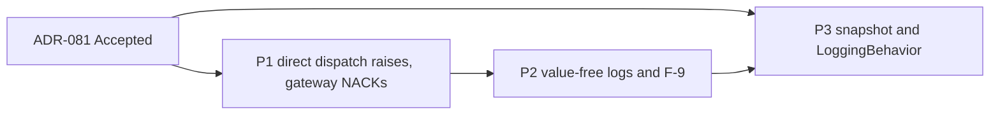

# Frame: Handler Failure Semantics

- **Date:** 2026-10-23
- **Issue:** DCE-151 (Feature DCE-132, fix plan cluster W2-3)
- **Research:** [04-handler-failure-semantics.research.md](04-handler-failure-semantics.research.md)
- **ADR:** [ADR-081](../docs/adr/ADR-081-handler-failures-reach-the-inbound-gateway.md) (Proposed, 2026-10-23;
  decision log B-180 to B-194)

Each phase below is one implementation Feature Task under DCE-132 and one PR. The implementation tasks depend on
ADR-081 being Accepted. The commit that accepts it adds the notes on ADR-046, 058, 060, 071 and 077 (B-192), so
those notes are not part of any phase.

Every phase follows the fix plan's §4 and §5:
- test first: strict-xfail red tests, run locally with `--runxfail`, pushed together with the green commit (P-32);
- docs in the same change;
- an upgrade-note entry in `how-to/upgrade/upgrade-to-next-release.md` for each behaviour change. The numbers are
  ADR-081's Negative list.

The test names below are the acceptance tests. The fixer may group them in classes but keeps the names. Every
test uses synthetic data and asserts through the public API (fix plan §4.3). Each phase removes from
`tests/support/probes/` the lines it fixes, and deletes a script once every row it covers is fixed (P-28):
- `inf/inbound_probe.py` INF-01 → P1;
- `cqrs/p_15_25.py`: CQRS-27 → P2; CQRS-18 and CQRS-20 → P3;
- `fakes/p08_09_broker_sub.py` FAKE-09 (rest) → P1.

**Superseded tests (B-193).** These tests pin a contract that ADR-081 replaces. They are rewritten to the decided
behaviour and named in the PR, never weakened or deleted. A scratch run of the suite with ADR-081 point 1 applied
(a pytest plugin that made `EventBus.dispatch` raise a group, outside the repository) gave `7 failed, 3055
passed`:

| Test | Phase | Rewritten to |
|---|---|---|
| `tests/cqrs/test_event_bus.py::TestFailureIsolation::test_failure_logged_and_swallowed` | P1 (P2 for the log) | Every handler runs, then `EventHandlersFailed` with one member; in P2 the record has no `exc_info` |
| `…::test_multiple_failures_all_isolated` | P1 | All three run; the group holds both failures in registration order |
| `…::test_failure_in_first_handler_does_not_block_others` | P1 | All three run; the group holds one failure |
| `tests/infrastructure/test_message_bus.py::TestDomainEventDispatch::test_dispatch_domain_event_handler_failure_isolation` | P1 | `MessageBus.dispatch(event)` raises the group after both handlers ran |
| `tests/cqrs/test_event_idempotency.py::TestKeysAndConsumers::test_one_instance_on_two_handlers_raises` | P1 (P2 for the log) | The group's member is the `EventIdempotencyMisuseError`; in P2 it is read from the raised group, not from `exc_info` |
| `tests/cqrs/test_event_idempotency.py::test_inbound_redelivery_after_a_failure_runs_again` | P1 | Outcomes `["nack EventHandlersFailed", "ack", "ack"]`, the third delivery skipped |
| `docs/diataxis/concepts/cqrs/idempotency-and-locking.md` l.224 (docs example) | P1 | The first `dispatch` is awaited under `pytest.raises(EventHandlersFailed)` or an `except*`, and the comment says so |
| `tests/infrastructure/test_inbound_event_gateway.py` `test_translation_failure_names_class_and_topic_with_traceback` (l.624) | P2 | Renamed `test_translation_failure_names_class_and_topic_with_a_value_free_stack` |
| `…` `test_dispatch_failure_names_event_class_and_topic` (l.713) | P2 | The new L3 text (B-185), no `exc_info` |
| `tests/saga/test_manager.py` `test_handler_and_compensation_errors_are_stored_by_type` (l.1273) | P2 | `failure["error"] == "RuntimeError"`, and the L4 text ends with `: RuntimeError` |
| `tests/saga/test_flows.py` l.391, l.664; `tests/saga/test_manager.py` l.599 | P2 | `"CommandExecutionError"` becomes the handler's own type (B-186) |

The post-command tests `test_event_handler_failure_logged_and_swallowed` and
`test_event_handler_failure_does_not_block_other_handlers` (`test_message_bus.py` l.503, l.541) stay green
unchanged in P1. They pin the `dispatch_many` contract, which ADR-081 keeps.

---

## Phase 1: Direct dispatch raises, and the gateway NACKs

**Feature Task title:** W2-3 P1: raise handler failures from direct event dispatch so the inbound gateway NACKs them

**Rows:** INF-01, A1, FAKE-09 (rest). Decisions B-180 to B-183, B-190, B-191, B-193.

**Components:**

- `src/pydomain/cqrs/exceptions.py`: `EventHandlersFailed(ExceptionGroup, CQRSError)`:
  - message `<n> handler(s) failed for <EventType>`;
  - `__new__` and `__init__` take the event type name and the failures;
  - `derive()` keeps the class and the message, so `except*` splits stay `EventHandlersFailed`;
  - the docstrings of `EventInProgressError` and `EventIdempotencyMisuseError` replace "Until W2-3 …" with the
    decided behaviour.
- `src/pydomain/cqrs/event_bus.py`:
  - `_execute(event)` returns the list of `Exception`s instead of `None`, still logging each one (P2 changes the
    line);
  - `dispatch` raises `EventHandlersFailed` when the list is not empty;
  - `dispatch_many` ignores the list;
  - the module and class docstrings say which path raises.
- `src/pydomain/infrastructure/message_bus.py`: the `dispatch` docstring adds `EventHandlersFailed` to its
  `Raises`. The code is unchanged.
- `src/pydomain/infrastructure/message_subscriber.py`: the module docstring's ACK/NACK section and the class
  docstring follow ADR-081 point 3. The code already re-raises; P2 changes its log line.
- `src/pydomain/testing/in_memory_message_subscriber.py`: `outcomes: list[str]` with `"ack"` and
  `"nack <ExceptionType>"`; the exception is still re-raised (B-190).
- Exports: `EventHandlersFailed` in `pydomain` and `pydomain.cqrs`, and in `tests/test_package_exports.py`.

**Testing strategy** (fix plan §9.2: end-to-end inbound NACK with a real failing handler):

- End to end, through a real `MessageBus`, the gateway and a protocol-conforming subscriber double that records
  ACK on return and NACK on raise (as `inf/inbound_probe.py` does):
  - `test_inbound_handler_failure_is_nacked`: the tracer. One failing handler gives `["NACK"]`;
  - `test_inbound_failure_of_one_handler_runs_the_others_then_nacks`;
  - `test_inbound_redelivery_of_a_failing_idempotent_handler_is_nacked_each_time`: the W2-2 review probe, one
    payload delivered twice to a failing handler wrapped in `EventIdempotencyBehavior`; both deliveries are
    NACKed, and the handler ran twice with one derived `event_id`;
  - `test_inbound_concurrent_duplicate_is_nacked`: `EventInProgressError` reaches the subscriber as a member of
    the group;
  - `test_inbound_idempotency_misuse_is_nacked` (B-182);
  - `test_inbound_translator_failure_is_acked`, `test_inbound_validation_failure_is_acked`,
    `test_inbound_unknown_topic_is_acked` (B-183);
  - `test_inbound_cancelled_handler_propagates_the_cancellation`: no outcome recorded, the later handler did not
    run.
- `EventBus` and `MessageBus`:
  - `test_direct_dispatch_raises_after_every_handler_ran`;
  - `test_handlers_failed_holds_each_handler_exception_unchanged`: identity of the members, in registration
    order;
  - `test_handlers_failed_holds_the_exception_after_the_release`: with a reserving store, the key is free again
    when the group is caught (ADR-080 point 6);
  - `test_handlers_failed_is_a_cqrs_error_and_an_exception_group`, and `except*` matches one member type;
  - `test_handlers_failed_message_names_the_event_type_and_count_only`: a content sentinel in the handler's
    exception is absent from `str()` and `repr()` of the group itself;
  - `test_post_command_dispatch_still_swallows_handler_failures`: the command result is returned.
- `InMemoryMessageSubscriber`:
  - `test_outcomes_record_ack_and_nack_with_the_exception_type`;
  - `test_failing_delivery_is_still_reraised`;
  - `test_unknown_topic_records_no_outcome`.
- The superseded P1 rows of the table above.

**Docs:**

- arc42:
  - §6, a new scenario "6.7 Inbound Delivery": a sequence diagram from the subscriber through the gateway,
    `MessageBus` and `EventBus` to the handlers, with the ACK and NACK table of ADR-081 point 3 (fix plan §9.2);
  - §5.3.5 and the `EventBus` row at l.538: direct dispatch raises;
  - §5.3.10: `EventHandlersFailed`;
  - §6.1 failure modes (l.167, the post-command path keeps swallowing);
  - §12 glossary: `EventHandlersFailed`, and the `EventBus` and `EventInProgressError` entries (l.260, l.551).
- Diataxis:
  - `concepts/infrastructure/inbound-event-gateway.md`: the failure modes, l.268-281 (B-177);
  - `concepts/infrastructure/message-subscriber.md` l.97-106; `concepts/cqrs/integration-events.md` l.145;
  - `concepts/infrastructure/message-bus.md` l.52-71: two paths, two rules;
  - `concepts/ddd/domain-events.md` l.178-189; `concepts/cqrs/handlers.md` l.81;
  - `how-to/infrastructure/configure-inbound-event-gateway.md` l.360-375;
  - `how-to/infrastructure/configure-message-subscriber.md` l.149, l.330: the examples already NACK on raise;
  - `how-to/cqrs/handle-domain-events.md` l.99-100: the NACK, and inbound handlers use `EventIdempotencyBehavior`
    because a NACK redelivers to every handler (B-191);
  - `concepts/cqrs/idempotency-and-locking.md` (the docs example);
  - `how-to/testing/use-in-memory-message-subscriber.md`: `outcomes`;
  - `concepts/infrastructure/exception-hierarchy.md`; `api-reference/_index.md`.
- Upgrade notes: 1, 2, 3 and 4. They replace the "planned for a later release" sentences at l.361-363 and l.411.

**Verification gate:**

- `inf/inbound_probe.py` INF-01, rewritten as a test, gives `['NACK']`.
- The research's S3 and S4 scenarios give NACK on every failed or refused delivery.

**Acceptance criteria:**

- [ ] All Phase 1 tests pass; the export tests list `EventHandlersFailed`.
- [ ] The seven superseded P1 rows are rewritten and named in the PR; the two post-command tests pass unchanged.
- [ ] No Protocol or signature changes.

---

## Phase 2: Value-free failure logs and F-9

**Feature Task title:** W2-3 P2: log handler failures with a value-free stack and store each compensation's own
error type

**Rows:** CQRS-27, the logs of ADR-071 decision 5 (B-31, B-33, B-44), F-9. Decisions B-184 to B-186.

**Components:**

- `src/pydomain/_describe.py`: `describe_stack(exc) -> str`.
  - It renders every exception reachable from `exc` once: the `__cause__` chain, the `__context__` chain unless
    `__suppress_context__` is set, and group members.
  - For each one it gives the type name and its frames, `File "<path>", line <n>, in <function>`.
  - It gives no message, no `__notes__`, no source line and no locals.
  - The module still imports no other pydomain module (the architecture rule stays).
- The lines of ADR-081 point 4, each `describe(...)` plus `"\n" + describe_stack(exc)`, with `exc_info` dropped:
  - `cqrs/event_bus.py` (L1). The handler is named by `__name__`, or by its type's name for a callable without
    one, never by `str(pipeline)`;
  - `infrastructure/message_subscriber.py` (L2);
  - `cqrs/saga/manager.py` (L4 to L7, each with `describe(_failure_of(exc))`);
  - `infrastructure/subscription.py` (L8, WARNING).
- `infrastructure/message_subscriber.py` (L3): `Dispatch failed for <Event> (from <IE>) on '<t>': <description> —
  propagating for a NACK`, no stack (B-185).
- `cqrs/saga/manager.py`: `_dispatch_compensations` records `describe(_failure_of(comp_err))` (B-186); the
  comment and the `_handle_event_error` docstring follow.

**Testing strategy** (fix plan §9.2: content sentinel on failure logs):

- `tests/test_describe.py`:
  - `test_describe_stack_names_types_and_frames_only`;
  - `test_describe_stack_follows_cause_context_and_group_members_once`;
  - `test_describe_stack_respects_suppressed_context`;
  - `test_describe_stack_drops_messages_and_notes`.
- `tests/test_sensitive_payloads.py`, one test per line, each through the real component, with
  `CONTENT_SENTINEL` in the user exception's message, in a note, and in a chained cause, and with
  `assert_absent_from_logs`:
  - `test_sentinel_absent_from_event_handler_failure_log` (L1, in-process and post-command);
  - `test_sentinel_absent_from_inbound_translation_failure_log` (L2);
  - `test_sentinel_absent_from_inbound_dispatch_failure_log` (L3);
  - `test_sentinel_absent_from_saga_compensation_failure_log` (L4), with a `MessageBus` and with a dispatcher
    that raises the handler's own exception;
  - `test_sentinel_absent_from_saga_handle_failure_log` (L5);
  - `test_sentinel_absent_from_saga_timeout_handler_failure_log` (L6);
  - `test_sentinel_absent_from_saga_timeout_command_failure_log` (L7), with both dispatchers;
  - `test_sentinel_absent_from_subscription_batch_failure_log` (L8).
- `test_failure_logs_carry_a_value_free_stack_and_no_exc_info`: each of L1, L2 and L4 to L8 has frames from the
  failing function and `exc_info is None`; L3 has no stack.
- `test_failed_compensation_stores_its_handler_exception_type` (B-186), and the superseded P2 rows of the table
  above.

**Docs:**

- arc42:
  - §8.13 l.763: the handler-failure logs follow ADR-071;
  - §2 l.131, l.167; §10 l.370: the "except W2-3" clauses go;
  - §11 l.290, l.297 and R-8 l.312: the risk is mitigated;
  - §9.22 l.775.
- Diataxis:
  - `how-to/infrastructure/handle-sensitive-payloads.md` step 6 (l.172-174) goes, and the expected outcome
    follows;
  - `how-to/sagas/saga-error-handling.md` l.135-147: the line formats and the stored compensation error;
  - `concepts/infrastructure/inbound-event-gateway.md` l.251 and the log examples;
  - `concepts/sagas/saga-manager.md` (`failed_compensations`).
- Upgrade notes: 5, 6 and 7.

**Verification gate:**

- The research's `sentinel_logs.py` scenarios (§3), rerun on the branch, print `sentinel in message=False in
  traceback=False` for every line. Its committed counterpart is the sentinel test list above.

**Acceptance criteria:**

- [ ] All Phase 2 tests pass; every `pydomain` handler-failure record has `exc_info is None`.
- [ ] `_describe` imports no pydomain module.
- [ ] Backlog F-9 reads as done.

---

## Phase 3: Handler snapshot, `LoggingBehavior` and the remaining docs

**Feature Task title:** W2-3 P3: snapshot event handlers per dispatch and keep LoggingBehavior from failing or
going silent

**Rows:** CQRS-18, CQRS-20 (rest). Decisions B-187 to B-189, B-192 (upgrade note 10).

**Components:**

- `src/pydomain/cqrs/event_bus.py`: `_execute` iterates `tuple(self._handlers.get(type(event), ()))`.
- `src/pydomain/cqrs/behaviors.py`, `LoggingBehavior`:
  - the formatter call moves into a `try`; an `Exception` becomes the WARNING `Payload formatter failed for
    <KIND> <Type>: <description>`, and the entry line is logged without `extra`;
  - `except asyncio.CancelledError` logs `Cancelled <KIND> <Type> after <ms>ms` at INFO and re-raises;
  - the class docstring says both.

**Testing strategy:**

- `test_handler_registered_during_dispatch_runs_from_the_next_dispatch`, for `dispatch` and `dispatch_many`.
- `test_raising_payload_formatter_logs_a_warning_and_the_message_continues`: a content sentinel in the
  formatter's error is absent from the logs.
- `test_cancelled_message_logs_cancelled_at_info_and_reraises`.
- `test_logging_behavior_logs_no_other_base_exception`: `KeyboardInterrupt` passes through with no line.

**Docs:**

- arc42: §5.3.5 (`LoggingBehavior`).
- Diataxis:
  - `concepts/cqrs/pipeline-behaviors.md` and `how-to/cqrs/add-pipeline-behavior.md` (`LoggingBehavior`);
  - `concepts/infrastructure/message-bus.md` (registration during dispatch).
- Upgrade notes: 8, 9 and 10.

**Verification gate:**

- `cqrs/p_15_25.py` CQRS-18 and CQRS-20, rewritten as tests, give `ran in one dispatch: ['first']` and a
  successful command with a WARNING. `tests/support/probes/README.md` no longer lists INF-01, CQRS-18, CQRS-20,
  CQRS-27 or FAKE-09 as open, and the scripts that cover no other open row are deleted.

**Acceptance criteria:**

- [ ] All Phase 3 tests pass.
- [ ] The upgrade page has notes 1 to 10.

---

## Phase Sequence

- P1 comes first: it is the tracer, and P2 rewrites the log line of `_execute`, which P1 restructures.
- P2 follows P1: its L1 and L3 tests need the group to reach the gateway.
- P3's code is independent of P1 and P2, but it edits `_execute` too and writes the last upgrade note, so it lands
  last to avoid conflicts.

## Scope Boundaries

**Out:**
- W2-8: one handler per topic in the in-memory subscriber and re-registration on real consumers (INF-03); dispatch
  by type.
- W2-7: the `SubscriptionRunner`'s retry and poison events (only its log line is here).
- W2-5: the saga state machine. The manager's retry and suspension are unchanged here.
- W3-1: where `EventHandlersFailed` sits in the hierarchy.
- F-10: a local outbox-fed dispatcher.

**Constraints honoured** (ADR-080 point 6, B-153):
- the gateway receives each handler's own exception, after the release, as a member of `EventHandlersFailed`
  (B-181);
- an `EventInProgressError` is NACKed.

## Phase status

| Phase | Feature Task | Status |
|---|---|---|
| P1 | to be created | planned |
| P2 | to be created | planned |
| P3 | to be created | planned |
