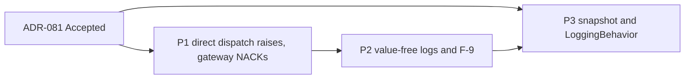

# Frame: Handler Failure Semantics

- **Date:** 2026-10-23
- **Issue:** DCE-151 (Feature DCE-132, fix plan cluster W2-3)
- **Research:** [04-handler-failure-semantics.research.md](04-handler-failure-semantics.research.md)
- **ADR:** [ADR-081](../docs/adr/ADR-081-handler-failures-reach-the-inbound-gateway.md) (Accepted, 2026-10-23;
  decision log B-180 to B-204)

Each phase below is one implementation Feature Task under DCE-132 and one PR. ADR-081 is Accepted, and
the commit that accepted it added the notes on ADR-046, 058, 060, 071, 077 and 080 and marked the README rows of
the first five (B-192, B-203, B-204), so none of that is part of a phase.

Every phase follows the fix plan's §4 and §5:
- test first: strict-xfail red tests, run locally with `--runxfail`, pushed together with the green commit (P-32);
- docs in the same change;
- an upgrade-note entry in `how-to/upgrade/upgrade-to-next-release.md` for each behaviour change. The numbers are
  ADR-081's Negative list.

The test names below are the acceptance tests. The fixer may group them in classes but keeps the names. Every
test uses synthetic data and asserts through the public API (fix plan §4.3).

**Red and guard tests.** A test marked *(guard)* already passes before the fix: it pins behaviour that ADR-081
keeps, so it carries no xfail marker. Every other test is red: strict xfail, and run with `--runxfail` to see it
fail for its reason. Red tests reach a name that does not exist yet by attribute access (`exceptions.EventHandlersFailed`,
`_describe.describe_stack`), with `raises=AttributeError` where that is the failure, as DCE-150 did. A
module-level `from … import` of a new name is never used, because it turns the whole module into a collection
error.

**Probes.** Each phase removes from `tests/support/probes/` the lines it fixes, and deletes a script once every
row it covers is fixed (P-28):
- `inf/inbound_probe.py` INF-01 → P1;
- `fakes/p08_09_broker_sub.py` → P1 removes the l.61 line (a handler's exception propagates, with no NACK);
  `tests/support/probes/README.md` records the payload and lifecycle lines as declined by B-190, and the
  one-handler line under W2-8 (INF-03). The script stays for FAKE-08 (W2-7);
- `cqrs/p_15_25.py`: CQRS-27 → P2; CQRS-18 and CQRS-20 → P3. The script crashes today at `c15` (an
  `IntegrationEvent` with a `datetime`, refused by the primitives rule), so the later scenarios never run. P2 fixes
  `c15` so the script reaches them.

**Superseded tests (B-193).** These tests pin a contract that ADR-081 replaces. They are rewritten to the decided
behaviour and named in the PR, never weakened or deleted. A scratch run of the suite with ADR-081 point 1 applied
(a pytest plugin that made `EventBus.dispatch` raise a group, outside the repository) gave `7 failed, 3055
passed`. Review ⑨ of PR #133 reproduced it. The P1 fixer repeats that sanity check before writing code: the suite
with point 1 applied, and nothing else, must fail on exactly the seven P1 rows below.

| Test | Phase | Rewritten to |
|---|---|---|
| `tests/cqrs/test_event_bus.py::TestFailureIsolation::test_failure_logged_and_swallowed` | P1 (P2 for the log) | Every handler runs, then `EventHandlersFailed` with one member; in P2 the record has no `exc_info` |
| `…::test_multiple_failures_all_isolated` | P1 | All three run; the group holds both failures in registration order |
| `…::test_failure_in_first_handler_does_not_block_others` | P1 | All three run; the group holds one failure |
| `tests/infrastructure/test_message_bus.py::TestDomainEventDispatch::test_dispatch_domain_event_handler_failure_isolation` | P1 | `MessageBus.dispatch(event)` raises the group after both handlers ran |
| `tests/cqrs/test_event_idempotency.py::TestKeysAndConsumers::test_one_instance_on_two_handlers_raises` | P1 (P2 for the log) | The group's member is the `EventIdempotencyMisuseError`; in P2 it is read from the raised group, not from `exc_info` |
| `tests/cqrs/test_event_idempotency.py::test_inbound_redelivery_after_a_failure_runs_again` | P1 | Outcomes `["nack EventHandlersFailed", "ack", "ack"]`, the third delivery skipped |
| `docs/diataxis/concepts/cqrs/idempotency-and-locking.md` l.224 (docs example) | P1 | The first `dispatch` is awaited under `pytest.raises(EventHandlersFailed)` or an `except*`, and the comment says so |
| `tests/infrastructure/test_inbound_event_gateway.py` `test_translation_failure_names_class_and_topic_with_traceback` (l.624) | P2 | Renamed `test_translation_failure_names_class_and_topic_with_a_value_free_stack` |
| `…` `test_dispatch_failure_names_event_class_and_topic` (l.713) | P2 | The new L3 text (B-185), no `exc_info` |
| `tests/saga/test_manager.py` `test_handler_and_compensation_errors_are_stored_by_type` (l.1273) | P2 | `failure["error"] == "RuntimeError"`, and the L4 text ends with `: RuntimeError` |
| `tests/saga/test_flows.py` l.391, l.664; `tests/saga/test_manager.py` l.599 | P2 | `"CommandExecutionError"` becomes the handler's own type (B-186) |

The post-command tests `test_event_handler_failure_logged_and_swallowed` and
`test_event_handler_failure_does_not_block_other_handlers` (`test_message_bus.py` l.503, l.541) stay green
unchanged in P1. They pin the `dispatch_many` contract, which ADR-081 keeps.

**Outcome formats.** The end-to-end tests drive one subscriber: a protocol-conforming double in the test module
that records the same strings as the fake, `"ack"` and `"nack <ExceptionType>"`. Behind the gateway, a handler
failure is always recorded as `"nack EventHandlersFailed"`.

---

## Phase 1: Direct dispatch raises, and the gateway NACKs

**Feature Task title:** W2-3 P1: raise handler failures from direct event dispatch so the inbound gateway NACKs them

**Rows:** INF-01, A1, FAKE-09 (rest). Decisions B-180 to B-183, B-190, B-191, B-193, B-195, B-198 to B-200.

**Components:**

- `src/pydomain/cqrs/exceptions.py`: `EventHandlersFailed(ExceptionGroup, CQRSError)` (ADR-081 point 2):
  - `__new__` and `__init__` take `(event_type, failures)`, and the event type name is kept in `event_type`;
  - message `<n> handler(s) failed for <EventType>`;
  - `derive(excs)` returns `EventHandlersFailed(self.event_type, excs)`, so a split recounts; it carries
    `# type: ignore[override]` under mypy strict;
  - `__reduce__` returns `(type(self), (self.event_type, list(self.exceptions)), self.__dict__)`;
  - `__repr__` returns `EventHandlersFailed('<message>')` (B-195);
  - the docstrings of `EventInProgressError` and `EventIdempotencyMisuseError` replace "Until W2-3 …" with the
    decided behaviour.
- `src/pydomain/cqrs/event_bus.py`:
  - `_execute(event)` returns the list of `Exception`s instead of `None`, still logging each one (P2 changes the
    line);
  - `dispatch` raises `EventHandlersFailed` when the list is not empty;
  - `dispatch_many` ignores the list;
  - the module and class docstrings say which path raises.
- `src/pydomain/infrastructure/message_bus.py`: the `dispatch` docstring adds `EventHandlersFailed` to its
  `Raises`. The code is unchanged.
- `src/pydomain/infrastructure/bootstrap.py`: the `Application.dispatch` docstring's `Raises` names
  `EventHandlersFailed`.
- `src/pydomain/cqrs/handlers.py` l.60: the `EventHandler` docstring says what a raising handler does on each path.
- `src/pydomain/infrastructure/message_subscriber.py`:
  - validation catches any `Exception` from `model_validate`; a `ValidationError` keeps its line, and any other
    exception is logged as a translation failure (L2) and returns (B-200);
  - right after the translator returns, before the `event_id` derivation, a result that is not a `DomainEvent` is
    logged as a translation failure and returns (B-199). Today such a result reaches the derivation and raises an
    unlogged `AttributeError` when the payload has `event_id` or `correlation_id`;
  - the module docstring's ACK/NACK section and the class docstring follow ADR-081 point 3. The dispatch already
    re-raises; P2 changes its log line.
- `src/pydomain/testing/in_memory_message_subscriber.py`: `outcomes: list[str]` with `"ack"` and
  `"nack <ExceptionType>"`; the exception is still re-raised (B-190, B-198).
- Exports: `EventHandlersFailed` in `pydomain` and `pydomain.cqrs`, and in `tests/test_package_exports.py`.

**Testing strategy** (fix plan §9.2: end-to-end inbound NACK with a real failing handler):

- End to end, through a real `MessageBus`, the gateway and the subscriber double (outcome formats above):
  - `test_inbound_handler_failure_is_nacked`: the tracer. One failing handler gives `["nack EventHandlersFailed"]`;
  - `test_inbound_failure_of_one_handler_runs_the_others_then_nacks`;
  - `test_inbound_redelivery_of_a_failing_idempotent_handler_is_nacked_each_time`: research S3, the W2-2 review
    probe. One payload is delivered twice to a failing handler wrapped in `EventIdempotencyBehavior`; both
    deliveries are NACKed, and the handler ran twice with one derived `event_id`;
  - `test_inbound_concurrent_duplicate_is_nacked`: research S4. The refused duplicate and the first delivery,
    which then fails, are both NACKed, and `EventInProgressError` is a member of the duplicate's group;
  - `test_inbound_idempotency_misuse_is_nacked` (B-182);
  - `test_inbound_translator_failure_is_acked` *(guard)*;
  - `test_inbound_validation_failure_is_acked` *(guard)*;
  - `test_inbound_non_validation_error_from_validation_is_acked` (B-200);
  - `test_inbound_translator_returning_a_non_domain_event_is_acked` (B-199), parametrized over a `Command`, a
    `Query` and a plain object, times payloads with and without `event_id` and `correlation_id`: each is ACKed
    with one L2 line, and no command or query handler runs;
  - `test_inbound_event_without_handlers_is_acked` *(guard)*;
  - `test_inbound_cancelled_handler_propagates_the_cancellation` *(guard)*: no outcome recorded, the later handler
    did not run.

  The unknown-topic row of ADR-081 point 3 is unreachable through the public API: the gateway subscribes one
  closure per registered topic and never drops a registration. It stays covered by the existing unit tests
  `test_process_message_unknown_topic_logs_warning` and `test_unknown_topic_warning_names_the_topic`
  (`test_inbound_event_gateway.py`), and there is no end-to-end test for it.
- `EventBus` and `MessageBus`:
  - `test_direct_dispatch_raises_after_every_handler_ran`;
  - `test_handlers_failed_holds_each_handler_exception_unchanged`: identity of the members, in registration
    order;
  - `test_handlers_failed_holds_the_exception_after_the_release`: with a reserving store, the key is free again
    when the group is caught (ADR-080 point 6);
  - `test_handlers_failed_is_a_cqrs_error_and_an_exception_group`, and `except*` matches one member type;
  - `test_handlers_failed_message_names_the_event_type_and_count_only` (B-195). It pins `.message ==
    "1 handler(s) failed for <Event>"`, and checks with plain `in` that a content sentinel in a member's message
    is absent from `str(g)` (which adds `(1 sub-exceptions)`) and from `repr(g)` (`EventHandlersFailed('…')`).
    It does not use `assert_absent_from_reprs`, which walks the members;
  - `test_handlers_failed_survives_pickle_and_copy`: `pickle`, `copy.copy` and `copy.deepcopy` round trips keep
    `event_type`, the `__notes__`, the
    message (not doubled) and the members;
  - `test_handlers_failed_split_recounts`: `split(ValueError)` and `except*` keep the `__notes__` and give
    `EventHandlersFailed` with
    `1 handler(s) failed for <Event>`;
  - `test_nested_handler_failure_is_a_nested_group`: a handler that dispatches directly to a failing handler gives
    an outer group containing the inner one, and `except* ValueError` reaches the innermost;
  - `test_post_command_dispatch_still_swallows_handler_failures` *(guard)*: the command result is returned;
  - `test_direct_dispatch_inside_a_command_handler_fails_the_command`: the command raises `CommandExecutionError`
    with the group as `__cause__`, and its scope rolls back (upgrade note 1).
- `InMemoryMessageSubscriber`:
  - `test_outcomes_record_ack_and_nack_with_the_exception_type`;
  - `test_failing_delivery_is_still_reraised` *(guard)*;
  - `test_unknown_topic_records_no_outcome`.
- The superseded P1 rows of the table above.

**Docs:**

- arc42:
  - §6, a new scenario "6.7 Inbound Delivery": a sequence diagram from the subscriber through the gateway,
    `MessageBus` and `EventBus` to the handlers, with the ACK and NACK table of ADR-081 point 3 (fix plan §9.2,
    B-194);
  - §5.3.5 and the `EventBus` row at l.538: direct dispatch raises;
  - §5.3.10: `EventHandlersFailed`, and the `EventInProgressError` row (l.525);
  - §5.5.3 l.794 (error handling);
  - §6.1 failure modes (l.167, the post-command path keeps swallowing);
  - §9 "Failure isolation" (l.270-276), §9.31 l.1044, and the status line of §9.32;
  - §12 glossary: `EventHandlersFailed`, and the `EventBus` and `EventInProgressError` entries (l.260, l.551).
- Diataxis:
  - `concepts/infrastructure/inbound-event-gateway.md`: the failure modes, l.268-281 (B-177), the
    non-`DomainEvent` and non-`ValidationError` cases;
  - `concepts/infrastructure/message-subscriber.md` l.97-106; `concepts/cqrs/integration-events.md` l.145;
  - `concepts/infrastructure/message-bus.md` l.52-71: two paths, two rules;
  - `concepts/ddd/domain-events.md` l.178-189; `concepts/cqrs/handlers.md` l.81;
  - `how-to/infrastructure/configure-inbound-event-gateway.md` l.360-375;
  - `how-to/infrastructure/configure-message-subscriber.md` l.149, l.330: the examples already NACK on raise;
  - `how-to/cqrs/handle-domain-events.md`: l.11, l.64-66, the "Independent Failure" section (l.68-77), and
    l.99-100. It covers the NACK, and says that inbound handlers use `EventIdempotencyBehavior` because a NACK
    redelivers to every handler (B-191);
  - `concepts/cqrs/idempotency-and-locking.md`: the docs example and l.175;
  - `how-to/testing/use-in-memory-message-subscriber.md`: `outcomes`, and that a handler failure behind the
    gateway is always recorded as `nack EventHandlersFailed`;
  - `concepts/infrastructure/exception-hierarchy.md`; `api-reference/_index.md`.
- Upgrade notes: 1, 2, 3 and 4. They replace the "planned for a later release" sentences at l.361-363 and l.411.

**Verification gate:**

- `inf/inbound_probe.py` INF-01, rewritten as a test, gives `["nack EventHandlersFailed"]`.
- The research's S3 and S4 scenarios NACK every failed or refused delivery (the tests above).

**Acceptance criteria:**

- [ ] All Phase 1 tests pass; the export tests list `EventHandlersFailed`.
- [ ] The seven superseded P1 rows are rewritten and named in the PR; the two post-command tests pass unchanged.
- [ ] No Protocol or signature changes.

---

## Phase 2: Value-free failure logs and F-9

**Feature Task title:** W2-3 P2: log handler failures with a value-free stack and store each compensation's own
error type

**Rows:** CQRS-27, the logs of ADR-071 decision 5 (B-31, B-33, B-44), F-9. Decisions B-184 to B-186, B-196,
B-201 (L1), B-202.

**Components:**

- `src/pydomain/_describe.py`: `describe_stack(exc) -> str` (ADR-081 point 4):
  - it walks iteratively, with a set of the exceptions seen: the `__cause__` chain, the `__context__` chain unless
    `__suppress_context__` is set, and group members;
  - for each exception it renders the type name and its frames, `File "<path>", line <n>, in <function>`. The
    frames come from `traceback.walk_tb`, the code objects (`co_filename`, `co_name`) and `tb_lineno`, never from
    `extract_tb`, which reads source lines;
  - it collapses repeated frames, and caps the output as `traceback.TracebackException` does
    (`max_group_width=15`, `max_group_depth=10`) and at 100 exceptions, with a value-free
    `… N more` marker;
  - it keeps only the whitelisted notes, `clean-up also failed: <Type>` and `draining the event buffers also
    failed: <Type>` (B-196);
  - it gives no message, no other note, no source line and no locals;
  - the module still imports no other pydomain module (the architecture rule stays).
- The lines of ADR-081 point 4, each `describe(...)` plus `"\n" + describe_stack(exc)`, with `exc_info` dropped:
  - `cqrs/event_bus.py` (L1). The handler is named by `__qualname__`, a `functools.partial` unwrapped to its
    `.func` recursively, else by its type's `__qualname__`; never by `str(pipeline)` (B-201);
  - `infrastructure/message_subscriber.py` (L2): `Translation failed for <IE> on topic '<t>': <description> —
    discarding`;
  - `cqrs/saga/manager.py` (L4 to L7, each with `describe(_failure_of(exc))`, B-202);
  - `infrastructure/subscription.py` (L8, WARNING).
- `infrastructure/message_subscriber.py` (L3): `Dispatch failed for <Event> (from <IE>) on '<t>': <description> —
  propagating to the subscriber`, no stack (B-185).
- `cqrs/saga/manager.py`: `_dispatch_compensations` records `describe(_failure_of(comp_err))` (B-186); the
  comment and the `_handle_event_error` docstring follow.
- `tests/support/probes/cqrs/p_15_25.py`: `c15` fixed so that the script runs to its end.

**Testing strategy** (fix plan §9.2: content sentinel on failure logs):

- `tests/test_describe.py`:
  - `test_describe_stack_names_types_and_frames_only`;
  - `test_describe_stack_follows_cause_context_and_group_members_once`;
  - `test_describe_stack_respects_suppressed_context`;
  - `test_describe_stack_drops_messages_and_foreign_notes`;
  - `test_describe_stack_keeps_pydomain_clean_up_notes` (B-196): the whitelist is an exact full match,
    `(clean-up also failed|draining the event buffers also failed): [A-Za-z_]\w*`; `clean-up also failed:
    RuntimeError` is kept, and a user note `clean-up also failed: <sentinel text>` is dropped;
  - `test_describe_stack_caps_the_number_of_exceptions`: 101 chained exceptions render 100 and the marker;
  - `test_describe_stack_reads_no_source_lines`: a frame whose source line holds the sentinel, in a temporary
    module, does not print it;
  - `test_describe_stack_terminates_on_cycles`: an `a` ↔ `b` context cycle;
  - `test_describe_stack_caps_a_recursion_error`: a few lines with the `… N more` marker. Today the traceback
    has ~1001 lines and 141 KB;
  - `test_describe_stack_caps_a_deep_nested_group`: a group nested 2000 deep, and no sentinel;
  - `test_describe_stack_renders_both_levels_of_a_nested_handler_group` with no message.
- `tests/test_sensitive_payloads.py`, one test per line, each through the real component, with
  `CONTENT_SENTINEL` in the user exception's message, in a note, and in a chained cause, and with
  `assert_absent_from_logs`:
  - `test_sentinel_absent_from_event_handler_failure_log` (L1, in-process and post-command);
  - `test_sentinel_absent_from_inbound_translation_failure_log` (L2);
  - `test_sentinel_absent_from_inbound_dispatch_failure_log` (L3);
  - `test_sentinel_absent_from_saga_compensation_failure_log` (L4), parametrized over two dispatchers: a
    `MessageBus` (the guard parameter: `CommandExecutionError`'s text carries no content) and one that raises the
    handler's own exception, the only parameter marked `xfail(strict=True)`;
  - `test_sentinel_absent_from_saga_handle_failure_log` (L5);
  - `test_sentinel_absent_from_saga_timeout_handler_failure_log` (L6);
  - `test_sentinel_absent_from_saga_timeout_command_failure_log` (L7), parametrized the same way, with
    `xfail(strict=True)` on the raw-dispatcher parameter only;
  - `test_sentinel_absent_from_subscription_batch_failure_log` (L8).
- `test_failure_logs_carry_a_value_free_stack_and_no_exc_info`: each of L1, L2 and L4 to L8 has frames from the
  failing function and `exc_info is None`; L3 has no stack.
- `test_failure_log_names_a_handler_by_qualname` (B-201): a method, a `functools.partial`, a `partial` of a
  `partial`, and a `partial` of a callable instance (named by its type's `__qualname__`).
- `test_failed_compensation_stores_its_handler_exception_type` (B-186), and the superseded P2 rows of the table
  above.

**Docs:**

- arc42:
  - §8.13 l.763: the handler-failure logs follow ADR-071;
  - §2 l.131, l.167; §10 l.370: the "except W2-3" clauses go;
  - §11 l.290, l.297 and R-8 l.312: the risk is mitigated;
  - §9.22 l.775; the status line of §9.32.
- Diataxis:
  - `how-to/infrastructure/handle-sensitive-payloads.md` step 6 (l.172-174) goes, and the expected outcome
    follows;
  - `how-to/sagas/saga-error-handling.md` l.135-147: the line formats and the stored compensation error;
  - `concepts/infrastructure/inbound-event-gateway.md` l.251 and the log examples;
  - `concepts/sagas/saga-manager.md` (`failed_compensations`).
- Upgrade notes: 5, 6 and 7.

**Verification gate:**

- The research's `sentinel_logs.py` scenarios (§3), rerun on the branch, print `sentinel in message=False in
  traceback=False` for every line, the "raw dispatcher" variants of L4 and L7 included. Their committed
  counterpart is the sentinel test list above.

**Acceptance criteria:**

- [ ] All Phase 2 tests pass; every `pydomain` handler-failure record has `exc_info is None`.
- [ ] `_describe` imports no pydomain module.
- [ ] Backlog F-9 reads as done.

---

## Phase 3: Handler snapshot, `LoggingBehavior` and the remaining docs

**Feature Task title:** W2-3 P3: snapshot event handlers per dispatch and keep LoggingBehavior from failing or
going silent

**Rows:** CQRS-18, CQRS-20 (rest). Decisions B-187 to B-189, B-197, B-201 (the entry line), B-192 (upgrade
note 10).

**Components:**

- `src/pydomain/cqrs/event_bus.py`: `_execute` iterates `tuple(self._handlers.get(type(event), ()))`.
- `src/pydomain/cqrs/unit_of_work.py`: a private helper that returns `anyio.get_cancelled_exc_class()`, or
  `asyncio.CancelledError` when that call raises `RuntimeError` (`anyio.NoEventLoopError`: no async library is
  running, a coroutine driven by hand, the B-131 case `_shielded` handles at l.66) (B-197).
  This module already imports anyio, so the architecture rule
  (`test_only_the_unit_of_work_imports_anyio_at_runtime`) is unchanged.
- `src/pydomain/cqrs/behaviors.py`, `LoggingBehavior`:
  - the formatter call moves into a `try`; an `Exception` becomes the WARNING `Payload formatter failed for
    <KIND> <Type>: <description>`, and the entry line is logged without `extra`;
  - an exception of the class the helper returns is logged as `Cancelled <KIND> <Type> after <ms>ms` at INFO,
    then re-raised;
  - the entry line names the handler by `__qualname__` (a `partial` unwrapped recursively, else the type's `__qualname__`), never by
    `str(ctx.handler)` (l.197-201, B-201);
  - the class docstring says all three.

**Testing strategy:**

- `test_handler_registered_during_dispatch_runs_from_the_next_dispatch`, for `dispatch` and `dispatch_many`.
- `test_raising_payload_formatter_logs_a_warning_and_the_message_continues`: a content sentinel in the
  formatter's error is absent from the logs.
- `test_cancelled_message_logs_cancelled_at_info_and_reraises`, on asyncio and through an anyio cancel scope.
- `test_cancelled_exception_class_falls_back_without_an_event_loop`: called with no async library running, the
  helper returns `asyncio.CancelledError`; and a `LoggingBehavior` pipeline driven by hand (`coro.send(None)`)
  whose handler raises `ValueError` still surfaces that `ValueError`.
- `test_logging_behavior_logs_no_other_base_exception` *(guard)*: a `KeyboardInterrupt` passes through with no
  line.
- `test_logging_behavior_names_a_handler_by_qualname`: a callable instance whose `repr()` holds the sentinel is
  named by its type.

**Docs:**

- arc42: §5.3.5 (`LoggingBehavior`); the status line of §9.32.
- Diataxis:
  - `concepts/cqrs/pipeline-behaviors.md` and `how-to/cqrs/add-pipeline-behavior.md` (`LoggingBehavior`);
  - `concepts/infrastructure/message-bus.md` (registration during dispatch).
- Upgrade notes: 8, 9 and 10. P3 writes note 10 (B-194).

**Verification gate:**

- `cqrs/p_15_25.py` CQRS-18 and CQRS-20, rewritten as tests, give `ran in one dispatch: ['first']` and a
  successful command with a WARNING.
- `tests/support/probes/README.md` no longer lists INF-01, CQRS-18, CQRS-20, CQRS-27 or FAKE-09 as open, and the
  scripts that cover no other open row are deleted.

**Acceptance criteria:**

- [ ] All Phase 3 tests pass.
- [ ] The upgrade page has notes 1 to 10.

---

## Phase Sequence

- P1 comes first: it is the tracer, and P2 rewrites the log line of `_execute`, which P1 restructures.
- P2 follows P1: its L1 and L3 tests need the group to reach the gateway.
- P3's code is independent of P1 and P2, but it edits `_execute` too and writes the last upgrade note, so it lands
  last to avoid conflicts.

## Scope Boundaries

**Out:**
- W2-8: one handler per topic in the in-memory subscriber, `(topic, outcome)` tuples (B-198), re-registration on
  real consumers (INF-03), and the wider INF-04 work on dispatch by type.
- W2-7: the `SubscriptionRunner`'s retry and poison events (only its log line is here); FAKE-08.
- W2-5: the saga state machine. The manager's retry and suspension are unchanged here.
- W3-1: where `EventHandlersFailed` sits in the hierarchy.
- F-10: a local outbox-fed dispatcher.

**Constraints honoured** (ADR-080 point 6, B-153):
- the gateway receives each handler's own exception, after the release, as a member of `EventHandlersFailed`
  (B-181);
- an `EventInProgressError` is NACKed.

## Phase status

| Phase | Feature Task | Status |
|---|---|---|
| P1 | DCE-152 | implemented (PR pending) |
| P2 | to be created | planned |
| P3 | to be created | planned |
