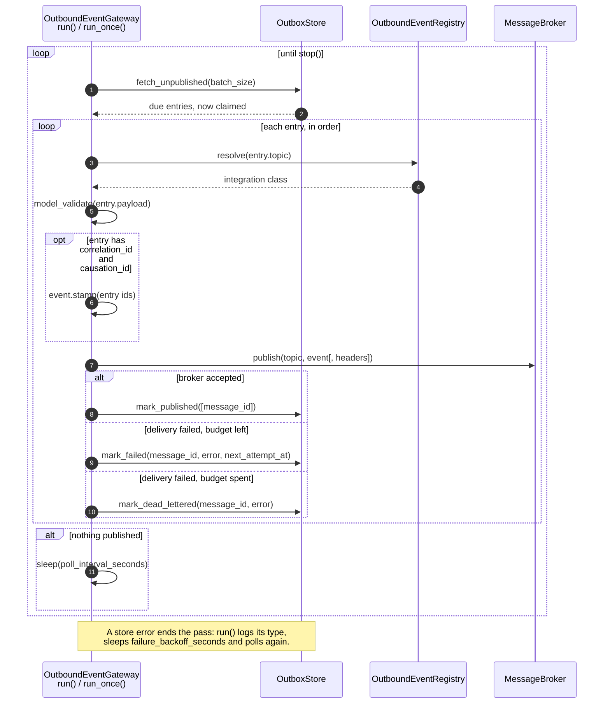

# 6. Runtime View

This section documents the key runtime scenarios of the `pydomain` library — how building blocks interact at runtime to fulfil the main use cases. Each scenario is illustrated with an ASCII sequence diagram and a step-by-step walkthrough referencing the actual classes and methods involved.

---

## 6.1 Command Handling — Write Path

The primary write path: a command flows from the `MessageBus` through the `CommandBus`, pipeline behaviors, a handler, the `UnitOfWork`, and back out as domain events dispatched to registered event handlers.

### Sequence diagram

```
┌──────────┐   ┌────────────┐   ┌────────────┐   ┌───────────┐   ┌──────────┐   ┌──────────────┐
│  Client   │   │ MessageBus │   │ CommandBus │   │ Pipeline  │   │  UoW     │   │   Event      │
│           │   │            │   │            │   │ Behaviors │   │          │   │   Handlers   │
└─────┬─────┘   └─────┬──────┘   └─────┬──────┘   └─────┬─────┘   └────┬─────┘   └──────┬───────┘
      │               │                │                 │              │                │
      │ 1. dispatch(cmd)               │                 │              │                │
      ├──────────────►│                │                 │              │                │
      │               │                │                 │              │                │
      │               │ 2. isinstance(Command) == True   │              │                │
      │               │                │                 │              │                │
      │               │ 3. command_bus.dispatch(cmd)     │              │                │
      │               ├───────────────►│                 │              │                │
      │               │                │                 │              │                │
      │               │                │ 4. uow = uow_factory()        │                │
      │               │                ├───────────────────────────────►│                │
      │               │                │                 │              │                │
      │               │                │ 5. resolve tracing IDs         │                │
      │               │                │    (correlation_id, causation_id)              │
      │               │                │                 │              │                │
      │               │                │ 6. MessageContext(kind=COMMAND) │               │
      │               │                │                 │              │                │
      │               │                │ 7. async with uow:             │                │
      │               │                ├───────────────────────────────►│                │
      │               │                │                 │              │                │
      │               │                │ 8. pipeline.execute(ctx, cmd)  │               │
      │               │                ├───────────────►│               │                │
      │               │                │                 │              │                │
      │               │                │                 │ ┌────────────┴─────────────┐   │
      │               │                │                 │ │ 8a. Behavior chain:      │   │
      │               │                │                 │ │   LoggingBehavior        │   │
      │               │                │                 │ │     ValidationBehavior   │   │
      │               │                │                 │ │       IdempotencyBehavior│   │
      │               │                │                 │ │  AggregateLockingBehavior│   │
      │               │                │                 │ │           handler(cmd,uow)│  │
      │               │                │                 │ └────────────┬─────────────┘   │
      │               │                │                 │              │                │
      │               │                │                 │              │ 8b. handler:    │
      │               │                │                 │              │  uow.repo.get() │
      │               │                │                 │              │  agg.method()   │
      │               │                │                 │              │                │
      │               │                │ 9. uow.commit() │              │                │
      │               │                ├───────────────────────────────►│                │
      │               │                │                 │              │                │
      │               │                │                 │              │ ┌──────────────┴┐
      │               │                │                 │              │ │ 9a. _flush()  │
      │               │                │                 │              │ │ 9b. _collect  │
      │               │                │                 │              │ │     _and_stamp│
      │               │                │                 │              │ │ 9c. _write_   │
      │               │                │                 │              │ │     outbox()  │
      │               │                │                 │              │ │ 9d. _commit() │
      │               │                │                 │              │ └──────────────┬┘
      │               │                │                 │              │                │
      │               │                │ 9e. leave async with: committed, no rollback,    │
      │               │                │     repositories drained                         │
      │               │                │                 │              │                │
      │               │                │ 10. (result, events)           │                │
      │               │◄───────────────┤                 │              │                │
      │               │                │                 │              │                │
      │               │ 11. dispatch_many(events)        │              │                │
      │               ├───────────────────────────────────────────────────────────────►│
      │               │                │                 │              │                │
      │               │                │                 │              │ 12. For each event:
      │               │                │                 │              │     for each handler:
      │               │                │                 │              │     pipeline.execute(ctx)
      │               │                │                 │              │     (fail independently)
      │               │                │                 │              │                │
      │  result       │                │                 │              │                │
      │◄──────────────┤                │                 │              │                │
      │               │                │                 │              │                │
```

### Walkthrough

| Step | Component | Action | Key code |
|------|-----------|--------|----------|
| 1 | Client | Calls `MessageBus.dispatch(cmd)` | `infrastructure/message_bus.py` |
| 2 | MessageBus | Detects `isinstance(cmd, Command)` → routes to CommandBus | `dispatch()` |
| 3 | CommandBus | Calls `command_bus.dispatch(cmd)` | `cqrs/command_bus.py` |
| 4 | CommandBus | Creates a new `UnitOfWork` from the registered factory | `uow = self._uow_factory()` |
| 5 | CommandBus | Resolves tracing IDs: `correlation_id` from command (or fallback to `command_id`); `causation_id` from command | `command_bus.py` |
| 6 | CommandBus | Creates `MessageContext(kind=COMMAND, uow=uow, ...)` | `cqrs/behaviors.py` — `MessageContext` |
| 7 | CommandBus | Enters `async with uow:` — scope-bound lifecycle | `cqrs/unit_of_work.py` |
| 8 | CommandBus | Calls `pipeline.execute(ctx, cmd)` | `cqrs/behaviors.py` — `MessagePipeline` |
| 8a | Pipeline | Runs behavior chain in onion order: `LoggingBehavior` → `ValidationBehavior` → `IdempotencyBehavior` → `AggregateLockingBehavior` → terminal handler | `behaviors.py` |
| 8b | Handler | Application-defined: loads aggregate via `uow.repo.get_by_id()`, calls a mutation method, aggregate records domain events internally | User code |
| 9 | CommandBus | Calls `uow.commit()` | `cqrs/unit_of_work.py` |
| 9a | UoW | `_flush()` — persists changes to storage | Overridable hook |
| 9b | UoW | `_collect_and_stamp()` — pulls events from all repos, stamps each with `correlation_id` / `causation_id` via `event.stamp()` | `unit_of_work.py` |
| 9c | UoW | `_write_outbox()` — writes events to outbox (if applicable) | Overridable hook |
| 9d | UoW | `_commit()` — commits the underlying transaction | Overridable hook |
| 9e | UoW | `__aexit__` sees a committed scope: no rollback, collected events kept; it drains the repositories so nothing staged after the commit lingers | `unit_of_work.py` |
| 10 | CommandBus | Returns `(result, events)` to MessageBus; `events` is a copy of the UoW's collected events | `command_bus.py` |
| 11 | MessageBus | Calls `EventBus.dispatch_many(events)` (ADR-062) | `message_bus.py` |
| 12 | EventBus | For each event, in order, and for each registered handler: creates a new `MessageContext(kind=EVENT, uow=None)` and runs the handler pipeline. **Handlers fail independently** — one handler's exception is logged and swallowed, remaining handlers continue | `EventBus._execute()` |

### Failure path

When a behavior, the handler or `commit()` raises, the bus does not call `rollback()` itself. The exception leaves the `async with uow` block, `__aexit__` rolls back once, and the bus wraps the failure outside the block (ADR-020, ADR-068):

```
┌────────────┐                    ┌──────────┐            ┌──────────────┐
│ CommandBus │                    │   UoW    │            │ Repositories │
└─────┬──────┘                    └────┬─────┘            └──────┬───────┘
      │ 8. pipeline.execute / 9. commit()                        │
      │    raises exc (failure = exc)  │                         │
      │                                │                         │
      │ leave async with: __aexit__(exc)                         │
      ├───────────────────────────────►│                         │
      │                                │ not committed:          │
      │                                │ rollback()              │
      │                                │   _rollback() (storage) │
      │                                │   finally: pull_events()│
      │                                │   on every repo, discard│
      │                                ├────────────────────────►│
      │                                │   clear collected events│
      │                                │   start a new scope     │
      │◄───────────────────────────────┤ exc propagates          │
      │   (or the rollback's own exception, context = exc)       │
      │                                │                         │
      │ raise CommandExecutionError(cmd) from failure            │
      │   __cause__ = exc, __context__ = rollback error if any,  │
      │   note "clean-up also failed: <type>" if it failed       │
      ▼                                                          │
```

### Failure modes

| Failure point | Behaviour |
|---------------|-----------|
| Handler or behavior raises | `__aexit__` calls `rollback()` once: every repository's event buffer is drained and discarded, so the events never reach this or any later commit, even through a shared repository → `CommandExecutionError` with the exception as `__cause__` |
| UoW commit fails | Not committed, so `__aexit__` rolls back once → `CommandExecutionError` with the commit's exception as `__cause__` |
| Rollback raises too | The drain and the scope reset still run. The caller still gets `CommandExecutionError`; `__cause__` is the original failure, `__context__` the rollback's exception, and a note names the rollback exception's type (never its message) |
| Handler calls `uow.commit()` itself | The bus's commit raises `UnitOfWorkAlreadyCommittedError` before any hook runs (nothing is written twice) → `CommandExecutionError` with it as `__cause__`. The handler's commit stays persisted; the scope committed, so no rollback, but its repositories are drained on exit. Its events are never dispatched in-process (the bus raises before it returns them); they reach consumers only through the outbox, if a writer is configured |
| Cancellation | `CancelledError` passes through `__aexit__`, which rolls back once; the bus does not wrap it |
| `__aexit__` suppresses the failure | The bus still raises `CommandExecutionError` with the failure as `__cause__` |
| Committed-exit drain raises after a successful commit | The exception propagates unwrapped and no events are returned; the commit persisted |
| `__aenter__` raises | Propagates unwrapped; the pipeline never runs |
| Event handler fails | Logged and swallowed — remaining handlers and other events continue unaffected |

---

## 6.2 Query Handling — Read Path

The read path: a query flows from the `MessageBus` through the `QueryBus` directly to a handler. No `UnitOfWork`, no side effects, no events.

### Sequence diagram

```
┌──────────┐   ┌────────────┐   ┌──────────┐   ┌───────────┐
│  Client   │   │ MessageBus │   │ QueryBus │   │  Handler  │
└─────┬─────┘   └─────┬──────┘   └────┬──────┘└─────┬──────┘
      │               │               │              │
      │ 1. dispatch(query)            │              │
      ├──────────────►│               │              │
      │               │               │              │
      │               │ 2. isinstance(Query) == True │
      │               │               │              │
      │               │ 3. query_bus.dispatch(query) │
      │               ├──────────────►│              │
      │               │               │              │
      │               │               │ 4. MessageContext(kind=QUERY, uow=None)
      │               │               │              │
      │               │               │ 5. pipeline.execute(ctx, query)
      │               │               ├──────────────┤
      │               │               │              │
      │               │               │              │ ┌──────────────────┐
      │               │               │              │ │ LoggingBehavior   │
      │               │               │              │ │   handler(query)  │
      │               │               │              │ │     (no uow arg)  │
      │               │               │              │ └──────────────────┘
      │               │               │              │
      │               │  result       │              │
      │               │◄──────────────┤              │
      │               │               │              │
      │  result       │               │              │
      │◄──────────────┤               │              │
      │               │               │              │
```

### Walkthrough

| Step | Component | Action | Key code |
|------|-----------|--------|----------|
| 1 | Client | Calls `MessageBus.dispatch(query)` | `infrastructure/message_bus.py` |
| 2 | MessageBus | Detects `isinstance(query, Query)` → routes to QueryBus | `dispatch()` |
| 3 | QueryBus | Looks up the registered pipeline for the query type | `cqrs/query_bus.py` |
| 4 | QueryBus | Creates `MessageContext(kind=QUERY, uow=None)` | `cqrs/behaviors.py` |
| 5 | QueryBus | Calls `pipeline.execute(ctx, query)` | `behaviors.py` |
| 5a | Pipeline | Runs behavior chain, then terminal handler with **single argument** (`query` only — no UoW passed for QUERY kind) | `MessagePipeline.execute()` |
| 6 | Handler | Returns typed `QueryResult` — may read from a read store, raw SQL, or any read-optimised source | User code |

### Key differences from command path

| Aspect | Command | Query |
|--------|---------|-------|
| UoW | Created per dispatch, committed on success | **Never created** (`uow=None`) |
| Terminal handler signature | `handler(cmd, uow)` | `handler(query)` |
| Side effects | Aggregate mutation + event publishing | **None** |
| Events | Collected and dispatched after commit | **No events** |
| Pipeline behaviors | Full chain (validation, idempotency, locking) | Logging only (typically) |

---

## 6.3 Event Replay — Aggregate Reconstitution

How an `EventSourcedAggregateRoot` is rebuilt from its persisted event stream. Covers snapshot-first hydration, upcasting, and the replay loop.

### Sequence diagram

```
┌──────────┐   ┌───────────────────┐   ┌───────────────┐   ┌────────────────┐   ┌──────────────┐
│  Repo    │   │ SnapshotStore     │   │  EventStore   │   │ Upcaster       │   │ EventSourced │
│  get_    │   │                   │   │               │   │ Registry       │   │ Aggregate    │
│  by_id() │   │                   │   │               │   │                │   │              │
└────┬─────┘   └────────┬──────────┘   └──────┬────────┘   └───────┬────────┘   └──────┬───────┘
     │                  │                     │                     │                   │
     │ 1. get_by_id(id) │                     │                     │                   │
     │                  │                     │                     │                   │
     │ 2. snapshot = store.get(type, id)      │                     │                   │
     ├─────────────────►│                     │                     │                   │
     │                  │                     │                     │                   │
     │ 3a. snapshot found and accepted by the │                     │                   │
     │     schema policy (no policy: always)? │                     │                   │
     │     YES ─────────┐                     │                     │                   │
     │                  │                     │                     │                   │
     │ 4. aggregate = cls.model_validate(     │                     │                   │
     │      state minus computed keys,        │                     │                   │
     │      id=id, version=snapshot.version)  │                     │                   │
     │    failure → SnapshotRestoreError      │                     │                   │
     │    (no fallback) │                     │                     │                   │
     │                  │                     │                     │                   │
     │ 5. stream = read_stream(id, from_version=snapshot.version)  │                   │
     ├─────────────────────────────────────────►│                    │                   │
     │                  │                     │                     │                   │
     │ 3b. no snapshot, or the policy rejects it                    │                   │
     │     fallback to full replay            │                     │                   │
     │                  │                     │                     │                   │
     │ 5'. stream = read_stream(id, from_version=0)                 │                   │
     ├─────────────────────────────────────────►│                    │                   │
     │                  │                     │                     │                   │
     │ 6. For each event in stream:           │                     │                   │
     │    (upcasting handled by EventRegistry │                     │                   │
     │     at deserialization time)           │                     │                   │
     │                  │                     │                     │                   │
     │                  │                     │                     │                   │
     │ 7. aggregate._replay(event)            │                     │                   │
     ├─────────────────────────────────────────────────────────────────────────────────►│
     │                  │                     │                     │                   │
     │                  │                     │                     │    ┌──────────────┴┐
     │                  │                     │                     │    │ 7a. _when(evt) │
     │                  │                     │                     │    │ 7b. version++  │
     │                  │                     │                     │    │ (no buffering) │
     │                  │                     │                     │    └──────────────┬┘
     │                  │                     │                     │                   │
     │ 8. return aggregate                    │                     │                   │
     │                  │                     │                     │                   │
```

### Walkthrough

| Step | Component | Action | Key code |
|------|-----------|--------|----------|
| 1 | `EventSourcedRepository` | `get_by_id(id_)` is called | `es/event_sourced_repository.py` |
| 2 | Repository | Asks `SnapshotStore` for a snapshot of the aggregate | `store.get(aggregate_type, aggregate_id)` |
| 3a | Repository | If a snapshot is found and the `SnapshotSchemaPolicy` (when one is configured) accepts it: validates `snapshot.state` into the aggregate class with `model_validate`, after dropping computed keys and with the requested id; nested models are rebuilt, containers copied, the aggregate's validators and `model_post_init` run, private attributes start from their defaults, keys of removed fields are ignored; sets `version = snapshot.version` (ADR-075) | `get_by_id()` — `_restore()` |
| 3a′ | Repository | If the state no longer validates: raises `SnapshotRestoreError` with a value-free description; there is no fallback to full replay (ADR-075, B-55) | `_restore()` |
| 3b | Repository | If no snapshot, or the schema policy rejects it: falls through to full replay from version 0. With no policy every snapshot is used (ADR-053) | `get_by_id()` — fallback branch |
| 5 | Repository | Reads event stream from `EventStore`, starting at snapshot version (or 0) | `event_store.read_stream(id, from_version)` |
| 6 | `EventRegistry` | During deserialization, `UpcasterRegistry.resolve(type, version)` chains transforms to migrate old events to current schema; the chain must end at the class's version (else `UpcastError`), which is written to `event_version`; a newer stored version is validated unchanged (ADR-069) | `infrastructure/event_registry.py` — `deserialize()` |
| 7 | Repository | Calls `aggregate._replay(event)` for each event | `es/aggregate.py` |
| 7a | Aggregate | `_when(event)` dispatches by `isinstance` to mutate aggregate fields | Subclass implementation |
| 7b | Aggregate | Increments `self.version += 1` — **no event buffering** (unlike `_apply()`) | `_replay()` |
| 8 | Repository | Returns fully reconstituted aggregate | `get_by_id()` |

### Snapshot-first vs full replay

| Path | Starting point | Events replayed | Performance |
|------|---------------|-----------------|-------------|
| Snapshot-first | Aggregate validated from the snapshot state, at its version | Only events after snapshot | Fast — skips historical events; equals a full replay (ADR-075) |
| Full replay | Empty aggregate, version 0 | All events in stream | Slower — grows with stream length |

### `_apply()` vs `_replay()` distinction

| Method | Mutates state | Buffers event | Increments version |
|--------|:------------:|:-------------:|:-----------------:|
| `_apply(event)` | ✅ `_when()` | ✅ `_add_event()` | ✅ |
| `_replay(event)` | ✅ `_when()` | ❌ | ✅ |

---

## 6.4 Saga Orchestration — Event-Driven Choreography

How an incoming domain event triggers saga creation or continuation, produces commands, and handles failures with compensation.

### Sequence diagram

```
┌──────────┐   ┌──────────────┐   ┌──────────────┐   ┌──────────┐   ┌──────────┐   ┌──────────┐
│ MessageBus│  │ SagaManager  │   │ SagaRegistry │   │ SagaRepo │   │   Saga   │   │Dispatcher│
└─────┬─────┘   └──────┬───────┘   └──────┬───────┘   └────┬─────┘   └────┬─────┘   └────┬─────┘
      │                │                  │                │              │              │
      │ 1. event arrives (from UoW commit)│                │              │              │
      │                │                  │                │              │              │
      │ 2. saga_mgr.handle(event)         │                │              │              │
      ├───────────────►│                  │                │              │              │
      │                │                  │                │              │              │
      │                │ 3. registry.get_sagas_for_event() │              │              │
      │                ├─────────────────►│                │              │              │
      │                │                  │                │              │              │
      │                │ 4. saga_classes[] │                │              │              │
      │                │◄─────────────────┤                │              │              │
      │                │                  │                │              │              │
      │                │ 5. For each saga_class:           │              │              │
      │                │                  │                │              │              │
      │                │ 6. repo.find_by_correlation_id()  │              │              │
      │                ├──────────────────────────────────►│              │              │
      │                │                  │                │              │              │
      │                │ 7. state (existing or new)        │              │              │
      │                │◄──────────────────────────────────┤              │              │
      │                │                  │                │              │              │
      │                │ 8. saga = saga_class(state)       │              │              │
      │                │                  │                │              │              │
      │                │ 9. saga.handle(event)             │              │              │
      │                ├─────────────────────────────────────────────────►│              │
      │                │                  │                │              │              │
      │                │                  │                │              │ ┌────────────┴─┐
      │                │                  │                │              │ │ 9a. Skip if  │
      │                │                  │                │              │ │ terminal or  │
      │                │                  │                │              │ │ duplicate    │
      │                │                  │                │              │ │ 9b. _handle_ │
      │                │                  │                │              │ │   event() →  │
      │                │                  │                │              │ │   registered │
      │                │                  │                │              │ │   handler    │
      │                │                  │                │              │ │ 9c. dispatch │
      │                │                  │                │              │ │   commands   │
      │                │                  │                │              │ │ 9d. push     │
      │                │                  │                │              │ │   compensa-  │
      │                │                  │                │              │ │   tions      │
      │                │                  │                │              │ └──────────────┘
      │                │                  │                │              │
      │                │ 10. commands = saga.collect_commands()           │              │
      │                │◄────────────────────────────────────────────────┤              │
      │                │                  │                │              │
      │                │ 11. _trace_commands (propagate correlation/causation IDs)      │
      │                │                  │                │              │
      │                │ 12. Save pending commands (recovery checkpoint) │              │
      │                ├──────────────────────────────────►│              │              │
      │                │                  │                │              │
      │                │ 13. Dispatch commands one-by-one  │              │              │
      │                │     (save state after each)       │              │              │
      │                ├─────────────────────────────────────────────────────────────────►│
      │                │                  │                │              │              │
      │                │ 14. Clear pending, save final state│              │              │
      │                ├──────────────────────────────────►│              │              │
      │                │                  │                │              │
```

### Compensation path (`fail()` or handler failure)

A step that fails deliberately (`fail=True`, or `self.dispatch(cmd)` then `await self.fail(...)`, also in
`on_timeout()`) and a handler that raises both reach `execute_compensations()` when the saga has
compensations. The forward commands queued before it are set aside, not discarded, and sent first
(ADR-077); when a handler or `on_timeout()` raised, its commands are dropped instead. Without compensations
`fail()` goes straight to `FAILED`, and a raising handler's queued commands still go out on the forward
path (SAGA-12, W2-5).

```mermaid
sequenceDiagram
    participant M as SagaManager
    participant S as Saga
    participant D as Dispatcher (MessageBus)
    participant R as SagaRepository

    M->>S: handle(event)
    alt fail=True step, or dispatch() then fail()
        S->>S: dispatch(forward command)
        S->>S: fail(reason, compensate=True)
    else handler raises
        S-->>M: exception
        M->>S: fail(type name, compensate=True)
        Note over M: commands queued before the raise are dropped<br/>(when compensation runs)
    end
    S->>S: execute_compensations(): status COMPENSATING,<br/>set the queued forward commands aside,<br/>pop compensation_stack (LIFO) into dispatch()
    M->>S: collect_commands_before_compensation()
    M->>S: collect_commands()
    loop forward commands (causation = step's event id; saga id on the timeout path)
        M->>D: dispatch(command)
        alt fails
            M->>M: record in failed_compensations (cause's type only)
        end
    end
    loop compensations, LIFO (causation = saga id)
        M->>D: dispatch(command)
        alt fails
            M->>M: record in failed_compensations (type only)
        end
    end
    alt failed_compensations empty
        M->>M: status = COMPENSATED
    else
        M->>M: status = FAILED
    end
    M->>R: save(state)
```

Every command goes through the dispatcher on its own, so one failure does not stop the others. A failed
forward command counts like a failed compensation: the saga ends `FAILED`. The forward commands are not
checkpointed in `pending_commands`; checkpointing the compensation path is W2-5 (SAGA-09, SAGA-12).

### Recovery path

`recover_pending_sagas(limit)` takes the stalled sagas from `find_stalled_sagas` (pending commands, or
`COMPENSATING`) and recovers each in its own `try`:

| Saga | Recovery | Reported as not recovered |
|------|----------|---------------------------|
| `COMPENSATING` | `execute_compensations()` for what is left on the stack, then always the compensation path above: `COMPENSATED`, or `FAILED` when `failed_compensations` holds anything (an unhydratable compensation, or a failure before the crash) | if it ends `FAILED` |
| Pending commands, all dispatched | `pending_commands` cleared, `retry_count` reset; a suspension recovery marked ends (the saga runs again) | no |
| `retry_count > max_retries` | fail with compensation | if a compensation failed (B-99) |
| Undispatched commands | `retry_count += 1` and save, then re-dispatch each in order; success clears `pending_commands`, resets `retry_count` and ends a suspension recovery marked (the saga runs again, `RUNNING`) | if a dispatch fails |
| An undispatched command that cannot be hydrated | recovery stops there: it and the commands after it stay pending, the ones before it were sent; a saga that was not suspended is suspended with `Could not hydrate <CommandType>` and the entry is marked `"suspended_by_recovery": True`; one already suspended keeps its reason and `timeout_at`, and only a marked suspension has its reason updated | yes |
| Saga type not registered | skipped | yes |

A failure is logged at ERROR with the saga id and the exception's type, and recovery continues with the
next saga; the call returns the ids it did not recover (ADR-077).

### Walkthrough

| Step | Component | Action | Key code |
|------|-----------|--------|----------|
| 1 | EventBus | Event dispatched by `MessageBus` through `EventBus.dispatch_many()` after the UoW commit | `message_bus.py`, `event_bus.py` |
| 2 | MessageBus | `SagaManager.handle(event)` called (registered as event handler via `bind_to()`) | `saga/manager.py` |
| 3 | SagaManager | Looks up saga classes registered for this event type via `SagaRegistry` | `registry.get_sagas_for_event()` |
| 5 | SagaManager | Iterates over each matching saga class | `_process_saga()` |
| 6 | SagaManager | Loads existing `SagaState` by `correlation_id`, or creates initial state | `repository.find_by_correlation_id()` |
| 7 | SagaManager | If terminal state → skip; if suspended → resume | State machine guard |
| 8 | SagaManager | Instantiates saga with loaded state | `saga_class(state)` |
| 9 | Saga | `saga.handle(event)` — idempotent (skips already-processed events) | `saga/saga.py` |
| 9a | Saga | Skips if terminal or duplicate event | `is_terminal`, `is_event_processed()` |
| 9b | Saga | Dispatches to `_when_{EventType}` handler or user-registered handler | `_handle_event()` |
| 9c | Saga | Handler queues commands via `self.dispatch(cmd)` | `dispatch()` |
| 9d | Saga | If compensation declared via `on()`, pushes onto `compensation_stack` | `add_compensation()` |
| 10 | SagaManager | Collects queued commands from saga | `saga.collect_commands()` |
| 11 | SagaManager | Propagates tracing IDs onto commands: `correlation_id` from state, `causation_id` = the handled event's `event_id` (the saga id for commands from `on_timeout()` and for compensations) | `_trace_command()` |
| 12 | SagaManager | Serializes and saves pending commands as recovery checkpoint | `repository.save(state)` |
| 13 | SagaManager | Dispatches commands **one-by-one**, marking each as dispatched and saving after each | `_dispatch_and_persist_commands()` |
| 14 | SagaManager | Clears `pending_commands`, saves final state | `state.pending_commands.clear()` |

### Saga state machine

```
                  ┌─────────────┐
                  │   PENDING   │  ← Initial state
                  └──────┬──────┘
                         │ first event handled
                         ▼
                  ┌─────────────┐
            ┌────►│   RUNNING   │◄───┐
            │     └──────┬──────┘    │
            │            │           │
            │   suspend()│           │ resume()
            │            ▼           │
            │     ┌─────────────┐    │
            │     │  SUSPENDED  │────┘
            │     └─────────────┘
            │
            │            │ fail()
            │            ▼
            │     ┌──────────────┐
            │     │ COMPENSATING │  ← executing compensations (LIFO)
            │     └──────┬───────┘
            │            │
            │     ┌──────┴──────┐
            │     ▼             ▼
            │  ┌───────────┐ ┌────────┐
            │  │COMPENSATED│ │ FAILED │  ← compensation errors
            │  └───────────┘ └────────┘
            │
            │            │ complete()
            │            ▼
            │     ┌───────────┐
            └─────│ COMPLETED │  ← normal end
                  └───────────┘
```

---

## 6.5 Subscription Catch-Up — Projections from Global Log

How the `SubscriptionRunner` polls the global event log, filters events by type, delivers them to projections, and tracks progress via checkpoints.

### Sequence diagram

```
┌───────────────────┐   ┌──────────────┐   ┌────────────────┐   ┌────────────────────┐   ┌───────────────┐
│ SubscriptionRunner │   │ Checkpoint   │   │  EventStore    │   │ Subscription       │   │  Projection   │
│ run() / run_once() │   │ Store        │   │                │   │ (id + event_types) │   │               │
└─────────┬──────────┘   └──────┬───────┘   └───────┬────────┘   └──────────┬─────────┘   └───────┬───────┘
          │                     │                    │                       │                      │
          │  ┌────────────────────────────────────────────────────┐         │                      │
          │  │ Polling loop (until stop() called)                 │         │                      │
          │  └────────────────────────────────────────────────────┘         │                      │
          │                     │                    │                       │                      │
          │ 1. _process_cycle() │                    │                       │                      │
          │                     │                    │                       │                      │
          │ 2. Load checkpoints │                    │                       │                      │
          │     for each sub    │                    │                       │                      │
          ├────────────────────►│                    │                       │                      │
          │                     │                    │                       │                      │
          │ 3. min_checkpoint = │                    │                       │                      │
          │     min(all)        │                    │                       │                      │
          │                     │                    │                       │                      │
          │ 4. stream = read_all(from_version=min)   │                       │                      │
          ├─────────────────────────────────────────►│                       │                      │
          │                     │                    │                       │                      │
          │ 5. For each subscription:                │                       │                      │
          │     (shared stream, independent dispatch) │                      │                      │
          │                     │                    │                       │                      │
          │ 6. Slice stream from sub's checkpoint    │                       │                      │
          │                     │                    │                       │                      │
          │ 7. Filter by isinstance(event, sub.event_types)                 │                      │
          │                     │                    │                       │                      │
          │ 8. process_batch(matching_events, sub)   │                       │                      │
          ├─────────────────────────────────────────────────────────────────►│                      │
          │                     │                    │                       │                      │
          │                     │                    │                       │ 9. projection.handle(event)
          │                     │                    │                       ├─────────────────────►│
          │                     │                    │                       │                      │
          │                     │                    │                       │    ┌─────────────────┴┐
          │                     │                    │                       │    │ _when_{EventType} │
          │                     │                    │                       │    │ checkpoint++      │
          │                     │                    │                       │    └──────────────────┘
          │                     │                    │                       │                      │
          │ 10. Save checkpoint │                    │                       │                      │
          │     (on success)    │                    │                       │                      │
          ├────────────────────►│                    │                       │                      │
          │                     │                    │                       │                      │
          │                     │                    │                       │                      │
          │ 10'. On failure:    │                    │                       │                      │
          │      log warning    │                    │                       │                      │
          │      backoff sleep  │                    │                       │                      │
          │      do NOT save    │                    │                       │                      │
          │      checkpoint     │                    │                       │                      │
          │      (will retry)   │                    │                       │                      │
          │                     │                    │                       │                      │
          │ 11. No events?      │                    │                       │                      │
          │      sleep(poll_    │                    │                       │                      │
          │      interval)      │                    │                       │                      │
          │                     │                    │                       │                      │
```

### Walkthrough

| Step | Component | Action | Key code |
|------|-----------|--------|----------|
| 1 | `SubscriptionRunner` | Polling loop calls `_process_cycle()` | `infrastructure/subscription.py` |
| 2 | Runner | Loads checkpoint for each registered subscription | `checkpoint_store.load(sub_id)` |
| 3 | Runner | Computes `min_checkpoint` from all subscriptions | `min(checkpoints.values())` |
| 4 | Runner | **Single DB read** from global event log starting at `min_checkpoint` | `event_store.read_all(from_version=min)` |
| 5 | Runner | Iterates each subscription independently from the shared stream | `_dispatch_to_subscription()` |
| 6 | Runner | Slices `stream.events[offset:]` from subscription's checkpoint | `offset = sub_checkpoint - stream_start` |
| 7 | Runner | Filters events by `isinstance(event, sub.event_types)` | List comprehension |
| 8 | Runner | Calls abstract `process_batch(matching, subscription)` | Subclass implementation |
| 9 | Projection | `projection.handle(event)` dispatches to `_when_{EventType}` method by convention | `es/projection.py` |
| 10 | Runner | On success: saves checkpoint to `CheckpointStore` | `checkpoint_store.save(sub_id, stream.version)` |
| 10' | Runner | On failure: logs warning, sleeps `failure_backoff_seconds`, **does not save checkpoint** → at-least-once guarantee | Exception handler in `_dispatch_to_subscription()` |
| 11 | Runner | If no new events in global log: sleeps `poll_interval_seconds` before next cycle | `run()` |

### Key properties

| Property | Implementation |
|----------|---------------|
| **At-least-once** | Checkpoint only updated after successful `process_batch()`. Failed batches are retried on next poll. |
| **Single DB read** | All subscriptions share one `read_all()` call. Each subscription slices and filters independently. |
| **Independent progress** | Each subscription tracks its own checkpoint. A slow subscription does not block others. |
| **Failure isolation** | One subscription's failure does not prevent others from advancing. Backoff + retry for the failing one. |
| **Graceful stop** | `stop()` sets a flag; current batch completes before the polling loop exits. |

---

## 6.6 Outbound Delivery — Outbox Relay

How the `OutboundEventGateway` drains the transactional outbox (§8.7): it claims a batch, rehydrates each entry, applies the entry's tracing, publishes, and marks that entry before it delivers the next one (ADR-063, ADR-065, ADR-074).

### Sequence diagram



### Walkthrough

| Step | Component | Action | Key code |
|------|-----------|--------|----------|
| 1–2 | `OutboxStore` | Returns up to `batch_size` due entries, oldest first, and claims them: no later fetch returns them until they are marked or the claim goes stale. `limit` below `1` raises `ValueError` | `fetch_unpublished()` |
| 3–5 | `OutboundEventGateway` | Resolves the class from the topic and validates the stored payload; an unknown topic, or a payload whose validation raises anything, is a delivery failure | `_deliver()` |
| 6 | `OutboundEventGateway` | Stamps the entry's `correlation_id` and `causation_id` (the domain event's `event_id`) over any the translator set; skipped when the entry has none | `_deliver()` |
| 7 | `MessageBroker` | Receives the event; `headers={"correlation_id", "causation_id"}` only when the relay stamped it | `publish()` |
| 8 | `OutboxStore` | Marks this entry published before the next one is delivered | `run_once()` |
| 9–10 | `OutboxStore` | Records a failure with capped exponential backoff, which releases the claim, or dead-letters the entry once `max_attempts` is spent | `run_once()`, `_next_attempt_at()` |
| 11 | `OutboundEventGateway` | Sleeps only after a pass that published nothing | `run()` |

### Failure modes

| Failure | Effect | Recovery |
|---------|--------|----------|
| Broker error, unknown topic, invalid payload | `mark_failed`, the rest of the batch continues | Retried after backoff until the budget is spent |
| `mark_*` or `fetch_unpublished` raises | The pass ends; entries already marked stay published | `run()` backs off; the batch's undelivered entries stay claimed until the claim goes stale |
| Cancellation or crash after a publish, before its mark | That one entry is published again later | At-least-once: consumers deduplicate on `message_id` |
| Relay crashes after a fetch | Its claims block the entries | Fetched again once the claim goes stale |
| A publish outlasts its claim | Another relay may deliver the entry again (at-least-once) | A later failure from the first relay does not undo the publication: marks after `mark_published` are no-ops, and a `mark_published` after a dead letter clears it |
| `stop()` | Stops the current run and waits for its in-flight pass; also stops a relay started a moment earlier. A `start()` meanwhile starts a fresh relay | — |
| `publish()` never returns | `stop()` waits with it | Known gap (ADR-074): give the broker adapter a timeout |

---

## Cross-Scenario Reference

The table below maps each runtime scenario to the building blocks (§5) involved:

| Scenario | Primary building blocks | Supporting blocks |
|----------|------------------------|-------------------|
| **Command handling** | `MessageBus`, `CommandBus`, `UnitOfWork`, `MessagePipeline` | `AggregateRoot`, `Repository`, `DomainEvent`, pipeline behaviors |
| **Query handling** | `MessageBus`, `QueryBus`, `MessagePipeline` | `Query`, `QueryResult` |
| **Event replay** | `EventSourcedRepository`, `EventSourcedAggregateRoot`, `EventStore` | `SnapshotStore`, `UpcasterRegistry`, `EventRegistry` |
| **Saga orchestration** | `SagaManager`, `Saga`, `SagaState`, `SagaRegistry` | `SagaRepository`, `CommandBus`, `DomainEvent` |
| **Subscription catch-up** | `SubscriptionRunner`, `Subscription`, `CheckpointStore` | `EventStore`, `EventSourcedProjection` |
| **Outbound delivery** | `OutboundEventGateway`, `OutboxStore`, `OutboundEventRegistry` | `MessageBroker`, `IntegrationEvent`, `OutboxWriter` |
