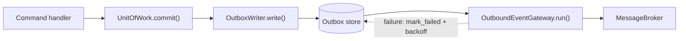

# OutboundEventGateway

> **Adoption Level:** 5 — Durable Outbound Delivery
> **Module:** `pydomain.cqrs.outbox` · `pydomain.infrastructure.message_broker`

## What is the OutboundEventGateway?

The **OutboundEventGateway** delivers integration events that were persisted *before* delivery was attempted. It is the outbound counterpart to [`InboundEventGateway`](inbound-event-gateway.md): where the inbound gateway turns broker messages into domain events, the outbox path turns domain events into durable outbound messages.

It is one half of a pair. [`OutboxWriter`](#the-classes) writes integration events into an outbox in the same transaction as the aggregate change; the gateway drains that outbox and publishes what it finds.



## Why It Exists

Before this mechanism, the only way to publish an integration event was to write a domain event handler that constructed one and called [`MessageBroker`](message-broker.md)`.publish()`. That path has three defects:

1. **It runs after commit**, outside the transaction. A crash between commit and publish loses the message permanently.
2. **`EventBus` swallows handler exceptions** ([ADR-046](../../../adr/ADR-046-event-handlers-fail-independently.md)). A broker outage would be logged and the message silently dropped — a *successful* command with a lost event.
3. **A broker outage becomes a write outage** if you publish inside `commit()` instead, because the commit now depends on the broker being reachable.

The outbox removes all three: the event is durable before delivery is attempted, delivery is retried until it succeeds, and the transaction never depends on the broker.

## How It Works

**Write path — inside the transaction.** During `commit()`, after domain events are collected and stamped, `_write_outbox()` translates them into outbox entries and appends them. [`AbstractUnitOfWork`](../cqrs/unit-of-work.md) implements this for you: pass an [`OutboxWriter`](#the-classes) to the constructor and no override is needed.

```python
class AppUnitOfWork(AbstractUnitOfWork):
    def __init__(self, session: AsyncSession, writer: OutboxWriter) -> None:
        super().__init__(outbox_writer=writer)
        self._session = session
        self._repos = {"orders": OrderRepository(session)}
```

The entries commit atomically with the aggregate state. Either both are persisted, or neither is.

**Delivery path — outside the transaction.** `OutboundEventGateway.run()` polls the outbox. A fetch **claims** the entries it returns, so a second relay, or a later fetch, does not get them again until they are marked or the claim goes stale. For each fetched entry the gateway resolves the integration class from the entry's `topic`, rehydrates the stored payload with `model_validate()`, stamps it with the entry's tracing IDs, publishes, and marks that entry published before it delivers the next one. Only a successful publish marks an entry delivered ([ADR-074](../../../adr/ADR-074-outbox-relay-and-registry-honour-their-contracts.md)).

**Tracing.** The entry carries the domain event's `correlation_id` and, as `causation_id`, the domain event's own `event_id`. When both are set, the gateway stamps them onto the integration event, replacing any IDs the translator set, and passes them to the broker as `headers={"correlation_id": ..., "causation_id": ...}`. An entry written from an unstamped domain event has neither: the relay does not stamp the event and passes no headers, so any IDs the translator set stay. See [Tracing](tracing.md).

The gateway is domain-ignorant: it knows topics and `IntegrationEvent` classes, never domain types.

## The Classes

| Class | Role |
|---|---|
| [`OutboxEntry`](#) | Frozen record of one integration event awaiting publication: `message_id`, `topic`, `payload`, `event_version`, `attempts`, `occurred_at`, and tracing IDs. `payload` is left out of `repr()` and `str()` |
| `OutboxStore` | Protocol for persisting the outbox — `append`, `fetch_unpublished`, `mark_published`, `mark_failed`, `mark_dead_lettered`. A fetch claims what it returns; `limit` must be at least `1` |
| `OutboundEventRegistry` | Maps domain event types to an `IntegrationEvent` class, a topic, and a **pure** translator. A topic resolves to one class; the translator must return exactly that class |
| `OutboxWriter` | The write-side join. Translates collected domain events and appends the result |
| `OutboundEventGateway` | The delivery relay. Fetches, rehydrates, publishes, marks |

## Failure Handling

Every failure leaves the entry **unpublished** and requeues it with capped exponential backoff, until the entry's retry budget is spent — then it is **dead-lettered**.

| Failure mode | Behaviour | Recovery |
|---|---|---|
| Broker unavailable / confirm timeout | Log error (type only, no traceback), `mark_failed`, backoff | Retry until the budget is spent |
| Broker nack | Log error (type only, no traceback), `mark_failed`, backoff | Retry until the budget is spent |
| Unknown topic (no registration) | Log error, `mark_failed` | Retry until the budget is spent |
| Payload fails `model_validate` (any exception, not only `ValidationError`) | Log error, `mark_failed` | Retry until the budget is spent |
| Retry budget exhausted | `mark_dead_lettered` at `ERROR` level | Dead-lettered — replayable after a fix |

### What the relay writes down

Every stored `error` and every log line names the failure without the payload's values ([ADR-071](../../../adr/ADR-071-library-failure-paths-carry-no-payload-values.md)). A validation failure is described by the integration class, the failing field locations and Pydantic's error codes, for example `Payload validation failed: ValidationError: 1 error for OrderPlacedIntegration at total (int_parsing)`. A broker or store exception is described by its type name alone (`Broker publish failed: ConnectionError`), because an adapter's message may quote the message body, and the relay logs it without a traceback. The outbox table therefore never holds a second copy of a payload's values in its error column, and deleting a row's payload removes them. The keys of a `dict` field and unknown keys can still appear in a location; see [Handle Sensitive Payloads](../../how-to/infrastructure/handle-sensitive-payloads.md).

A failed **delivery** never blocks the rest of the batch. A **store** error (a fetch or a mark that raises) ends the pass: the error propagates from `run_once()`, `run()` logs it and backs off, and the entries of the batch not yet delivered stay claimed, so they are fetched again once their claim goes stale. Because each entry is marked as soon as it is published, such an error, or a cancellation, can duplicate at most the entry in flight. `stop()` drains the in-flight pass before returning — so `Application.shutdown()` can stop the relay before the broker with no publish left dangling — and also takes effect when called right after `start()`.

### Arguments the gateway refuses

The constructor raises `ValueError`, naming the argument, for a `batch_size` or `max_attempts` that is not an `int` (a `bool` included) or is below `1` (`max_attempts=None` is still allowed), a negative `base_delay` or `max_delay`, a `poll_interval_seconds` or `failure_backoff_seconds` that is negative or not finite, and a `max_delay` shorter than `base_delay`.

### Known gaps

Four lifecycle gaps are deferred to a later release ([ADR-074](../../../adr/ADR-074-outbox-relay-and-registry-honour-their-contracts.md)): a broker `publish()` that never returns blocks `stop()`, because `stop()` waits for the in-flight pass; after the background task has died, `start()` does nothing until `stop()` has been called; a `stop()` made before a task you created yourself for `run()` has begun is lost; and after `start()`, a task created for `run()` makes `stop()` wait forever, so use one or the other, never both. Give your broker adapter its own publish timeout, and prefer `start()` to your own `run()` task. With stale claims, an entry's attempts can exceed `max_attempts` by one for each relay that took it over (B-80). A `start()` made while a `stop()` is still draining starts a fresh relay.

### The retry budget

`OutboundEventGateway` takes `max_attempts` (default `10`). An entry that fails that many deliveries is dead-lettered: it stops being fetched, is never reported as published, and remains visible for inspection and manual replay. `max_attempts=None` retries forever.

The budget is **uniform** — the relay does not decide which failures are worth retrying, because it cannot know. An unknown topic is usually recoverable by deploying the missing translation and a validation failure is usually terminal, but the exception type is a property of the broker adapter, not of the message's future deliverability. A single bounded budget gives every recoverable failure the full ten attempts to recover in, and still reaches a terminal state for rows that are genuinely broken.

The point of dead-lettering is that it stops a poison row from consuming a slot in every fetch forever. Without it, a permanently broken row competes with new rows for `batch_size` on every pass.

> **⚠️** Dead-lettering is an **operational obligation**, not an optimisation. A dead letter nobody watches is worse than a row that keeps retrying. Alert on the `ERROR` log, and know how to replay.

## Design Decisions

> **📌 ADR-063**: [Outbound Event Gateway and Transactional Outbox](../../../adr/ADR-063-outbound-event-gateway-and-outbox.md) — the outbox stores serialized *integration* events, and translation happens at **write** time so the stored row is the wire format.

> **📌 ADR-064**: [`OutboxWriter` — Library-Owned Write-Side Join by Composition](../../../adr/ADR-064-outbox-writer-composition.md) — the write-side join is a composable collaborator, not a `UnitOfWork` base class.

> **📌 ADR-065**: [Outbox Retry Policy and Dead-Letter Queue](../../../adr/ADR-065-outbox-retry-policy-and-dead-letter.md) — why the retry budget is bounded and uniform rather than classifying failures.

> **📌 ADR-074**: [The Outbox Relay and Registry Honour Their Contracts](../../../adr/ADR-074-outbox-relay-and-registry-honour-their-contracts.md) — per-entry marking, claims, argument checks, topic and translator-class checks, and tracing applied at delivery.

> **📌 ADR-001**: [Protocol over ABC for Interfaces](../../../adr/ADR-001-protocol-over-abc-for-interfaces.md) — why there is no `OutboxUnitOfWork` to inherit from.

Two decisions are worth understanding because they are easy to assume wrongly:

- **Translation happens at write time, not delivery time.** If the outbox stored domain events and the relay translated them, an already-stored row would be re-interpreted by whatever code runs at delivery — replay instability in an at-least-once queue. It would also require `EventRegistry`-based type resolution, which ADR-060 [rejects for gateways](../../../adr/ADR-060-inbound-event-gateway.md). Because translation happens at write time, the stored row *is* the wire format, and serialization needs no conversion layer: `IntegrationEvent` is primitives-only by validation ([ADR-022](../../../adr/ADR-022-integration-events-primitive-payloads.md)).
- **The relay is not an `EventBus` handler.** `EventBus` logs and swallows handler exceptions by design; a non-replayable side effect must not run under that policy, so the gateway is its own pump.

## Relationship to Other Concepts

- **[Unit of Work](../cqrs/unit-of-work.md)** — `_write_outbox()` is the seam. Pass an `OutboxWriter` to the constructor and it is wired for you; without one, nothing is written and the relay polls an empty outbox forever.
- **[Integration Events](../cqrs/integration-events.md)** — the payload type the outbox stores.
- **[MessageBroker](message-broker.md)** — transport. The gateway publishes through it and never replaces it.
- **`OutboundEventRegistry` vs `EventRegistry`** — different tools. `EventRegistry` resolves serialized *domain* events by type name and is for event stores and weak-schema migration. The outbound registry resolves *integration* events by **topic**, following the flat payload pattern.

## Common Pitfalls

> **⚠️ Constructing the UoW without a writer.** `_write_outbox()` is a no-op when no `OutboxWriter` was passed to `super().__init__()`, and nothing warns you — the gateway runs, finds an empty outbox, and reports healthy. Pass the writer, or override the hook. See the [how-to guide](../../how-to/infrastructure/configure-outbound-event-gateway.md).

> **⚠️ Impure translators.** Translators run *inside the database transaction*. Calling a downstream service to enrich an event holds the transaction open and can deadlock under load. Translation must be a pure function of the domain event.

> **⚠️ Two classes on one topic.** A topic resolves to one integration class at delivery. Registering a second domain type on a topic with a *different* class raises `ValueError` (`Topic 'orders.placed' still resolves to OrderPlacedIntegration, first bound by OrderPlaced; …`); give it its own topic, or translate it to the same class. A topic stays bound even after the domain type that bound it moves to another topic, because the rows it stored there still resolve to the original class. Re-registering the *same* domain type still overwrites (the version hot-swap of ADR-063), and then rows already stored on that topic are rehydrated as the new class, so the new class must accept them.

> **⚠️ A translator that returns another class.** `to_entry()` raises `TypeError` unless the translator returns exactly the registered class — a subclass too, because rehydrating it as the registered class would drop its extra fields. The error aborts the commit.

> **⚠️ Removing a translation registration while unpublished rows exist.** Those rows become undeliverable until the registration returns. Drain the outbox before deleting a registration.

> **⚠️ Treating delivery as exactly-once.** It is at-least-once. A crash between an entry's publish and its own `mark_published` produces a duplicate of that entry, and so does a claim that goes stale while its relay is still publishing: a publish that lasts longer than the claim timeout can be delivered twice. A published entry wins in either order: when the first relay's publish then fails, its `mark_failed` or `mark_dead_lettered` is a no-op, and when it succeeds after the other relay dead-lettered the entry, `mark_published` clears the dead letter. Consumers must deduplicate on `message_id` — `ProcessedMessageStore.check_and_set` is the intended mechanism.

> **⚠️ Assuming the gateway guarantees ordering.** It publishes in fetch order per pass, but no global ordering contract is expressed. Do not build cross-event ordering guarantees on it.

> **⚠️ Expecting the broker's message in the outbox.** The stored error and the relay's log carry the broker exception's type only. Log what you need inside the broker adapter, without the message body.

> **⚠️ Setting `max_attempts=None` without monitoring.** Retrying forever is a legitimate choice when a broker outage is expected to be long, but it restores the problem dead-lettering solves: a row that can never be delivered is fetched, fails, and is rescheduled on every pass, indefinitely, and nothing ever tells you.

## Next steps

- **[How to configure the outbound event gateway](../../how-to/infrastructure/configure-outbound-event-gateway.md)** — wiring, registration, and the `OutboxWriter`
- **[Integration Events](../cqrs/integration-events.md)** — the payload type
- **[Message Broker](message-broker.md)** — the transport the gateway publishes through
- **[Unit of Work](../cqrs/unit-of-work.md)** — where the write happens
