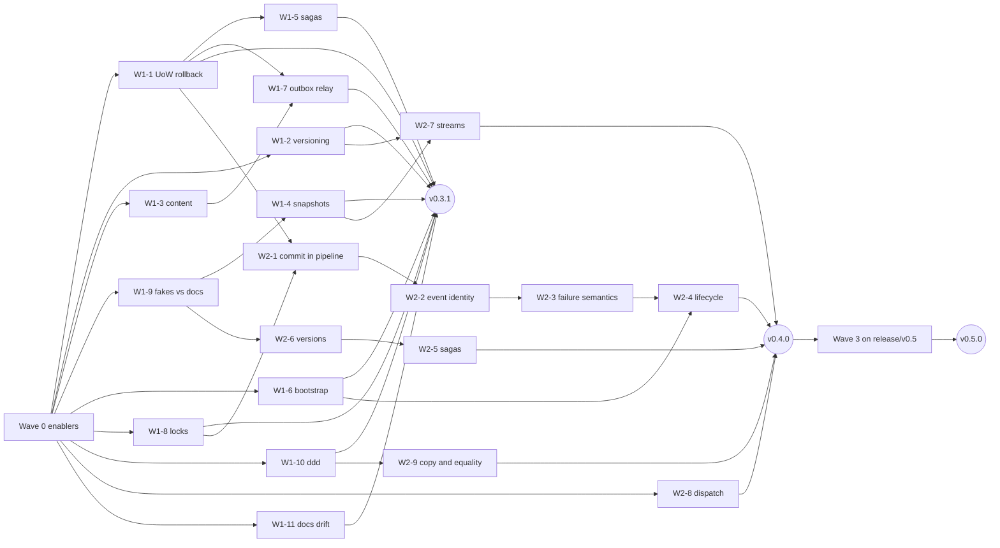

# Bug-Fix Plan for the 2026-10 Audit

| Item | Value |
|---|---|
| Date | 2026-10-21 |
| Input | [`bug-audit-findings.md`](bug-audit-findings.md) (134 verified rows), [`bug-audit-plan.md`](bug-audit-plan.md) (row IDs, severities, §12 ADR and docs findings) |
| Baseline | `dev` = `main` at `35acef5`, released as `v0.3.0` |
| Releases | `0.3.1` (fixes that restore a stated contract), `0.4.0` (fixes that need a design decision, additive APIs, deprecations), `0.5.0` (breaking, via `release/v0.5`) |
| Rules | Every fix is test-driven (§4), and ships with its ADR, arc42 and Diataxis changes (§5) |
| Status | Waves 0 and 1 shipped as `v0.3.1` (Epic DCE-105: Wave 0 is DCE-106 to DCE-115, Wave 1 is DCE-116 to DCE-128). Wave 2 (`0.4.0`, §9) is next |
| Reading this plan now | Sections 6 to 8, 11.1, 13 and 15 record how Waves 0 and 1 were planned; they are history, and what was decided lives in [`decision-log.md`](decision-log.md) and YouTrack. Section 9 (Wave 2), the clusters' owners in §9.1 and the open decisions in §14 are the live parts. The next free ADR number is ADR-079 |

## Table of Contents

1. [How pydomain is developed](#1-how-pydomain-is-developed)
2. [Problems in the process itself](#2-problems-in-the-process-itself)
3. [Principles for the fixes](#3-principles-for-the-fixes)
4. [Test-driven development protocol](#4-test-driven-development-protocol)
5. [Documentation protocol](#5-documentation-protocol)
6. [Release trains](#6-release-trains)
7. [Wave 0: enablers](#7-wave-0-enablers)
8. [Wave 1: 0.3.1, contract-restoring fixes](#8-wave-1-031-contract-restoring-fixes)
9. [Wave 2: 0.4.0, fixes that need a decision](#9-wave-2-040-fixes-that-need-a-decision)
10. [Wave 3: 0.5.0, breaking changes](#10-wave-3-050-breaking-changes)
11. [Workflow for one fix](#11-workflow-for-one-fix)
12. [YouTrack structure](#12-youtrack-structure)
13. [Order, dependencies and size](#13-order-dependencies-and-size)
14. [Decisions for the author](#14-decisions-for-the-author)
15. [First steps](#15-first-steps)

---

## 1. How pydomain is developed

This summarizes what the repository, its skills and its history say. The plan follows all of it.

| Area | Rule | Source |
|---|---|---|
| Branches | GitFlow: `feature/DCE-NN-*` from `dev`, squash-merged into `dev`; `dev` → `staging` → `main` by merge commit; `hotfix/*` from `main`; `release/v*` for breaking releases | `CLAUDE.md`, `commit_and_release_guide.md` §1–2 |
| Commits | `DCE-NN: <type>(<scope>): <description>`; `feat`, `fix` and `perf` reach the changelog, the rest are filtered out | `CLAUDE.md`, `publish.yml` |
| Breaking changes | Any `!:` or `BREAKING CHANGE:` commit is blocked from `dev`, `staging` and `main` unless the PR comes from `release/v*` | `block-breaking.yml`, guide §5, §9 |
| Releases | Push a `v*` tag on `main`. `publish.yml` builds, publishes to PyPI, writes the GitHub release from commit subjects, and opens sync-back PRs to `dev` and `staging` | guide §7, `publish.yml` |
| CI | ruff lint and format, mypy on `src`, pytest with coverage; Python 3.12 only at the audit (3.12–3.14 since DCE-107); installs with pip | `test.yml` |
| Tooling | pip, not uv. This was a deliberate change (`433c6d7`) | git history |
| ADRs | Immutable once Accepted. A changed decision gets a new ADR that supersedes or amends it. The `adr-writer` skill updates the ADR README and arc42 §9: the narrative 9.x, the mapping table, the reference table, and the "All N Decisions" count | `docs/adr/README.md`, `adr-writer` skill |
| arc42 | 12 sections in `docs/arch42/`. §9 mirrors the ADRs; §5 (building blocks), §6 (runtime, with sequence diagrams), §8 (concepts), §10 (quality and testing), §11 (risks) and §12 (glossary) describe behaviour | `docs/arch42/` |
| Diataxis | `docs/diataxis/`: `getting-started/`, `concepts/<module>/`, `how-to/<module>/`, `how-to/recipes/`, `how-to/testing/` (one page per fake). Written and linted with the `diataxis-writer` skill (`lint_docs.py --strict`) | repo, skills |
| Larger work | DRAFT documents in `design-docs/` (research → alignment → frame, with vertical phases and verification gates), then an ADR | `design-docs/01-outbound-event-gateway.*` |
| Issues | YouTrack `DCE`: Epic (one per Level, DCE-1 to DCE-5, all open) → Feature → Feature Task, each with Context, What to Do, and acceptance criteria. States go Open → Develop → Test → Review → Merged → Staging → Done, plus Rework | `youtrack-project` skill, DCE-90, DCE-103 |
| Testing | Fakes, not mocks; per-module test folders; anyio; ≥ 90 % branch coverage target (arc42 §10.4) | arc42 §4.6, §10.4 |

---

## 2. Problems in the process itself

Fix these in Wave 0, before any code changes.

| # | Problem | Evidence | Fix |
|---|---|---|---|
| P1 | The workflow steps ①–⑪ are referenced but not written down. The "State-Driven Workflow", "Repo-Wide Refactoring" and "Specialist Agent Assignments" sections in `CLAUDE.md` are empty headings | `CLAUDE.md`; `git-conventions` refers to steps ②, ⑧, ⑩, ⑪ | Write down §11 of this plan as the workflow |
| P2 | YouTrack has not been used since DCE-104 (May) | `git log`; DCE search | Use DCE again (§12) |
| P3 | The commit lint makes the `DCE-NN:` prefix optional, while `CLAUDE.md` requires it | `check-commit-msg.sh` | Decide D-P3 (§14) |
| P4 | The PR template's checklist asks for `feat(DCE-XX):`, which contradicts `DCE-NN: feat:`. It also has no TDD or documentation items | `PULL_REQUEST_TEMPLATE.md` | Replace the checklist with the definitions of done in §4.6 and §5.4 |
| P5 | `git-conventions` names a skill, `voltagent-dev-exp:git-workflow-manager`, that is not installed | `.claude/skills/` | Point it at plain `git` commands, or install the skill |
| P6 | `copilot-instructions.md` and arc42 §10.4 describe a test layout that does not match `tests/`: no `test_fakes.py`, two saga folders, different file names | `tests/`, arc42 §10.4 | Rewrite both from the real tree, with the TDD protocol (§4) |
| P7 | CI ran 3.12 only, though the classifiers claim 3.12–3.14 (PD48) | `test.yml` | Matrix before any fix (done: DCE-107) |
| P8 | The YouTrack timezone is `Europe/Moscow` in the skill and `Europe/Athens` in `CLAUDE.md` | both files | Align them |
| P9 | The release notes are built from commit subjects only, so a behaviour change has nowhere to explain its upgrade impact | `publish.yml` | An upgrade-notes how-to per release (§5.1) |
| P10 | The audit plan's phase 0 originally said "Makefile on uv", against the deliberate move to pip | `bug-audit-plan.md` §3 (since corrected) | Use pip and `make` |
| P11 | It is unclear whether the KB articles (`DCE-A-NN`) or `docs/diataxis/` are the maintained docs | history | Decide D-P11 |
| P12 | No code example in the docs is executed. 69 lines call attributes that don't exist (A26), and several how-tos teach a defect (A14, A15, A25, A27, A30, A33) | audit findings §8 | Test the docs examples (W0-6) |
| P13 | Nothing checks that a fake behaves like its Protocol, so the library's own tests pass against looser fakes | audit findings §2.1 | Contract suites (W0-5), used by every fake fix |

---

## 3. Principles for the fixes

1. **Test first, always** (§4). No production line changes before a test that fails because of the defect
   has been committed.
2. **Every fix ships with its documentation** (§5): an ADR, the arc42 sections it changes, the Diataxis
   pages that describe the behaviour, docstrings, and upgrade notes. A PR without them is not done.
3. **Sort each fix by what it needs:**
   - **Contract-restoring**: an ADR, docstring or doc page already states the right behaviour. Ships in
     `0.3.1`. The ADR records the fix and cites the decision it restores.
   - **Needs a decision**: a contract gap or an ADR conflict. The ADR comes first (Proposed, then
     Accepted), then the code, in `0.4.0`. Larger clusters get a DRAFT alignment and frame.
   - **Breaking**: changes a public type, exception or default. Use `!` commits on `release/v0.5`, after a
     deprecation warning in `0.4.0` where one is possible.
4. **One cluster per issue, one PR per Feature Task.** A cluster is a set of rows with one root cause.
   Don't mix waves in a PR.
5. **ADR text is never edited.** Errors in Accepted ADRs (A2, A4, A37, ADR-063's `UUID` types) are corrected
   in the superseding or amending ADR of the matching cluster, or in one "ADR errata" ADR.
6. **S1 first** within each wave; then S2; S3 only when the file is already open.
7. **Fakes before the library's tests are trusted.** Contract-restoring fake fixes go in Wave 1. Fake
   changes that alter what downstream test suites observe, such as copy-on-read, go in Wave 2 with an
   upgrade note.

---

## 4. Test-driven development protocol

### 4.1 The cycle

Every fix follows red → green → refactor. The commits show it, even though the PR is squash-merged.

| Step | What | Commit | CI must show |
|---|---|---|---|
| **0. Specify** | Write the acceptance criteria in the issue as test names with Given/When/Then, one per AUD row. Name the contract: ADR, docstring or doc page | — | — |
| **1. Red** | Write the tests. Mark each one `@pytest.mark.xfail(strict=True, raises=<expected failure>, reason="DCE-NN AUD-<id>")`. `raises=` makes it fail for the right reason: an `AssertionError` or the specific wrong exception, never an `ImportError` or a typo | `DCE-NN: test(<scope>): reproduce <defect>` | Not pushed on its own (P-32): run locally with `--runxfail`, each new test fails for its stated reason; pushed together with the green commit |
| **2. Green** | The smallest change that makes the tests pass; remove the `xfail` markers | `DCE-NN: fix(<scope>): <fix>` | Green, with the markers gone |
| **3. Refactor** | Only with every test green; no behaviour change | `DCE-NN: refactor(<scope>): …` (optional) | Green |
| **4. Harden** | Mutation testing on the changed functions (§4.4); add tests until no mutant survives without a written reason | `DCE-NN: test(<scope>): …` | Green; mutation report attached to the PR |

The PR keeps the individual commits on GitHub after the squash, so reviewer ⑨ can check out the red commit and run it. The PR body gives the local red run's summary.

### 4.2 Which tests a fix needs

Each fix includes every layer that applies to its defect:

| Layer | When | Example |
|---|---|---|
| **Regression example** | Always: the verification probe, rewritten as a test against the public API | A refused command's event never reaches the next commit (W1-1) |
| **Property test** (Hypothesis) | When an invariant exists | Serialize then deserialize is stable over random upcaster chains (W1-2); a snapshot plus its tail equals a full replay (W1-4) |
| **Stateful test** (`RuleBasedStateMachine`) | State machines and stores | Outbox and relay (W1-7); saga lifecycle (W2-5) |
| **Contract-suite case** | When a Protocol is involved; the case runs against every fake and every future adapter | "Two loads in separate UoWs conflict" in the Repository suite (W2-6) |
| **Failure injection** | Ordering, rollback, cancellation, concurrency defects | Cancel at each await of `commit()` (W2-1); a lock release that raises (W1-8) |
| **Content sentinel** | Anything that logs, stores errors or builds a `repr()` | W1-3 |
| **Typing test** (`mypy --strict`, `assert_type`) | Typing fixes | Typed `dispatch` (W2-11) |
| **Docs example test** | When a doc page taught the defect, or shows the fixed behaviour | `app.message_bus` (W1-6); the upcaster examples (W1-2) |

### 4.3 Rules for the tests

- **Assert the contract, not the implementation.** No asserts on private attributes (`_committed`,
  `_events`, `_store`). Observe through the public API, spies, or the contract suites.
- **Never weaken a test to make a fix pass.** A test that blessed the defect (TEST-03, e.g.
  `test_can_change_id`, the `test_exceptions.py` inheritance asserts) changes in the same PR as the fix. The
  PR states why, citing the AUD row.
- **One behaviour per test**, named after it: `test_rollback_drains_repository_event_buffers`.
- **Per-test fixtures.** No shared unit-of-work instance unless the test is about sharing.
- **Deterministic.** Concurrency tests force the interleaving with explicit yields or events, never with
  sleeps. Hypothesis tests set a profile, so CI runs are reproducible.
- **Synthetic data only**, in the style of the existing tests (orders, invoices, shipments).

### 4.4 Mutation testing

Run `mutmut` (dev dependency) on the modules a fix changed, limited to the changed functions where
possible. Each surviving mutant is either killed by a new test or listed in the PR with a reason (an
equivalent mutant, or dead code that the PR removes). The audit plan §4.8 baseline is recorded once in
Wave 0. After that, no PR may lower the score of a module it touches.

### 4.5 Coverage

Branch coverage of a changed file must not fall. The 90 % project target (arc42 §10.4) still applies.
Coverage alone proves nothing here: every defect in the audit sat on covered lines.

### 4.6 Test definition of done

- [ ] The acceptance criteria are in the issue as test names, one per AUD row.
- [ ] A red commit with `xfail(strict=True, raises=…)` precedes the fix commit, and its tests fail locally for their stated reasons (P-32).
- [ ] Every applicable layer in §4.2 is present.
- [ ] No test asserts private state; no existing test was weakened. Changed tests say why.
- [ ] Mutation report for the changed functions; survivors killed or justified.
- [ ] Branch coverage of changed files did not fall; `make check` and `make test` pass on 3.12–3.14.

---

## 5. Documentation protocol

### 5.1 What every fix updates

| Layer | Rule | Tool |
|---|---|---|
| **ADR** | One ADR per cluster, numbered from the next free number (ADR-067 was the first of Wave 1; ADR-079 is the first of Wave 2). It is **Proposed** when the issue moves to Develop and **Accepted** when the review approves, before the merge. A fix that changes an Accepted decision supersedes or amends it, with the three-part README update. A contract-restoring fix cites the ADR or doc it restores and records what was wrong. Each new ADR gets its own standalone section in the ADR README, as ADR-058 to ADR-065 do | `adr-writer` |
| **arc42 §9** | For every ADR: the narrative 9.x (when the decision is architectural, not procedural), the mapping table, the reference table, and the "All N Decisions" count | `adr-writer` |
| **arc42, other sections** | Each section whose description the fix changes, as listed per cluster: §5 for a contract or API, §6 for a runtime flow (update the Mermaid sequence diagram), §8 for a concept, §10 for testing and operational safety, §11 for a risk added or retired, §12 for a term, §7.5 for versioning and compatibility | `diagramming` for diagrams |
| **Diataxis** | The concept pages that explain the behaviour, every how-to and recipe whose example touches it, and the `how-to/testing/` page of any fake that changed. A page that taught the defect is fixed in the same PR | `diataxis-writer` |
| **Docstrings and README** | Every docstring that states the contract; the README if a level's description or a dependency claim changes | — |
| **Upgrade notes** | `how-to/upgrade/upgrade-to-<version>.md` (working name `upgrade-to-next-release.md` until the release is tagged), one per release, one entry per behaviour change: what changed, who is affected (code and tests), what to do | `diataxis-writer` |
| **Conventions** | `CLAUDE.md`, `copilot-instructions.md` and the PR template when a convention changes | — |
| **KB** | Only if D-P11 keeps the KB maintained | `youtrack-knowledge-base` |

### 5.2 Docs checks

- `lint_docs.py --strict` (from the `diataxis-writer` skill) passes.
- Links between ADRs, arc42 and Diataxis resolve.
- A search for the old behaviour's names finds nothing outdated, e.g. `app.message_bus` before W1-6, or
  `lambda: uow` after W1-1.
- The docs example tests (W0-6) pass for every page the PR touched.

### 5.3 Who writes what

The implementing agent writes the docs in the same PR. The second reviewer (§11 step ⑩) reviews the
architecture and the docs together: ADR reasoning, arc42 consistency with §9, and Diataxis accuracy against
the new tests.

### 5.4 Documentation definition of done

- [ ] ADR written (Proposed → Accepted), ADR README section and supersede/amend chain updated.
- [ ] arc42 §9 updated (narrative if architectural, mapping, reference, count).
- [ ] Each arc42 section listed for the cluster updated, diagrams included.
- [ ] Each Diataxis page listed for the cluster updated; pages that taught the defect fixed.
- [ ] Docstrings and README match the new behaviour.
- [ ] Upgrade-notes entry for any behaviour change.
- [ ] Docs lint, link check, stale-name search and docs example tests pass.

---

## 6. Release trains

| Release | Path | Contains | Gate |
|---|---|---|---|
| **0.3.1** | `feature/*` → `dev` → `staging` → `main`, tag `v0.3.1` | Wave 0 and Wave 1 | All Wave 1 Bugs Merged; both definitions of done met for each; upgrade notes for 0.3.1 complete |
| **0.4.0** | same path, tag `v0.4.0` | Wave 2: ADRs and their fixes, the fake semantics, additive APIs, deprecation warnings for Wave 3 | Each cluster's ADR Accepted before its code merges |
| **0.5.0** | `release/v0.5` from `main`, merge-commit PR to `main`, tag `v0.5.0`, resolve the sync-back PRs | Wave 3 | Deprecations shipped in a released 0.4.x |

**Decided 2026-10-21: Wave 2 code does not wait for `v0.3.1`.** It may merge into `dev` as soon as its ADR is
Accepted. Consequences:
- Whatever is on `dev` when a release is cut ships in it. If no Wave 2 code has merged yet, the release is
  `0.3.1`. Otherwise it is `0.4.0`, because Wave 2 adds APIs and changes documented behaviour.
- A patch with Wave 1 fixes only, after Wave 2 code has merged, goes through `hotfix/*` branches from `main`
  (guide §8), one PR per fix, followed by the sync-back PRs.
- Wave 3 is unchanged: `release/v0.5` only.

---

## 7. Wave 0: enablers

No behaviour changes. These are Tasks in YouTrack, merged into `dev`, shipped in `0.3.1` as `chore`, `ci`,
`test` and `docs` commits.

| ID | Task | Rows or problems |
|---|---|---|
| W0-1 | **Process docs.** Write down the workflow (§11) in `CLAUDE.md`. Replace the PR template checklist with §4.6 and §5.4. Fix the `git-conventions` reference and the timezone | P1, P4, P5, P8 |
| W0-2 | **CI matrix** 3.12, 3.13 and 3.14 in `test.yml` | P7, PD48 |
| W0-3 | **Test support.** Add `hypothesis` and `mutmut` to the `[dev]` extra, plus a `make mutate` target. Add `tests/support/` with a fault injector (raise or cancel at the Nth await), an ordering spy, the content sentinel and a leaked-task fixture. Add Hypothesis profiles. Commit the verification probes under `tests/support/probes/` as reference material, excluded from collection | audit plan §3 |
| W0-4 | **Mutation baseline** for the modules in audit plan §4.8, recorded in arc42 §10.4 | §4.4 |
| W0-5 | **Contract-suite skeletons** in `pydomain.testing.contracts`, one per Protocol, with the cases that pass today. Each fix adds its own cases (red first) | P13, PD49 |
| W0-6 | **Docs example tests.** A pytest collector that runs the fenced Python blocks of the Diataxis pages that are marked runnable, with shared setup per page. Start with the pages Wave 1 touches; mark the rest as they are fixed | P12 |
| W0-7 | **Testing docs.** Rewrite arc42 §10.4 (real tree, TDD protocol, contract suites, mutation testing), `concepts/testing/testing-philosophy.md`, `concepts/testing/test-structure.md` and the copilot testing conventions | P6, TEST rows |
| W0-8 | **Process ADR**: "Test-first fixes with docs in the same change", covering §4 and §5 (ADR-066) | — |
| W0-9 | **YouTrack**: the Epic, the Wave 1 Bugs and the Wave 2 Features (§12) | P2 |
| W0-10 | **Decisions** D-P3 and D-P11 (§14) and applying them | P3, P11 |
| W0-11 | **Upgrade-notes page** `how-to/upgrade/upgrade-to-next-release.md`, renamed to `upgrade-to-<version>.md` when the release is tagged, filled in as fixes land | P9 |

---

## 8. Wave 1: 0.3.1, contract-restoring fixes

One Bug issue and one PR per cluster, each following §4 and §5. "Contract" names what already promises the
fixed behaviour.

### W1-1 Unit of work: rollback and event buffers (S1)

- **Rows:** CQRS-K5, FAKE-03, ES-24, CQRS-06, CQRS-24, CQRS-08 (the aliasing part), FAKE-04.
- **Change:**
  - `rollback()` drains every repository's event buffer and becomes idempotent.
  - `__aexit__` rolls back whenever it has not committed.
  - `collect_events()` returns a copy.
  - `CommandBus` stops rolling back a second time.
  - `FakeUnitOfWork` resets on entry.
- **Code:** `cqrs/unit_of_work.py`, `cqrs/command_bus.py`, `testing/fake_unit_of_work.py`.
- **Contract:** `unit_of_work.py:31-32`; ADR-005; ADR-020.
- **Tests:** a refused command's event never reaches the next commit; one rollback per failure; a raising
  rollback keeps the `CommandExecutionError`; UnitOfWork contract suite cases.
- **ADR:** "Rollback drains event buffers and is idempotent" (cites ADR-005, ADR-020).
- **arc42:** §5.3.7 Unit of Work; §6.1 failure modes and the sequence diagram; §8.3 event collection;
  §10.6; §12 (UnitOfWork).
- **Diataxis:**
  - `concepts/cqrs/unit-of-work.md`, `concepts/cqrs/command-bus.md`;
  - `how-to/cqrs/configure-command-bus.md`, which stops teaching `lambda: uow` (A33);
  - `how-to/testing/use-fake-uow.md`;
  - `how-to/recipes/test-your-application.md`, `es-with-cqrs.md` and `all-modules.md` (shared
    repositories).

### W1-2 Event versioning on read (S1)

- **Rows:** INF-14, ES-15, ES-14.
- **Change:**
  - Set the final `event_version` after the upcaster chain.
  - Raise `UpcastError` when the final version is not the class's.
  - Catch `KeyError` only around `resolve()`.
  - `UpcasterRegistry.register` validates its input and refuses duplicates.
- **Code:** `infrastructure/event_registry.py`, `es/upcasting.py`.
- **Contract:** `implement-upcaster.md:109`; ADR-042.
- **Tests:** property "round trip is stable over random chains"; a gap raises; a validator's `KeyError` is
  not relabelled; the docs example upcasters run.
- **ADR:** amends ADR-042 (chain must reach the class version; registry validation) and notes ADR-044.
- **arc42:** §8.8 Event Versioning; §5.4 (upcasting); §11.2 Event Schema Evolution; §12.
- **Diataxis:** `concepts/es/event-versioning.md` (A30), `how-to/event-sourcing/implement-upcaster.md`,
  `concepts/infrastructure/event-registry.md`, `how-to/infrastructure/event-registry.md`.
- **Upgrade note:** payloads that silently passed with a stale shape now raise.

### W1-3 Content out of errors, logs and reprs (S1)

- **Rows:** INF-10, INF-15 (PD25, PD23).
- **Change:** one internal `_describe(exc)`, giving the type and field locations, never input values. Use it
  for the relay's stored errors and its log, inbound validation logging, saga hydration and
  `UpcastError`. Add `Field(repr=False)` on library-owned payload fields.
- **Code:** `infrastructure/message_broker.py`, `infrastructure/message_subscriber.py`,
  `cqrs/saga/hydration.py`, `es/upcasting.py`, `cqrs/outbox.py`, `infrastructure/event_registry.py`,
  `cqrs/saga/state.py`.
- **Tests:** the content sentinel appears in no log record, stored error or `repr()`, across every listed
  path.
- **ADR:** new, "Library-owned failure paths never carry payload values". It leaves ADR-046's handler
  tracebacks to W2-3.
- **arc42:** new §8.13 "Sensitive payloads"; §10.6; §11 new risk entry; §2 constraints, if it states the
  rule.
- **Diataxis:**
  - new how-to `how-to/infrastructure/handle-sensitive-payloads.md` (PD30);
  - `concepts/infrastructure/outbound-event-gateway.md`, `how-to/infrastructure/configure-outbound-event-gateway.md`;
  - `how-to/sagas/saga-state-hydration.md`.

### W1-4 Snapshot restore (S1)

- **Rows:** ES-08 (nested models, computed fields), ES-09, A24, A36.
- **Change:** restore with `model_validate`, which revalidates and copies; exclude computed fields from
  snapshots; `FakeSnapshotStore` stores copies.
- **Code:** `es/event_sourced_repository.py`, `es/aggregate.py`, `testing/fake_snapshot_store.py`,
  `es/snapshot.py`.
- **Tests:** property "snapshot + tail == full replay" with a nested-model aggregate; repeated loads are
  identical; SnapshotStore contract cases.
- **ADR:** amends ADR-043 and ADR-053 (how state is restored).
- **arc42:** §6.3 snapshot-first path and its diagram; §8.9 Snapshotting.
- **Diataxis:** `concepts/es/snapshots.md`, `how-to/event-sourcing/configure-snapshots.md`,
  `how-to/event-sourcing/handle-es-errors.md` (A24), `how-to/testing/use-fake-snapshot-store.md`.

### W1-5 Saga declarative and recovery fixes (S1)

- **Rows:** SAGA-01, SAGA-11a, SAGA-11b, SAGA-11c, SAGA-21, SAGA-19, FAKE-12, A29.
- **Change:**
  - `fail=True` sends its forward command.
  - Unhydratable commands stay recorded as failed.
  - `retry_count` goes up once per failure.
  - `max_retries=0` is consistent (D-11c).
  - Recovery continues past a failing saga.
  - The manager is typed with a dispatcher Protocol.
  - The fake drains events before it copies.
  - The stalled-saga contract includes COMPENSATING.
- **Code:** `cqrs/saga/saga.py`, `cqrs/saga/manager.py`, `cqrs/saga/repository.py`,
  `testing/fake_saga_repository.py`.
- **Contract:** ADR-055, ADR-035.
- **Tests:** what reaches the bus, per scenario of the probes; SagaRepository contract cases.
- **ADR:** amends ADR-055 (forward command order), ADR-035 (stalled sagas, hydration failures) and ADR-031
  (dispatcher Protocol).
- **arc42:** §5.3.9 Saga Subsystem; §6.4 compensation path and its diagram; §9.13 narrative (via the ADR);
  §12 glossary entry for stalled sagas (`12-glossary.md:527`).
- **Diataxis:**
  - `concepts/sagas/saga-manager.md`, `saga-repository.md` (A29), `saga-error-handling.md` and
    `declarative-vs-imperative.md`;
  - `how-to/sagas/configure-saga-manager.md`, `saga-error-handling.md` and `saga-state-hydration.md`;
  - `how-to/testing/use-fake-saga-repository.md`.

### W1-6 Bootstrap and `Application` wiring (S1)

- **Rows:** INF-16, INF-17, INF-06, INF-07, A26, A27.
- **Change:** `bootstrap()` raises on a gateway bus mismatch; `Application` gets read-only `message_bus`
  and `event_registry`; a partial start cleans up; shutdown isolates each stop.
- **Code:** `infrastructure/bootstrap.py`.
- **Tests:** a mismatch raises; partial-start and shutdown failure injection; docs example tests for every
  page that uses `app.message_bus`.
- **ADR:** amends ADR-047 (public accessors, wiring check, shutdown isolation).
- **arc42:** §3.2.3 `bootstrap()`; §5 infrastructure building blocks; §7.3 consumer-side wiring.
- **Diataxis:**
  - `concepts/infrastructure/bootstrap.md`;
  - `how-to/infrastructure/bootstrap-application.md`, `configure-inbound-event-gateway.md` (A27) and
    `register-handlers.md`;
  - the 15 pages with `app.message_bus` or `app.event_registry` (A26).

### W1-7 Outbox relay and outbox registry (S2)

- **Rows:** INF-09, INF-11, INF-12, INF-18, INF-13, CQRS-14, CQRS-16, CQRS-25, CQRS-15, FAKE-05.
- **Change:**
  - Mark each entry when its own publish finishes.
  - Validate the relay's arguments.
  - Fix `stop()` before `run()`.
  - Apply the entry's tracing at delivery, with causation set to the domain `event_id`.
  - Raise on topic collisions and wrong translator classes.
  - Validate primitive payloads recursively.
  - `FakeOutboxStore` honours `limit` and claims rows.
- **Code:** `infrastructure/message_broker.py`, `cqrs/outbox.py`, `cqrs/integration_events.py`,
  `testing/fake_outbox_store.py`.
- **Tests:** stateful outbox and relay test (audit plan §6); OutboxStore contract cases; tracing round
  trip.
- **ADR:** amends ADR-063 (registry checks, per-entry marking, plus the `UUID` → `str` errata), ADR-065
  (argument validation) and ADR-061 (causation on entries).
- **arc42:** §8.7 Integration Events; §9.17 and §9.18 narratives (via the ADR); §10.6; §6, a new
  "Outbound delivery" runtime scenario with a sequence diagram.
- **Diataxis:**
  - `concepts/infrastructure/outbound-event-gateway.md` and `tracing.md`;
  - `concepts/cqrs/integration-events.md`;
  - `how-to/infrastructure/configure-outbound-event-gateway.md`, `how-to/cqrs/implement-integration-event.md`
    and `how-to/recipes/publish-integration-events.md`.

### W1-8 Locks (S2)

- **Rows:** CQRS-01, CQRS-02.
- **Change:** release every acquired lock in `finally`, per key, catching `BaseException`; a failed release
  after a successful handler no longer fails the command.
- **Code:** `cqrs/behaviors.py`.
- **Contract:** ADR-019.
- **Tests:** cancel during acquire; a raising release; LockProvider contract cases.
- **ADR:** amends ADR-019 (release guarantees under cancellation).
- **arc42:** §5.3.5; §10.6.
- **Diataxis:** `concepts/cqrs/idempotency-and-locking.md`, `how-to/cqrs/add-distributed-locking.md`,
  `how-to/testing/use-fake-lock-provider.md` (documents non-reentrancy, D-CQRS-03).

### W1-9 Fakes that contradict their own docs (S2)

- **Rows:** FAKE-09, FAKE-10 (ES-03, ES-04, ES-05), A28.
- **Change:** `InMemoryMessageSubscriber` raises `KeyError` for an unknown topic; `FakeEventStore` checks
  the version before recording `command_id`; an empty append runs the checks then stores nothing (B-36);
  negative offsets raise.
- **Code:** `testing/in_memory_message_subscriber.py`, `testing/fake_event_store.py`.
- **Contract:** the fakes' docstrings; ADR-041; `event_store.py:41-45`.
- **Tests:** EventStore contract cases; no MessageSubscriber case (B-37).
- **ADR:** ADR-072, "Shipped fakes conform to their Protocol contracts", covering the contract suites. It
  cites ADR-041.
- **arc42:** §10.4 fakes table; §11.5 (risks of in-memory fakes).
- **Diataxis:** `how-to/testing/use-in-memory-message-subscriber.md` (A28),
  `how-to/testing/use-fake-event-store.md`, `concepts/testing/testing-philosophy.md`.

### W1-10 ddd small fixes (S1–S3)

- **Rows:** DDD-01, DDD-03, DDD-05, DDD-09, DDD-10, DDD-04, DDD-15, DDD-14, A22.
- **Change:**
  - Every copy of an aggregate gets its own copy of the event buffer.
  - Resolve `NewType`, PEP 695 aliases, `Annotated` and unions in the id guard, recursively; an id type it
    cannot check raises `DomainError`.
  - Don't mutate the caller's dict.
  - A per-subclass generator for `DomainEvent`, `Command` and `Query`.
  - `stamp()` validates its two ids, and runs no model validator.
  - Remove the dead branch.
  - Iterative composite evaluation.
  - Composite specifications dump their children (ADR-070); no round trip (deferred, see §9.1).
- **Code:** `ddd/aggregate_root.py`, `ddd/entity.py`, `ddd/domain_event.py`, `cqrs/commands.py`,
  `cqrs/queries.py`, `ddd/specification.py`.
- **Tests:** the copy matrix for `model_copy` and `copy`; parametrized id types; Hypothesis specification
  laws; a nested dump test (no round trip).
- **ADR:** ADR-070, which amends ADR-050 (copies own their buffer), ADR-007 (id types), ADR-011 (`stamp`
  validates its ids) and ADR-010 (composite dumps).
- **arc42:** §5.2.1, §5.2.3, §5.2.4, §5.2.6; §8.1; §8.11.
- **Diataxis:** `concepts/ddd/aggregates.md`, `entity-identity.md`, `domain-events.md` and
  `specifications.md` (A22); `how-to/ddd/entity-identity.md` and `implement-specification.md`.

### W1-11 Docs drift and the test suite

- **Rows:** A18, A19, A20, A21, A25, A31, A32, the README's dependency claim; TEST-02, TEST-03, TEST-06,
  TEST-07, TEST-08. TEST-01 waits for W2-5.
- **Change:** docs and tests only, so there is no ADR unless a page turns out to state a decision. The
  arc42 and Diataxis pages are the ones each A-row names in audit plan §12.
- **Tests:** TEST rows follow §4.3 (no private asserts; no weakened tests).

---

## 9. Wave 2: 0.4.0, fixes that need a decision

Each cluster is a Feature. The first Feature Task writes the ADR (and, for **DRAFT** clusters, an alignment
and frame in `design-docs/`). Red tests can land at the same time, as strict xfail. Implementation Feature
Tasks depend on the ADR being Accepted.

### 9.1 Clusters

| ID | Cluster | Rows | Decision to record | ADRs touched |
|---|---|---|---|---|
| W2-1 | **Commit inside the pipeline** (DRAFT) | CQRS-K1, CQRS-K3, CQRS-04, CQRS-07, CQRS-21, CQRS-11, FAKE-04 (rest) | The commit runs in the pipeline's terminal step, still owned by `CommandBus`. Locks are held through the commit; idempotency records after it and reserves with `check_and_set`; rollback is shielded; a second `next()` is refused or documented | Amends ADR-017, 018, 019, 020 |
| W2-2 | **Message identity for event idempotency** | CQRS-K2, CQRS-05, INF-02, FAKE-06, A2, A31, FAKE-05 (rest) | What identifies a delivered event, per handler; mark only after success; separate key spaces | Amends ADR-062 and the ADR-058 statement |
| W2-3 | **Handler failure semantics** | INF-01, CQRS-18, CQRS-27, A1, FAKE-09 (rest), CQRS-20 (rest) | In-process isolation stays; the inbound gateway sees failures and NACKs; what a failure log may contain | Supersedes parts of ADR-046, 058, 060 |
| W2-4 | **Application lifecycle** | INF-05, A9, INF-11 (rest), INF-07 (rest), INF-08 | Consumers start after handlers are registered (`await app.start()`); auto-start deprecated | Supersedes the ordering in ADR-047 |
| W2-5 | **Saga state machine and durability** (DRAFT) | SAGA-02 to 10, 12, 13, 16, 17, 18, 20; FAKE-11; A5 to A8; A34; A35; TEST-01 | A transition table; a version rule compatible with optimistic concurrency; compensation checkpoints; timeout and duplicate checks; correlation uniqueness; oldest-first eviction; errors that surface | Amends ADR-027, 032, 033, 034, 035, 036, 055, 056 |
| W2-6 | **Versions and repository contract** | DDD-19, FAKE-01, FAKE-02, FAKE-13, A14, A23, ES-01, ES-10, ES-11, A13, ES-02, FAKE-04 (rollback keeps saves) | State-based version rule; `FakeRepository` copies; snapshot-versus-stream rules | New ADR next to ADR-006 and 041 |
| W2-7 | **Event streams and catch-up** | ES-25, A40, ES-06, ES-17, ES-18, ES-19, ES-21, ES-22, A25, ES-07 | Legacy events don't stop reads; stamp before append; checkpoint by events read; position semantics; poison events; one runner | Amends ADR-037, 044, 048, 049 |
| W2-8 | **Dispatch by type and class identity** | CQRS-17, INF-04, SAGA-14, ES-23, INF-03, A12 | Exact type or `isinstance`, once for all registries; a stable type name | New ADR |
| W2-9 | **Copy and equality semantics** | DDD-02, DDD-06, DDD-12, A11, DDD-20 | Copies and pending events; `id=None` equality; non-negative versions | New ADR (amends ADR-050) |
| W2-10 | **Tracing end to end** | CQRS-12, CQRS-19, CQRS-26, ES-06, A4, CQRS-09 | A public tracing channel for Protocol-only UoWs; no `None` stamps; query correlation | Amends ADR-021, 061 |
| W2-11 | **Typing and imports** (additive) | A17, PD44, DDD-21, DDD-16, DDD-17 | Typed `dispatch`; positional-only handler parameters; `Specification[T]`; lazy `pydomain.es` re-exports | Amends ADR-015 |
| W2-12 | **Deprecations for Wave 3** | DDD-07, DDD-11, DDD-13 | `DeprecationWarning`s | Recorded in the Wave 3 ADRs (Proposed) |

Notes on the clusters:

- **W2-9:** ADR-070 (W1-10) already decides that an aggregate's event buffer is never shared between copies and
  that a copy keeps the events pending when it was made. What pickling, `model_validate(model_dump())` and
  re-emission do with pending events (DDD-02) stays here.
- **Specification round trip:** loading a composite specification from its dump is not a cluster. It is a
  feature, backlog item F-1 ("JSON to Specification") in [decision-log.md](decision-log.md#2-feature-backlog),
  deferred by ADR-070.

### 9.2 Tests and documentation per cluster

| ID | Tests that lead (§4.2) | arc42 | Diataxis |
|---|---|---|---|
| W2-1 | Ordering spy for commit, idempotency and release; failure injection and cancellation at every await of `commit()`; concurrent duplicate commands | §4.5 S4; §5.3.5; §6.1 with a new sequence diagram; §8.5; §10.6 | `concepts/cqrs/pipeline-behaviors.md`, `idempotency-and-locking.md`, `command-bus.md`; `how-to/cqrs/add-idempotency.md`, `add-pipeline-behavior.md`, `add-distributed-locking.md` |
| W2-2 | Sibling events and multiple handlers; failure then redelivery; ProcessedMessageStore contract cases | §5.3.6; §8.2 | `concepts/cqrs/idempotency-and-locking.md`, `concepts/infrastructure/inbound-event-gateway.md`; `how-to/cqrs/handle-domain-events.md`, `how-to/testing/use-fake-processed-command-store.md` |
| W2-3 | End-to-end inbound NACK with a real failing handler; content sentinel on failure logs | §6, a new "Inbound delivery" scenario; §8 | `concepts/infrastructure/message-bus.md`, `inbound-event-gateway.md`; `how-to/infrastructure/configure-inbound-event-gateway.md`, `how-to/cqrs/handle-domain-events.md` |
| W2-4 | No message is consumed before `start()`; the deprecation warning fires | §3.2.3; §6, a new "Startup and shutdown" scenario; §7.3 | `concepts/infrastructure/bootstrap.md`; `how-to/infrastructure/bootstrap-application.md`; `getting-started/quickstart.md`; `how-to/recipes/all-modules.md` |
| W2-5 | `RuleBasedStateMachine` over the saga lifecycle; crash injection at every save and dispatch; a model-based manager test; SagaRepository contract cases with version checks | §5.3.9; §6.4 with the state-machine diagram; §8.10; §9.6, §9.13, §9.14; §11.3; §12 | All of `concepts/sagas/*` and `how-to/sagas/*`; `how-to/recipes/saga-orchestration.md`, `saga-example-suspend-resume.md`; `how-to/testing/use-fake-saga-repository.md` |
| W2-6 | Repository contract suite: two loads conflict, a no-op save increments, rollback discards; a snapshot ahead of its stream | §5.2.5; §8, a new "Version rule" concept; §10.4 | `concepts/ddd/repositories.md`; `how-to/ddd/implement-repository.md` (A14, A23); `how-to/event-sourcing/implement-es-repository.md`; `how-to/testing/use-fake-repository.md` |
| W2-7 | A legacy event in a stream; a paginating and a gapped store; a poison event; two runners; restart from checkpoint | §5.4.3; §6.5 and its diagram; §8.8; §11.2 | `concepts/es/event-stream.md`, `subscriptions.md`, `projections.md`; `how-to/event-sourcing/track-checkpoints.md` (A25); `how-to/infrastructure/subscriptions.md`; `how-to/recipes/subscriptions-catchup.md` |
| W2-8 | Subclass and same-name cases across every registry | §8, a new "Type identity" concept; §12 | `concepts/infrastructure/event-registry.md`, `message-bus.md`; `how-to/cqrs/handle-domain-events.md` |
| W2-9 | Copy matrix; Hypothesis equality laws | §8.1 | `concepts/ddd/aggregates.md`, `entities.md`, `value-objects.md` |
| W2-10 | Tracing round trip from command to broker and back; a Protocol-only UoW | §8.2 | `concepts/infrastructure/tracing.md`; `how-to/infrastructure/configure-tracing.md` |
| W2-11 | `mypy --strict` typing tests; an import-isolation subprocess test | §4.4 S3; §10.3; §2.5 | `concepts/cqrs/command-query-result-types.md`; `how-to/cqrs/command-result-types.md` |
| W2-12 | Each warning fires once, with the right message | §7.5 | Upgrade notes for 0.4.0 |

The remaining gaps (CQRS-03, CQRS-10, CQRS-22, CQRS-23, ES-05, ES-16, FAKE-08) each get a short decision in
§14, recorded in the ADR of the cluster they belong to.

---

## 10. Wave 3: 0.5.0, breaking changes

On `release/v0.5`, with `!` commits, each following §4 and §5.

| ID | Change | Rows | ADR | arc42 | Diataxis |
|---|---|---|---|---|---|
| W3-1 | `CQRSError` gets its own root; `DomainError` subclasses are re-raised unwrapped; the wrapper keeps the command's type and id | CQRS-K4, CQRS-13, A16, A37 | Supersedes the hierarchy detail of ADR-004 and the wrapping in ADR-020 | §5.2.10, §5.3.10; §6.1 failure modes | `concepts/infrastructure/exception-hierarchy.md`; `how-to/ddd/handle-domain-errors.md` (A16); `how-to/event-sourcing/handle-es-errors.md` |
| W3-2 | `id` is frozen | DDD-07 | Supersedes part of ADR-006 | §5.2.1; §8.11 | `concepts/ddd/entities.md`, `entity-identity.md`; `how-to/ddd/define-entity.md` |
| W3-3 | `occurred_at` must be timezone-aware | DDD-11 | Amends ADR-011 | §5.2.4 | `concepts/ddd/domain-events.md`; `how-to/ddd/publish-domain-event.md` |
| W3-4 | Mutable fields in frozen value objects are an error | DDD-13 | New ADR | §8.1 | `concepts/ddd/value-objects.md`; `how-to/ddd/create-value-object.md` |
| W3-5 | Remove the deprecated auto-start | INF-05 | Completes the W2-4 ADR | §3.2.3; §7.3 | bootstrap pages |

Every Wave 3 row also updates arc42 §7.5 (versioning) and the 0.5.0 upgrade notes. Release steps are in
guide §9.

---

## 11. Workflow for one fix

This replaces the empty workflow section of `CLAUDE.md` (W0-1). It keeps the existing step numbering
where the skills already use it (② branch, ⑧ PR). Accepted 2026-10-21 (§14).

| Step | Action | DCE state |
|---|---|---|
| ① | **Analyse.** Read the AUD rows and the findings evidence; name the contract; write the acceptance criteria as test names (§4.1, step 0); list the ADR, arc42 and Diataxis pages from this plan | Open |
| ② | **Branch** `feature/DCE-NN-<slug>` (or `fix/…`) from `dev`; create the ADR as **Proposed**, if the change records a decision | Develop |
| ③ | **Red.** Tests with `xfail(strict=True, raises=…)`; push; CI green | Develop |
| ④ | **Green.** The minimal fix; remove the markers; CI green | Develop |
| ⑤ | **Refactor and harden.** Refactor with tests green; run mutation testing on the changed functions | Develop |
| ⑥ | **Document.** The ADR text, arc42 §9 and the listed sections, the Diataxis pages, docstrings, upgrade notes (§5.1) | Develop |
| ⑦ | **Checks.** `make check` and `make test` on 3.12–3.14 (CI, DCE-107); docs lint, links, stale-name search, docs example tests (DCE-111) | Test |
| ⑧ | **PR** to `dev`, title `DCE-NN: <type>(<scope>): <issue summary>` (linted), both definitions of done ticked | Review |
| ⑨ ⑩ | **Two reviews in parallel.** ⑨ Code and tests: correctness, test quality against §4.3, the red-commit evidence. ⑩ Architecture and docs: layers, ADR reasoning, arc42 and Diataxis consistency. Either can send the issue to Rework with a comment | Review |
| ⑪ | **Accept and merge.** ADR → **Accepted**; squash-merge; the PR title is the commit subject | Merged |
| ⑫ | `dev` → `staging`, once per release | Staging |
| ⑬ | `staging` → `main`, tag, check the sync-back PRs; publish the upgrade notes with the release | Done |

### 11.1 Agents and models

Steps ① to ⑦ run in an implementation agent per issue, and ⑨ and ⑩ in two review agents; transitions, PRs,
merges and decisions stay in the main session. **The author chooses the model of every new agent**: Claude
proposes one with a reason before starting it (§14, decision log P-15). Custom agents whose definition sets a
model start as defined; an agent resumed with a message keeps its model. Two rules are decided: this one and
the ⑩ rule in the table (P-17). The per-issue assignments below are proposals that apply those rules; each is
confirmed or changed when its agent starts. They could later fill the empty
"Specialist Agent Assignments" heading in `CLAUDE.md`.

| Role | Steps | Proposed model | Why |
|---|---|---|---|
| Fixer | ① to ⑦ | Opus | Test-first fixes on failure paths, concurrency and lifecycles; mutation hardening; an ADR plus arc42 and Diataxis in one branch. The Wave 1 fixers had to spot open choices and stop, which needs the strongest model |
| Code and tests reviewer | ⑨ | Opus | Adversarial: writes probes to break the fix and re-runs the red commits. In the first Wave 1 PRs (DCE-116, DCE-125) the reviews found defects in the candidate fixes before merge: a composite override calling `super()` that recursed forever, `stamp()` running the event's model validators, events staged after a commit leaking into the next one, and concurrent dispatches on one repository losing events (ADR-068, ADR-070; decision log B-12, B-14, B-19) |
| Architecture and docs reviewer | ⑩ | Sonnet; Opus where the docs make claims about runtime behaviour | Checks the ADR, arc42, Diataxis and upgrade notes against sources and the decision log. Trial result (P-17): on PR #109 both models found the main defects; Sonnet was faster and broader (drift, stale examples), Opus deeper on runtime claims (it removed the bus check to show a docs example was no test, and reproduced the anyio cleanup behaviour). So Opus reviews docs about lifecycles, concurrency and failure paths, and the DRAFT clusters W2-1 and W2-5 |
| Re-review after Rework | ⑨ ⑩ | The same agent, resumed | Keeps its context and model; no new choice |
| Docs-only fixer | ① to ⑦ | Sonnet | Mechanical edits against a list of pages and sources (W1-11 docs rows) |
| Lookup or probe | — | Haiku | Short, well-defined searches and one-off scripts |

Proposed per remaining Wave 1 issue, after the P-16 trial (P-17):

| Issue | Fixer | ⑨ | ⑩ | Note |
|---|---|---|---|---|
| DCE-118 W1-3 payloads | Opus (running) | Opus | Opus (failure paths) | In review (PR #107); started before the trial, and the P-17 rule gives Opus too |
| DCE-121 W1-6 bootstrap | Opus (ran) | Opus | Sonnet and Opus | PR #109; the P-16 trial, result in P-17 |
| DCE-119 W1-4 snapshots | Opus | Opus | Opus (restore and its failure paths) | Depends on DCE-124 (merged) |
| DCE-120 W1-5 sagas | Opus | Opus | Opus (saga recovery) | Depends on DCE-116 (merged); D-11c decided (B-49); the largest Wave 1 cluster |
| DCE-122 W1-7 outbox relay | Opus | Opus | Opus (relay failure paths) | Depends on DCE-116 (merged) and DCE-118 (in review) |
| DCE-123 W1-8 locks | Opus | Opus | Opus (cancellation and release) | D-CQRS-03 decided (B-48) |
| DCE-126 W1-11 docs drift | Sonnet for the docs rows, Opus for the TEST rows | Opus for the TEST rows | Sonnet | One issue and one PR, as §8 requires |

Wave 2: Opus for the fixer and ⑨ in every cluster; Opus for ⑩ in the DRAFT clusters W2-1 and W2-5, whose ADRs
carry the design, and wherever the docs describe runtime behaviour, which is most clusters; Sonnet for ⑩ in W2-11
(typing and imports) and W2-12 (deprecations); W2-9 (copy and equality) is decided when it starts (P-17).

---

## 12. YouTrack structure

- **Epic:** "Correctness audit 2026-10", with a `Relates` link to DCE-1 to DCE-5.
- **Wave 0:** 10 **Task** issues under the Epic (DCE-106 to DCE-115); W0-9, the YouTrack setup itself, has no issue.
- **Wave 1:** one **Bug** per cluster under the Epic (W1-11 is a Task). The description follows the DCE-90
  pattern:
  - Context: the AUD rows and the findings link;
  - What to Do;
  - acceptance criteria: the test names from §4.1, step 0, plus the ADR, arc42 and Diataxis items from §8
    as a checklist.
- **Wave 2:** one **Feature** per cluster. Its first Feature Task is "ADR (and DRAFT) for <cluster>", then
  one or more implementation Feature Tasks that `Depends on` it, each with the §9.2 tests and docs as
  acceptance criteria.
- **Wave 3:** one **Feature** "0.5.0 breaking changes", with a Feature Task per row of §10, each depending on
  its W2-12 deprecation being released.
- **Tag:** `audit-2026-10` on every issue.

---

## 13. Order, dependencies and size

Within Wave 0, W0-3, W0-5 and W0-6 come before any Wave 1 work, because every fix's red tests use them.
Wave 1 clusters touch different source files, apart from `message_broker.py` (W1-3 before W1-7). The docs
overlap more: W1-1, W1-5 and W1-6 all touch `how-to/recipes/all-modules.md`, and W1-1 and W1-7 both touch
arc42 §6. Merge those PRs one after another and rebase in between. ADR numbers are taken in merge order.

Rough size, with the tests and documentation counted in:
- Wave 0: about 1 week (W0-5 and W0-6 are the larger items).
- Wave 1: about 3 weeks.
- Wave 2: 6–8 weeks; W2-1 and W2-5 are the large ones.
- Wave 3: 1–2 weeks, plus the sync-back merges.

Documentation and test hardening add about 40–60 % to each fix compared with code alone. Most of that sits
in the arc42 §6 diagrams and the Diataxis how-tos.

---

## 14. Decisions for the author

**Decided 2026-10-21:**
- D-Epic: one audit Epic, DCE-105, with `Relates` links to DCE-1 to DCE-5.
- D-P3: `DCE-NN:` is required for `feat`, `fix`, `perf`, `refactor` and `test`, and optional for the other
  types.
- D-ADR: one ADR per fix cluster.
- §11 workflow: accepted. D-W2: no hold (§6).
- PR titles carry the prefix (`DCE-NN: <type>(<scope>): 
`) and are linted, since they become squash
  subjects. CI runs on pushes to feature, fix, chore, ci, docs and hotfix branches, so the red commit has its
  own run. YouTrack timezone: Europe/Athens. The Codecov upload is removed.
- D-Agents: the author chooses the model of every new agent; Claude proposes one first (§11.1, P-15). ⑩ runs on
  Sonnet, or on Opus where the docs describe runtime behaviour and in the DRAFT clusters (P-17). The §11.1
  per-issue assignments are proposals.
- D-P11: the repository docs (`docs/diataxis/`, `docs/arch42/`, `docs/adr/`) are maintained; the YouTrack KB is
  historical (DCE-114).
- D-CQRS-10 (`commit()` twice in one scope, W1-1): the second `commit()` raises
  `UnitOfWorkAlreadyCommittedError`, a new `CQRSError`, at the start of `commit()` before any hook runs, so
  nothing is flushed, written to the outbox or committed twice (a probe of the old behaviour recorded
  `outbox writes: [[1], [1, 2]]  db commits: 2`). Inside a dispatch the bus wraps it in
  `CommandExecutionError`; a handler's own first commit stays persisted and is not rolled back. A retry after
  a failed commit raises too; `rollback()` starts a new scope. Recorded in ADR-068 (DCE-116).
- D-ES-05 (negative offsets, W1-9): `read_stream` and `read_all` raise `ValueError` for a negative
  `from_version`. The `EventStore` Protocol states it, `FakeEventStore` implements it, and
  `EventStoreContract` pins it. Recorded in ADR-072 (DCE-124).
- W1-9 follow-ups (DCE-124): an empty append runs the checks and stores nothing, stated in the Protocol with
  contract cases (B-36); no `MessageSubscriberContract` case (B-37); a negative offset raises `ValueError`
  before the stream lookup (B-38); the new promises are behaviour changes, not breaking (B-39). Recorded in
  ADR-072.
- D-CQRS-03 (lock reentrancy, W1-8): locks are not reentrant, documented as unsupported; `FakeLockProvider`
  raises a clear error when the same task acquires a key it holds, instead of deadlocking, and
  `LockProviderContract` pins it (B-48). Recorded in ADR-076 (DCE-123).
- D-11c (`max_retries=0`, W1-5): `0` means no retries on both paths, `max_retries: int | None = 3`, and `None`
  means unlimited (B-49). Implemented and recorded in an ADR with DCE-120.

Every answered question is also indexed, with the options offered, in [decision-log.md](decision-log.md).

Still open:

| # | Decision | Blocks | Recommendation |
|---|---|---|---|
| D-Docs-tests | How much of the docs to make runnable in W0-6 | W0-6 | Only the pages Wave 1 touches at first; each later fix marks its pages runnable |
| D-CQRS-22 | Projection re-apply guard | W2-7 | Docs only; ADR-048 already requires idempotent projections |
| D-CQRS-23 | Event collection order | W2-9 | Order raised, through a sequence number |
| D-ES-16, D-FAKE-08 | A round-trip fake; broker fake lifecycle | W2-7 | Add a JSON round-trip event store to `pydomain.testing`; document only |
| D-Probes | Keep the probes as `tests/support/probes/` | W0-3 | Yes, excluded from collection. A script is deleted once every row it covers has a committed test (DCE-127); a script that still reproduces an open row stays until the cluster that owns the row fixes it (P-28) |

---

## 15. First steps

1. ~~Confirm §11 and answer D-P3, D-ADR, D-W2 and D-Epic~~ (done 2026-10-21). D-P11 decided 2026-10-21: repo docs only, KB historical (DCE-114).
2. **W0-2** CI matrix and **W0-8** process ADR. The ADR records the TDD and documentation rules, so every
   later PR can point to it.
3. **W0-3** test support, **W0-5** contract-suite skeletons and **W0-6** docs example tests, in parallel.
   They touch disjoint paths.
4. **W0-7** testing docs (arc42 §10.4 and the testing concepts), so the docs describe the protocol before
   the first fix uses it.
5. **W0-9**: create the Epic and the Wave 1 Bugs, with acceptance criteria written as test names.
6. Start Wave 1 with **W1-1** (unit of work) and **W1-2** (versioning) in parallel.
